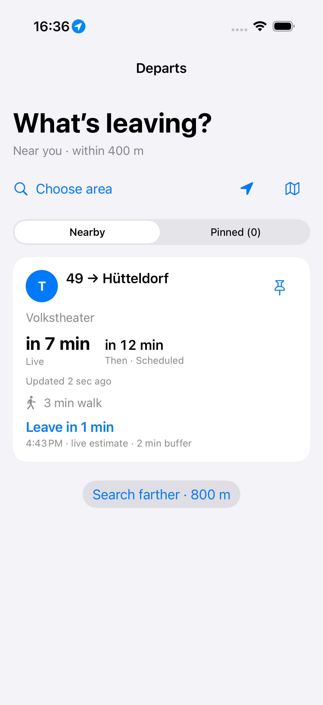
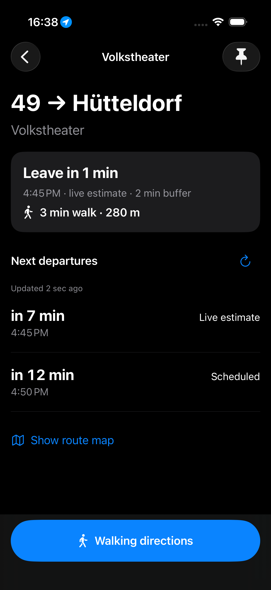

# Native fast answers

## What users see

Departs opens with cached content when available, then finds nearby lines and fetches the next two departures. The first three provider stop boards load initially; additional stop sections load as they enter view. The optional grouped endpoint shares one request across a stop’s lines. Capped or unsupported grouped responses fall back to per-line calls, in batches of three. Pinning saves the exact stop, transport type, line, and direction. Nearby pins appear in their saved order in the Pinned section. “Pinned elsewhere” opens saved routes outside the current area. Swipe or hold a row to pin it; the detail screen retains its pin button.

The detail screen reuses the same board and shows up to four departures. Walking directions open Apple Maps at the stop coordinate. The line's direction stays visible so the user can check the service before boarding. Maps are optional and do not start loading on the main answer path.

## Freshness and leave guidance

- A board is fresh for 60 seconds after a successful fetch. Failed refreshes immediately mark its previous data as saved, even within that interval. Stale cards show absolute times; expired departures disappear.
- Boards restored from disk remain labeled as saved until successfully checked again, even if their previous fetch was recent.
- A location must be at most two minutes old and accurate to 100 metres or better for leave-time advice.
- A walking route is reused for ten minutes within 40 metres of its origin. Walking time rounds up. Routes farther than five kilometres from the origin are not requested.
- Advice uses the first departure that allows the full walking duration plus a two-minute buffer. The leave countdown rounds down. Scheduled services are explicitly identified as scheduled estimates.
- Missing location, a stale board, a failed refresh, or a mismatched route suppresses leave-time recommendations. Directions may still be shown from a manually searched area, with that origin labeled.
- Visible answers refresh on foreground return and every 30 seconds after the previous refresh completes, while active. Countdown labels tick every 15 seconds. A pending location request times out after eight seconds; permission dialogs are not timed out.

These rules are estimates, not guarantees of boarding. No platform or station-entrance information is fabricated.

## Data and network behavior

`TransitStore` is the single observable source for list and detail. Independent walking/departure tasks publish their results as each arrives. A refresh batches each kind of request three at a time. Stop sections request their boards on demand. Countdown ticks never change the running/idle partition; fetched boards can change it, deferred while the list is being touched or scrolling. APIService coalesces matching URLs, limits each request to 12 seconds, and bypasses the local URL cache for departure refreshes. No periodic work is scheduled while the scene is inactive; already-started shared requests may finish and populate the cache.

UserDefaults stores pins, the last successful nearby snapshot, and the 40 newest boards. Boards older than one day are discarded on launch. Walks remain in memory only. Pins use length-prefixed service identities, so provider ordering and embedded punctuation do not break them. Area revisions reject older searches; route results are checked against the current walking origin. A failed refresh keeps the last useful answer.

The wider-search feature requires backend PR #9. Its optional radius is bounded from 100 to 2000 metres; native search steps are 400, 800, and 1600. The existing response shape and production host are unchanged.

## Shortcuts

Pin a route, then add Departs' **Open pinned route** action in Apple's Shortcuts app and select the saved route. The action opens its board and refreshes it. Shortcuts can be added to the Home Screen using the system's controls. The app also accepts `departs://pin?id=<encoded saved identity>` for existing local pins; unknown IDs do not load arbitrary stops.

The application declares its App Intent/entity metadata and updates suggestions when pins change. Voice invocation and Shortcuts discovery should also be checked on a signed physical-device build before distribution.

## Verification

The shared Departs scheme runs unit tests and UI tests:

```bash
xcodebuild -project ios/Departs/Departs.xcodeproj -scheme Departs \
  -destination 'platform=iOS Simulator,name=iPhone 17 Pro' \
  -parallel-testing-enabled NO test
```

Unit tests cover catchability boundaries, stale/failing data, current-location requirements, caching, pin persistence, out-of-order requests, bounded loading, and independence from walking failures. UI tests start a local HTTP fixture server in the test runner, simulate location, and use separate preferences. They exercise the actual URLSession decoder and SwiftUI navigation, including pins across relaunch, direct entry, failed refresh/recovery, wider search, denied-location recovery, and accessibility text. Screenshots are saved in the test result bundle.

Debug builds accept `DEPARTS_API_BASE_URL` for a local backend and `DEPARTS_DEFAULTS_SUITE` for isolated test preferences. Release builds ignore these environment variables. No provider credentials are embedded in the app.

Before TestFlight distribution, verify live HERE/Mapbox coverage at representative stops, manual MapKit place search, Apple Maps walking handoff, App Shortcuts on a signed device, and real mobile-data startup time. Simulator fixtures cannot establish a three-second startup guarantee or realtime coverage.

## Validation on 15 November 2026

- 41 native unit tests and six UI flow tests passed on iPhone 17 Pro / iOS 26.4 with normal simulator signing.
- An additional dark-mode pin, relaunch, and direct-entry UI run passed. Screenshots were reviewed at normal and the largest accessibility text size.
- An unsigned Release build for a generic iOS device passed. App Intent metadata contains the pinned-route provider and action; normal simulator signing removes the registration error seen in unsigned simulator runs.
- A live MapKit search for Volkstheater, Vienna returned places in a macOS API smoke check. Production HTTP checks returned nearby stops and a walking LineString; the sampled selected-line board was empty. These checks do not establish operator-wide coverage.
- Backend PR #9 passed 62 tests with coverage, lint, and a production build. Its local HTTP handler rejected an out-of-range radius. Valid local provider calls could not be checked because this checkout has no `.env.local` credentials; mock route tests cover the expanded radius.

The screenshots below use deterministic simulator fixtures, not live departure predictions:

| Nearby answers | Pinned board in dark mode |
| --- | --- |
|  |  |
