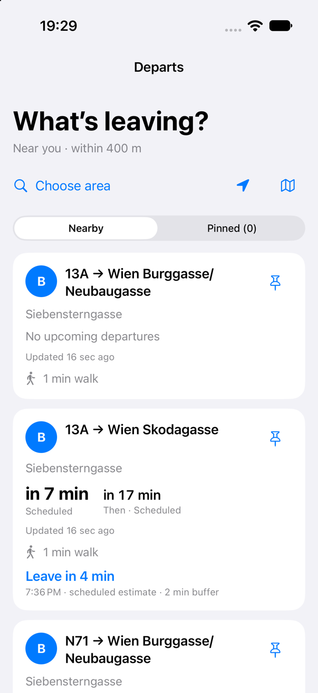
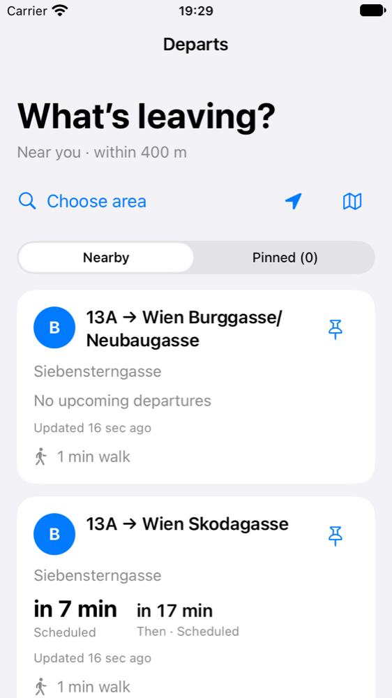
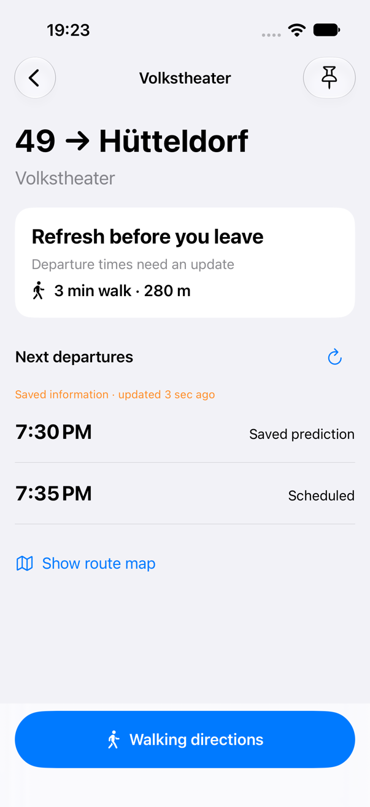
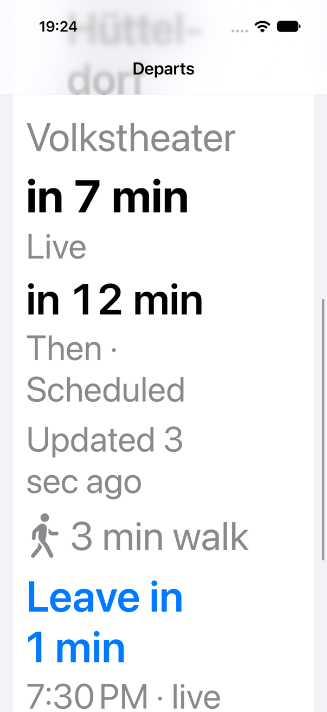
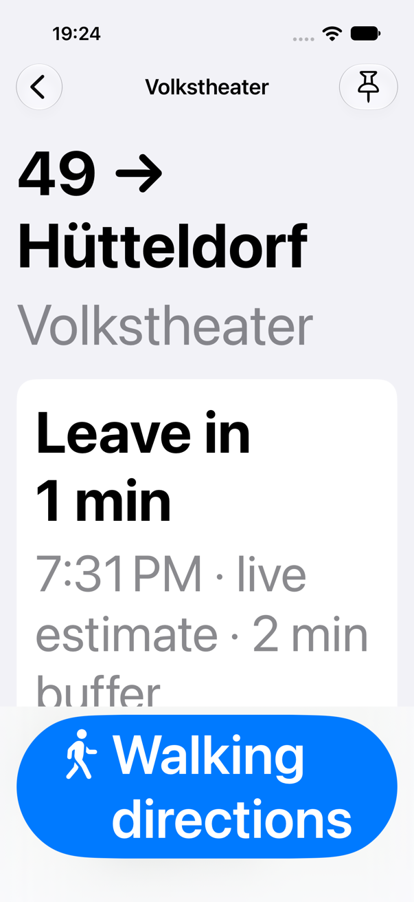

# iOS design evaluation and improvement plan

| | |
| --- | --- |
| Status | Proposal. This branch changes no app code. |
| Date | 15 November 2026 |
| Evaluated build | `c1439c4`. `main` has since moved to `a310461` (1.1 build 5 release bookkeeping, no view changes). |
| Branch | `feat/ios-design-improvements` |
| Follow-on plans | [iPhone Duo adaptation](iphone-duo-adaptation.md) and [iPad adaptation](ipad-adaptation.md), each on a branch based on this one |

## Summary

Departs promises one thing: open it, see a departure you can catch, and know when to leave. The design keeps that promise honestly. It never presents stale or scheduled data as live. It keeps it slowly, though. On the opening screen:

- **The header takes 36% of an iPhone 17 Pro screen** (319 of 874 pt) and 42% of a 667-pt screen before the first answer. It holds two titles, an area line, an action row and a filter.
- **Lines that are not running get full-size cards, in provider order.** At the documented Vienna test location on a Sunday evening, the first card said "No upcoming departures". So did three of the first four.
- **Each card spends 185 to 255 pt on one line and direction.** It repeats the stop name, the walking time, and a freshness stamp that ticks every second.

In that sample an iPhone 17 Pro showed one catchable departure without scrolling. A 667-pt display cut that one card off above its leave advice. The target of this plan is at least five, with the freshness and leave-guidance rules unchanged.

The other findings are smaller: three controls under the 44-pt touch minimum, two contrast failures, a badge that ignores Dynamic Type, a card taller than the screen at the largest text size, a map that cannot be tapped, and a search sheet with no memory.

The work has five phases. Phase 1 repairs defects without changing the layout. Phases 2 to 4 redesign the list, the detail screen, and the content. Phase 5 makes the layout resizable. Both adaptation plans depend on Phase 5.

## How this was evaluated

1. Read every SwiftUI view, the store, and the UI tests under `ios/Departs/`.
2. Ran the six existing UI tests on an iPhone 17 Pro simulator (iOS 27.0, Xcode 27.0). All passed. Their eight screenshots cover the list, the detail screen, the failed-refresh state, the search sheet, and the largest accessibility text size. They use fixture data.
3. Launched the same build against the production API at the documented test coordinate (48.20134, 16.34941) at about 19:30 Vienna time on Sunday 15 November 2026. The API returned 17 stop entries and 73 line and direction options.
4. Repeated step 3 on an iPhone SE (3rd generation) simulator, 375 × 667 pt, the shortest iPhone the deployment target supports.
5. Measured positions, sizes and rendered colors from the PNG captures. Contrast ratios use the WCAG 2.1 formula.

Limits. Everything ran in the simulator: no physical device, no VoiceOver session, no outdoor legibility check. The live sample is one city and one evening, when night lines are idle, so the share of empty cards will differ at other times. The stops map and the pinned filter with distant pins were reviewed in code, not captured. The app has no usage analytics, so priorities here rest on the product direction in the [roadmap](../ios-roadmap.md), not on observed behavior.

## What works and should stay

- The answer is on the first screen: line, direction, stop, next two departures, walking time, and leave advice.
- The freshness model is honest. Stale boards switch to absolute times and say "Saved". Advice disappears when location or data cannot support it.
- System colors and materials give correct dark mode with no extra work.
- Text wraps instead of truncating, the detail rows restack at accessibility sizes, and digits are monospaced.
- Recovery is always visible: choose an area, try again, search farther.
- The map never delays the first answer.
- The code has no layout that depends on device, idiom, orientation or screen size. That makes Phase 5 cheaper than usual.

## Findings

Severity: **High** slows or blocks the main job. **Medium** hurts a common situation. **Low** is polish.

### A. Time to a useful answer

| ID | Finding | Evidence | Severity |
| --- | --- | --- | --- |
| A1 | The header pushes the first answer down. It stacks the navigation title "Departs", the headline "What's leaving?", the area line, an action row, and a segmented filter. | First card starts at 319 pt on iPhone 17 Pro (874 pt tall) and 277 pt on iPhone SE (667 pt tall). | High |
| A2 | Options with no service are shown first-come at full size. Order is provider order with pins first. Nothing ranks by usefulness. | Vienna sample, first four cards: 13A → Burggasse/Neubaugasse (none), 13A → Skodagasse (in 7 min), N71 → Burggasse/Neubaugasse (none), N71 → Skodagasse (none). | High |
| A3 | A card is tall for what it says. | 185 pt with no departures, 255 pt with two. Two fit on iPhone 17 Pro. On the SE the second card is cut after 193 pt, above its leave advice. | High |
| A4 | Each card repeats what its neighbors already say: stop name, walking time, freshness stamp. | "Siebensterngasse" and "1 min walk" appear on each of the first four cards. The API lists that stop as four entries (two bus, two tram). | High |
| A5 | The list is paged six options at a time behind a text button. There is no grouping and no filter by mode or line. | 73 options would take 12 taps on "More nearby options". | Medium |
| A6 | The leave advice is the last item on the card, under the freshness caption. It is the product's answer and the least prominent line. It uses the accent blue of every tappable control. | `StopRowView` order: line, stop, times, status, walk, advice. | High |

### B. Hierarchy and legibility

| ID | Finding | Evidence | Severity |
| --- | --- | --- | --- |
| B1 | A card has up to eight text rows in five text styles. "Scheduled" and "Then · Scheduled" repeat the same label. | Live card in the Vienna capture. | Medium |
| B2 | The freshness stamp counts seconds on every card ("Updated 16 sec ago"). Six visible stamps tick at once and pull the eye from the times. | `Text(_, style: .relative)` in `StopRowView` and `DepartureDetailView`. | Medium |
| B3 | Live and scheduled departures look the same. A delay appears only on the detail screen, as a secondary caption. | "Live estimate" and "Scheduled" share one style. | Medium |
| B4 | Direction names carry a city prefix that every row shares ("Wien …"). It forces two-line titles at 402 pt. | "13A → Wien Burggasse/Neubaugasse" wraps. | Low |
| B5 | The transport badge is an English initial in a blue circle (M, T, B, R). The line number, which riders scan for, is plain text. | `TransportIconView`, always drawn in the accent color in the list. | Medium |

### C. Controls and feedback

| ID | Finding | Evidence | Severity |
| --- | --- | --- | --- |
| C1 | Three controls are below the 44-pt minimum. Their frame is applied outside the button, so the tappable area stays at the label's size. | "Search farther" measures 32 × 196 pt. "More nearby options" and "Try again" are bare text. | High |
| C2 | The location button looks the same whether the list follows the device or a chosen place. "Choose area" never shows the chosen place. | `location.fill` is constant. The place name appears only in the subtitle. | Medium |
| C3 | The "Nearby / Pinned (0)" filter takes a full row from first launch, before any pin exists. Pins outside the current area can only be reached through it. | Segmented control at 272 to 304 pt in the capture. | Medium |
| C4 | When location is denied, the message offers no route to Settings. | "Location is off. Choose an area or use a pinned route." | Medium |
| C5 | Pinning gives no haptic or animated confirmation. Countdown numbers jump at each 15-second tick. | No `sensoryFeedback` or content transitions in the views. | Low |
| C6 | With a chosen area, a two-line explanation stays above the answers for the whole session. | "Stops are near your chosen area. Walking advice uses…" | Low |

### D. Accessibility

| ID | Finding | Evidence | Severity |
| --- | --- | --- | --- |
| D1 | The stale-data label fails contrast in light mode. | Rendered `#FF8D28` on `#F2F2F7`: 2.07:1. Body-size text needs 4.5:1. | High |
| D2 | Map pin letters fail contrast on every palette color. | White 13-pt bold on the ten `StopPalette` fills: 1.92:1 to 3.27:1. | Medium |
| D3 | The transport badge has a fixed 16-pt font in a fixed 40-pt circle. It does not grow with Dynamic Type. | `TransportIconView`. | Medium |
| D4 | At the largest text size the layout keeps every line. One card is taller than the screen, so the first card's leave advice sits well below the first screen. On the detail screen the walking button wraps to two lines and grows to about 135 pt. Its bar then covers the last line of the advice card. In the search sheet the footer text fills the space where results belong. | UI test captures at `AccessibilityXXXL`. | High |
| D5 | VoiceOver reads a card as every text in visual order, starting with the badge and including the arrow glyph. Map pins read as a single letter. | No custom label or value on the card button. Annotation views have no accessibility label. | Medium |
| D6 | The iPhone build is locked to portrait. | `UISupportedInterfaceOrientations` = portrait only. | Low |
| D7 | The stops-error box uses the plain background style on a grouped background. In dark mode both are black, so the box outline disappears. | `NearbyStopsView`, by inspection. Not captured. | Low |

Secondary gray (`#8A8A8E` on white, 3.44:1) is the system's own label color and carries the stop name, the live or scheduled label, and the walking time. The proposal below moves the facts people act on into primary text.

### E. Detail, search and map

| ID | Finding | Evidence | Severity |
| --- | --- | --- | --- |
| E1 | The detail screen shows the stop name twice: as the navigation title and under the headline. | "Volkstheater" in both places. | Low |
| E2 | "Refresh before you leave" names an action the card does not offer. Refresh is a small icon further down. | Failed-refresh capture. | Medium |
| E3 | "Show route map" inserts a fixed 250-pt map at the end of the scroll view. On shorter screens it opens below the visible area. The map cannot be panned. | `DepartureDetailView`, `RouteMapView`. | Medium |
| E4 | The walking-directions bar covers 112 pt (13%) of every detail screen. It is a custom bar, so the system cannot move it on other form factors. | Bar from 762 pt down. Button 62 pt tall. | Medium |
| E5 | The stops map is display-only. Pins cannot be selected, pin colors follow list position and mean nothing elsewhere, and the search radius is not drawn. | `StopsMapView` has no selection handling. | Medium |
| E6 | Search has no recent or saved places and no "current location" row. Every use starts from an empty field. Results do not favor transit stops. | `AreaSearchView`. | Medium |
| E7 | From a board there is no way to see the other lines at the same stop. | Detail shows one line and direction. | Low |

### F. Identity and content

| ID | Finding | Evidence | Severity |
| --- | --- | --- | --- |
| F1 | The interface is the default system blue. The icon's language (charcoal ground, pastel stops on a line) appears only as the low-contrast map pins. | `AccentColor` is system blue. | Low |
| F2 | The app icon is a wordmark with one appearance. Text gets small at Home Screen sizes, and there are no dark or tinted variants. | `AppIcon.appiconset` has one 1024-px image. | Low |
| F3 | Strings are assembled from fragments ("Updated" + interval + "ago"; "Then · " + label). Units (m, km, min) are hard-coded. There is no String Catalog. The test city is German-speaking. | `StopRowView`, `NearbyStopsView`, `DepartureDetailView`. | Medium |
| F4 | Some copy is system vocabulary: "2 min buffer", "scheduled estimate", "Saved prediction". | Advice detail line and board rows. | Low |

## Principles for the changes

1. **Answer first.** Nothing sits above the first departure except one line of context.
2. **Say it once.** A fact shared by several rows moves to their header.
3. **Rank by usefulness, then hold still.** Running lines come before idle ones. Rows do not shuffle on refresh.
4. **Keep the honesty.** The 60-second freshness rule, the saved-data labels, and the conditions for leave advice in [ios-fast-answers.md](../ios-fast-answers.md) do not change.
5. **Prefer system components.** Standard lists, bars and sheets are what let the same screens work on iPhone Duo and iPad.

## Proposed design

These are directions to prototype with `PreviewData`, not final specifications. Sections 1 to 3 depend on the decisions listed later.

### 1. First screen

```
┌──────────────────────────────────────────┐
│ 19:29                              ▂▄▆ ▮ │
│          Near you ▾            ⌕   ➤  ⊞  │  title menu · search · locate · map
│ within 400 m · updated just now          │  one line of context
│ PINNED                                   │
│ ┌──────────────────────────────────────┐ │
│ │ ▐49▌ Hütteldorf           Leave in 1 │ │
│ │      Volkstheater · 3 min     7 · 12 │ │
│ └──────────────────────────────────────┘ │
│ SIEBENSTERNGASSE · 1 MIN WALK            │
│ ┌──────────────────────────────────────┐ │
│ │ ▐13A▌ Skodagasse          Leave in 4 │ │
│ │       scheduled               7 · 17 │ │
│ ├──────────────────────────────────────┤ │
│ │ ▐49▌ Hütteldorf, Bujattig… Leave in 2│ │
│ │      live · 3 min late        5 · 11 │ │
│ ├──────────────────────────────────────┤ │
│ │ 3 lines with nothing soon          › │ │
│ └──────────────────────────────────────┘ │
│ KIRCHENGASSE · 4 MIN WALK                │
│ …                                        │
└──────────────────────────────────────────┘
```

- **Header.** The navigation title becomes the area ("Near you", or the chosen place) with a title menu: current location, recent places, "Search for a place…". Search, locate and map are toolbar buttons with a title and a symbol each. The "What's leaving?" headline moves to the empty state. One context line carries the radius and list freshness.
- **Pinned section.** Pins inside the current area appear first with full answers. A "Pinned elsewhere (n)" row opens the rest. This replaces the segmented filter.
- **Stop sections.** One section per stop. Entries with the same name within about 150 m merge. The header carries the stop name and walking time once.
- **Idle lines.** Lines with no upcoming departure collapse into one row per stop.
- **No paging button.** Sections load as they scroll into view, within the request budget set by decision 1.

### 2. Answer row

```
┌────────────────────────────────────────────┐
│ ▐49▌ Hütteldorf, Bujattigasse   Leave in 2 │  badge · direction · answer
│      live · 3 min late             5 · 11  │  status · next departures in minutes
└────────────────────────────────────────────┘
```

- **Badge.** The line name in a rounded rectangle filled with a mode color, with a small mode symbol so color is not the only cue. It scales with Dynamic Type.
- **Direction.** Primary text, up to two lines. A city prefix shared by every direction in the list is hidden here and kept on the detail screen and in VoiceOver.
- **Answer.** The trailing column always says when: "Leave in 2 min", "Leave now", "Too tight", or the next countdown when advice is unavailable. It is the largest text in the row and takes a status color and symbol.
- **Second line.** Live or scheduled, a delay of a minute or more, and the next two countdowns. Stale boards show absolute times, as now.
- **Three text tiers** per row instead of five styles.
- **Largest text sizes.** The row keeps badge, direction, answer and next time. Everything else moves to the detail screen.
- **Height.** About 64 pt at the default size, against 185 to 255 pt today.

### 3. Ranking and stability

1. Pinned options in the current area, in pin order.
2. Stops by walking time, falling back to provider order.
3. Within a stop: lines with a departure in provider order, then one collapsed row for idle lines.
4. A row changes group only when its board gains or loses departures. Countdown changes never reorder rows, and no row moves while the list is being touched.

### 4. Freshness

One list-level line replaces the per-card stamp: "updated just now", "updated 2 min ago", "updating…", or "saved 12 min ago" with a refresh action. Rows carry a marker only as an exception: a saved-data symbol, or "couldn't load · retry". No seconds are shown.

### 5. Detail screen

```
┌──────────────────────────────────────────┐
│ ‹        ▐49▌ Hütteldorf            ⚑    │  back · line and direction · pin
│ Volkstheater · 3 min walk · 280 m        │
│ ┌──────────────────────────────────────┐ │
│ │ ● Leave in 1 min                     │ │  status color and symbol
│ │ to catch the 19:30 · live            │ │
│ │ ░░░░░░ walking route preview ░░░░░ › │ │  opens the route map sheet
│ └──────────────────────────────────────┘ │
│ NEXT DEPARTURES         updated just now │
│ in 7 min    19:30   ◉ live               │
│ in 12 min   19:35   ◔ scheduled          │
│ in 22 min   19:45   ◉ live · 3 min late  │
│ OTHER LINES AT THIS STOP                 │
│ ▐52▌ Baumgarten              in 4 · 14   │
│                                          │
│          ( Walking directions )          │  bottom toolbar item
└──────────────────────────────────────────┘
```

- The navigation title is the line and direction. The stop appears once.
- The advice card owns its action. In the saved-data state its button is "Refresh now".
- Live and scheduled differ by symbol and color. Delays are prominent.
- The route map is a preview in the advice card that opens a sheet with medium and large detents.
- Walking directions becomes a standard bottom toolbar item with a title and a symbol.
- "Other lines at this stop" lists the stop's remaining lines with their next times.

### 6. Search and areas

- The search sheet opens with "Current location" and the last five chosen places, stored on the device.
- The footer text goes. Results get a category symbol and a distance, with transit stops listed first where MapKit identifies them.
- The location button shows whether the list follows the device.

### 7. Maps

- The stops map opens as a sheet with detents. Pins can be selected. A selected pin shows the stop name and lines and scrolls the list to that stop.
- Pins use the same badges as the list. The search radius is drawn.
- Annotations get VoiceOver labels.
- The maps become panes that can be embedded at any size. Phase 5 and both adaptation plans rely on that.

### 8. Color roles

| Role | Use | Light | Dark |
| --- | --- | --- | --- |
| Control | Tappable elements only | system accent | system accent |
| Go | "Leave in…", "Leave now", live symbol | `#1D7A36` on white, 5.40:1 | `#30D158` on `#1C1C1E`, 8.42:1 |
| Tight | "Too tight", delays | `#B25000` on white, 5.20:1 | `#FF9F0A` on `#1C1C1E`, 8.28:1 |
| Saved | Stale-data marker | label color with a `#C75300` symbol, 4.50:1 | label color with an orange symbol |
| Idle | No departures, unavailable advice | secondary label | secondary label |

Mode badge fills, with white text. These are starting values derived from the icon's hues:

| Mode | Fill | White text on fill | Fill on dark card `#1C1C1E` |
| --- | --- | --- | --- |
| Tram | `#3A6C9E` | 5.50:1 | 3.09:1 |
| Bus | `#A8553F` | 5.20:1 | 3.27:1 |
| Rail | `#3B7A47` | 5.17:1 | 3.29:1 |
| Subway | `#6B52A6` | 6.21:1 | 2.74:1, needs a lighter dark variant |

Every status also has a symbol and wording, so nothing depends on color alone.

### 9. Accessibility targets

- Every control is at least 44 × 44 pt.
- App-chosen text meets 4.5:1, or 3:1 at 17-pt semibold and above.
- Through the largest text size, the first answer and its leave advice are on the first screen.
- Each row has one VoiceOver element with the answer first: "Leave in 2 minutes. Tram 49 toward Hütteldorf from Volkstheater. Next in 5 and 11 minutes, live."
- Countdown changes use numeric content transitions and respect Reduce Motion.

## Phases

Sizes are relative: S is days, M is about a week, L is more.

### Phase 1. Repairs, no layout change (S)

| Item | Findings |
| --- | --- |
| Give "Search farther", "More nearby options" and "Try again" 44-pt targets | C1 |
| Stale label in label color with a contrast-safe symbol | D1 |
| Contrast-safe map pin fills | D2 |
| Badge sized with Dynamic Type | D3 |
| Freshness stamp without seconds | B2 |
| Answer-first VoiceOver labels on cards, spoken "toward", labels on map pins | D5 |
| Visible error box in dark mode | D7 |
| "Open Settings" in the denied-location message | C4 |
| Location button reflects follow state | C2 |
| At accessibility sizes: one-line walking button, no search footer | D4 |
| Check the launch-only light status bar style (`UIStatusBarStyle`) against the light launch screen | — |

Acceptance: no control under 44 × 44 pt. No app-chosen color pair under the contrast targets. The six UI tests pass with label changes only. New captures at default and largest text sizes are attached to the PR.

### Phase 2. Answer-first list (L)

Scope: sections 1 to 4 and the row parts of section 8. Views affected: `NearbyStopsView`, `StopRowView`, `TransportIconView`, the list derivation in `TransitStore`, and the UI tests that look for `departure-option`, `pin-route` and `route-filter`.

Depends on decisions 1 to 4.

Acceptance, measured at the Vienna test location and with fixtures:

| Measure | Today | Target |
| --- | --- | --- |
| Top of the first answer, iPhone 17 Pro | 319 pt | 170 pt or less |
| Top of the first answer, 667-pt display | 277 pt | 130 pt or less |
| Options with a departure visible without scrolling, iPhone 17 Pro | 1 in the sample | 6 or more |
| Same, 667-pt display | 1, cut off | 5 or more |
| Idle options listed above a running one | 3 of the first 4 | 0 |
| Taps to reach every nearby line that is running | up to 12 | 0 |
| Departure requests when the screen opens | 6 | budget from decision 1 |

### Phase 3. Detail, search and maps (M)

Scope: sections 5 to 7. Views affected: `DepartureDetailView`, `AreaSearchView`, both map views, and the persistence of recent places.

Acceptance: the stop name appears once. The saved-data state has a refresh action in the advice card. The route map is visible without scrolling after one tap on every supported iPhone size. A stop can be selected on the map. Search opens with recents.

### Phase 4. Content, motion and identity (M)

- Move strings to a String Catalog with whole-sentence keys and plurals. Format distances and durations with the locale. Add German once the layout settles.
- Rewrite system vocabulary (F4).
- Add numeric transitions for countdowns and a selection haptic for pinning.
- Add dark and tinted icon variants, and review the wordmark at small sizes.
- Decide the accent (decision 5).

Acceptance: the app builds with a German pseudo-localization and no clipped or concatenated strings. Distances follow the device's measurement system.

### Phase 5. Resizable foundation (M to L)

This phase is the prerequisite for the iPhone Duo and iPad branches. It also benefits iPhone: landscape, larger iPhones in landscape, and resizable iPhone Mirroring on macOS 27.

1. **One store per app, not per window.** Each `ContentView` creates its own `TransitStore` and `LocationService`, while the built Info.plist declares `UIApplicationSupportsMultipleScenes = true`. Two windows would hold separate pins and caches and overwrite each other's saved data.
2. **One navigation model for every width.** A list and detail split with a single selection. In compact width it collapses to today's push navigation. The selection survives resizing, rotation, and folding.
3. **Container-relative layout.** Keep the current absence of device, idiom, orientation and screen checks. Cap text columns at a readable width of about 560 to 640 pt. Switch arrangements by size class or available width.
4. **Standard bars only.** Every persistent action is a toolbar item with a title and a symbol, so the system can place it at the bottom, at the top, or on the side.
5. **Maps as panes.** Both maps fill whatever container they are given and are created only after the first answers render.
6. **Compact height.** Every screen works at a height of 400 pt or less. Then enable landscape on iPhone.
7. **Size matrix in tests.** Previews and UI test runs at 320, 402, 466, 669, 834 and 1024 pt widths.

Acceptance: the UI tests pass on an iPhone and an iPad destination. Resizing a window from 320 pt to 1200 pt wide never loses the selected board, the scroll position or an open sheet.

## Decisions needed

| # | Decision | Recommendation |
| --- | --- | --- |
| 1 | **Ranking needs to know which lines are running before their rows are shown.** Today only the six displayed options are fetched. Option A: use the existing unfiltered `/api/departures?stopId=` call once per visible stop, which returns up to four departures, then fetch per-line boards for visible rows. About 11 requests on open instead of 6. Option B: an additive, optional parameter that returns the next departures grouped by line for a stop. About 3 requests on open. | B, after a short spike on HERE quota and latency. The existing contract stays valid for installed builds. |
| 2 | Group by stop, or keep one card per line and direction. | Group by stop. |
| 3 | Replace the Nearby and Pinned filter with a pinned section. | Yes. |
| 4 | Pin control in compact rows: a visible 44-pt button in every row, or swipe and long-press with a first-run hint and the button kept on the detail screen. | Swipe and long-press in compact width. A visible button where the row has room. |
| 5 | Accent: stay with system blue or derive an accent from the icon. | Keep system blue for controls in this pass. Use the icon's hues for mode badges. |
| 6 | Hide a city prefix shared by all directions. | Yes, display only. |
| 7 | Search placement: a toolbar button, or the system search field in the bottom toolbar. | Prototype both. The bottom field keeps the main recovery action in thumb reach. |
| 8 | Maps: keep the `UIViewRepresentable` wrappers or move to SwiftUI `Map` (iOS 17) for selection and accessibility. This changes a documented architecture choice. | Evaluate in Phase 3 before committing. |
| 9 | German localization. | Make strings localizable in Phase 4. Ship German after Phase 2 settles. |
| 10 | Landscape on iPhone. | Enable at the end of Phase 5. |

## Risks

- **Request volume.** Smaller rows show more options, and ranking needs stop-level data. Decision 1 sets the budget. The roadmap already asks for provider usage alerts before wider distribution.
- **Density against glanceability.** A 64-pt row holds less air than a card. Check prototypes at the largest text sizes and outdoors on a device before committing.
- **Row stability.** Ranking must not make rows jump. Rule 4 in section 3 is the guard, and it needs a UI test.
- **Pin discoverability** if the row button goes (decision 4).
- **Test churn.** The UI tests depend on `departure-option`, `pin-route`, `unpin-route`, `route-filter`, `search-farther` and `board-status`. Keep the identifiers where the elements survive.
- **No usage data.** Validate with the TestFlight cohort the roadmap describes, using its own measure: time to a first useful answer.

## Out of scope

Widgets, Live Activities, notifications, accounts, journey planning, and any backend change beyond the additive option in decision 1.

## How the three plans relate

```
main
 └─ feat/ios-design-improvements      this plan
     ├─ feat/iphone-duo-adaptation    needs Phases 1, 2 and 5
     └─ feat/ipad-adaptation          needs Phases 2 and 5
```

Phase 5 is shared work. Whichever adaptation starts first builds it, and the other reuses it.

## Appendix A. Captures

Live captures use the production API at the Vienna test coordinate. The others come from the UI tests' fixtures.

| Live list, iPhone 17 Pro | Live list, 667-pt display | Saved data after a failed refresh |
| --- | --- | --- |
|  |  |  |

| List at the largest text size | Detail at the largest text size |
| --- | --- |
|  |  |

## Appendix B. Measurements

| Item | Value |
| --- | --- |
| iPhone 17 Pro canvas | 402 × 874 pt |
| First card top, iPhone 17 Pro | 319 pt |
| First card top, iPhone SE (375 × 667 pt) | 277 pt |
| Card with no departures | 185 pt |
| Card with two departures and advice | 255 pt |
| "Search farther" button | 32 × 196 pt |
| Detail bottom bar, including the home indicator area | 112 pt |
| Walking-directions button | 62 pt tall |
| Stale label | `#FF8D28` on `#F2F2F7`, 2.07:1 |
| Leave advice and badge | `#007AFF` with white, 4.02:1 |
| Secondary label | `#8A8A8E` on white, 3.44:1 |
| Map pin fills with white text | 1.92:1 (teal) to 3.27:1 (soft purple) |
| Vienna sample | 17 stop entries, 73 line and direction options |

## Appendix C. Where things live

| Screen or element | File |
| --- | --- |
| Scene state, navigation, refresh loop | `ios/Departs/Departs/Views/ContentView.swift` |
| Opening list, header, filter, empty states | `Views/NearbyStopsView.swift` |
| Departure card | `Views/StopRowView.swift` |
| Transport badge | `Views/TransportIconView.swift` |
| Board, advice card, walking action | `Views/DepartureDetailView.swift` |
| Area search | `Views/AreaSearchView.swift` |
| Maps | `Views/Map/StopsMapView.swift`, `Views/Map/RouteMapView.swift` |
| List order, paging, freshness, advice inputs | `ViewModels/TransitStore.swift`, `Models/TransitState.swift` |
| Pin palette | `Utilities/StopPalette.swift` |
| UI flows and fixtures | `ios/Departs/DepartsUITests/DepartsUITests.swift` |
