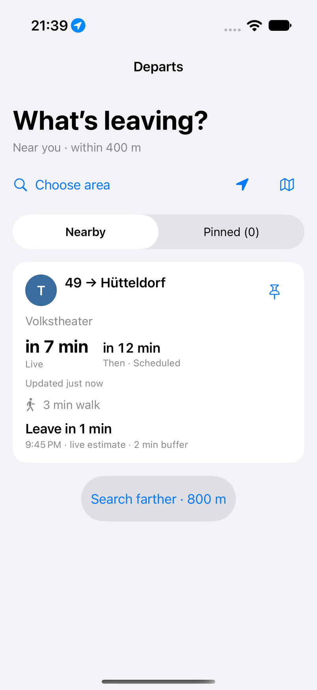
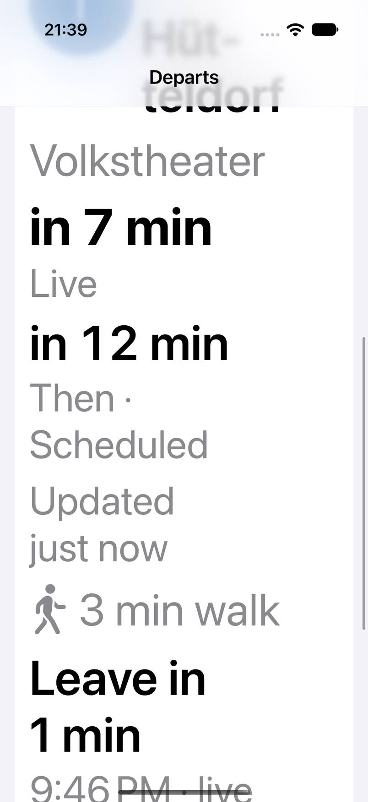

# Phase 1 validation

The owner approved iOS 26 as the minimum during implementation. App and test deployment targets are 26.0; version/build numbers are unchanged.

## Controls and contrast

UI assertions on iPhone 17 Pro / iOS 27.0 measured Choose area at 124 × 44 pt, pin at 44 × 44 pt, Search farther at 196 × 58 pt, and each filter button at 185 × 44 pt. The native segmented control exposed a 32-point target even inside a 44-point frame. Two standard buttons now occupy the same filter position and retain the selection trait and route-filter container identifier.

Code inspection: More nearby options has a 48-point label target; Try again and Open Settings have 44-point minimum label targets. Locate, map, refresh and detail pin explicitly use 44 × 44-point labels. Search results use 44-point minimum labels. System navigation actions retain their system targets.

White on the ten map fills measures 5.17–6.37:1 using WCAG relative luminance. The list badge uses the 5.50:1 fill. Saved text and its symbol now use the system primary label, replacing the 2.07:1 orange text. Leave advice uses primary text. Controls retain the system accent as requested. Light/dark captures were visually inspected; physical-device VoiceOver and outdoor testing remain distribution checks, not claimed here.

## Captures and data sources

Before: `docs/screenshots/design-review-2026-11-15/`.

After: `docs/screenshots/ios-design-phase-1/`. UI-test attachments use deterministic local fixtures at default and AccessibilityXXXL sizes. Additional `live-iphone-17e-*` captures use production at 48.20134, 16.34941, around 21:39 Vienna time on 15 November 2026. The live app displayed departures, walking times and leave guidance. This is one read-only sample, not provider-wide coverage. No backend change or deployment was made.

The largest-text walking button reads “Walk” visually and “Walking directions” to accessibility. Search no longer reserves space for a footer. The large cards and header remain for Phase 2.

Final check: 42 unit tests and six UI tests passed with `xcodebuild test`, iPhone 17 Pro / iOS 27.0, normal simulator signing. Result bundle `/tmp/departs-p1-final.xcresult`; derived data `/tmp/departs-p1-ios26`. `git diff --check` passed.

## Additional curated captures

| Capture | Capture |
| --- | --- |
|  |  |

## Evidence storage

This phase keeps **2 curated images** in Git. Screenshots are stored upright at 2× as optimized JPEGs (quality 70); Phase 4's three icon-review panels remain lossless PNGs at their original pixel dimensions. No app artwork or application code was changed by this curation. Measurements refer to the original test exports.

The [full Phase 1 capture set](https://github.com/p3ob7o/Departs/tree/8bebd302f470f17692eb19601f5a74fc3c06aee6/docs/screenshots/ios-design-phase-1) is preserved at commit `8bebd302f470f17692eb19601f5a74fc3c06aee6` on **`evidence/ios-design-improvements`**, an evidence-only branch that must never be merged. Unembedded captures and earlier review versions are excluded from the rewritten phase history. Original filenames in capture manifests refer to that archive. The UI tests can regenerate the captures.
