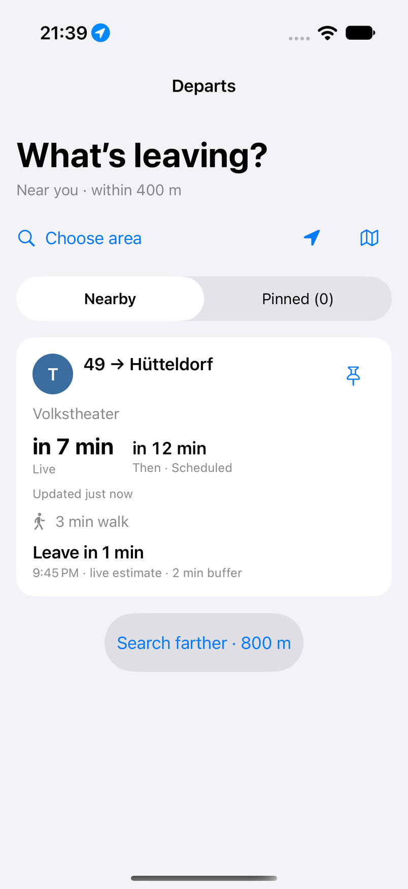
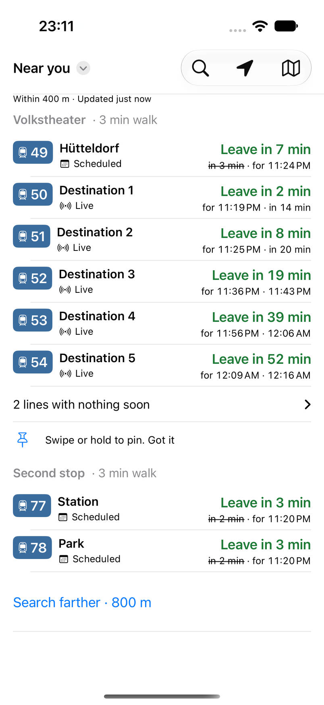
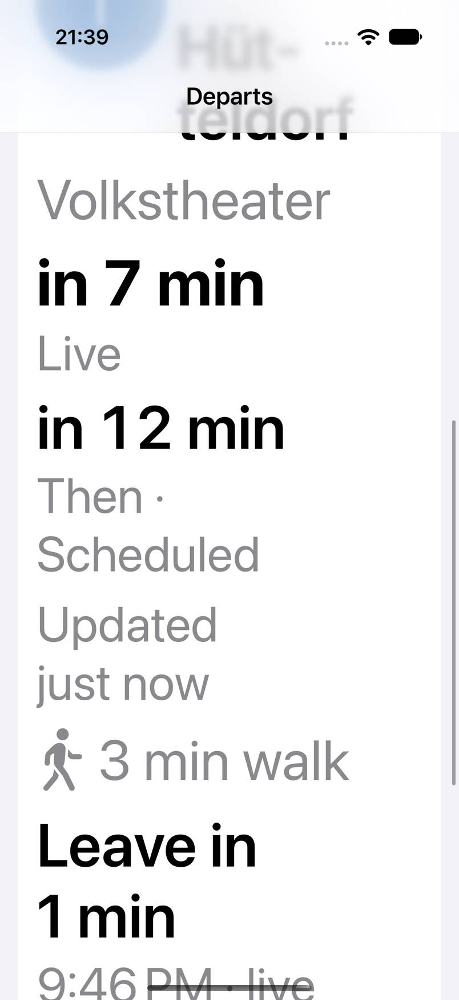
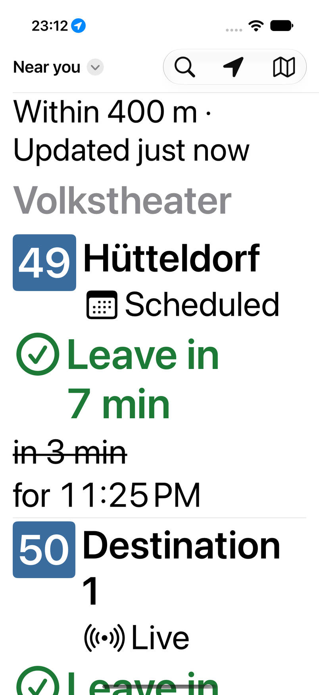
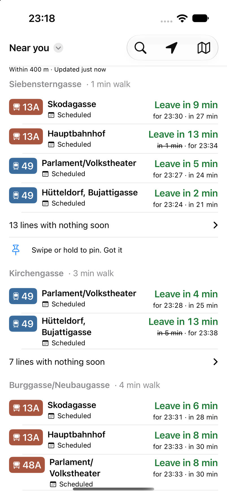
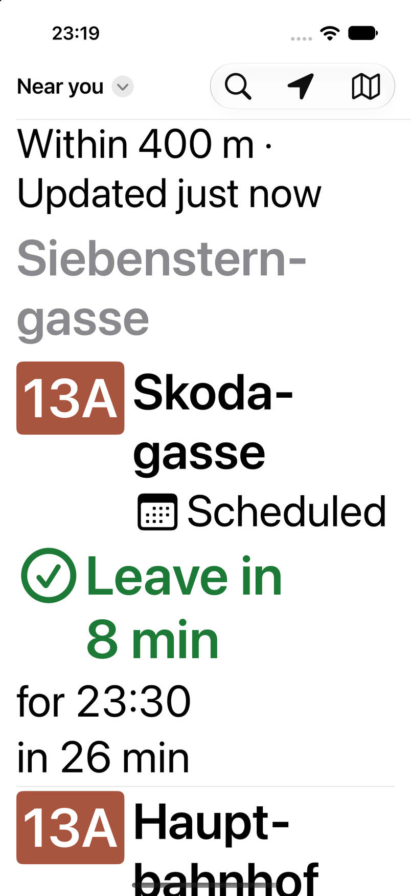
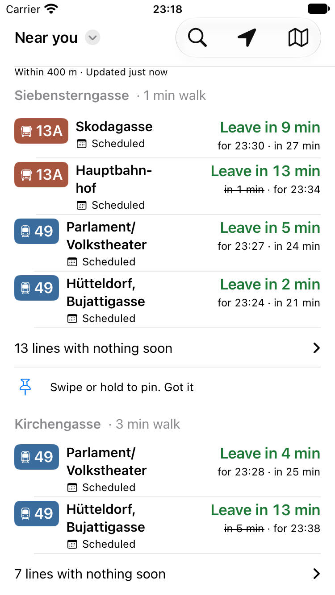
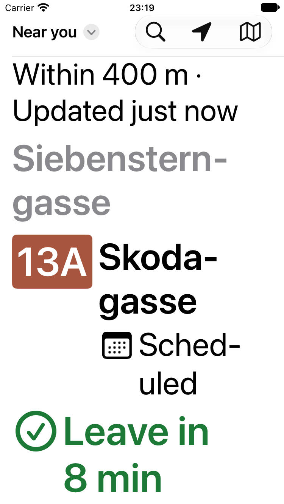
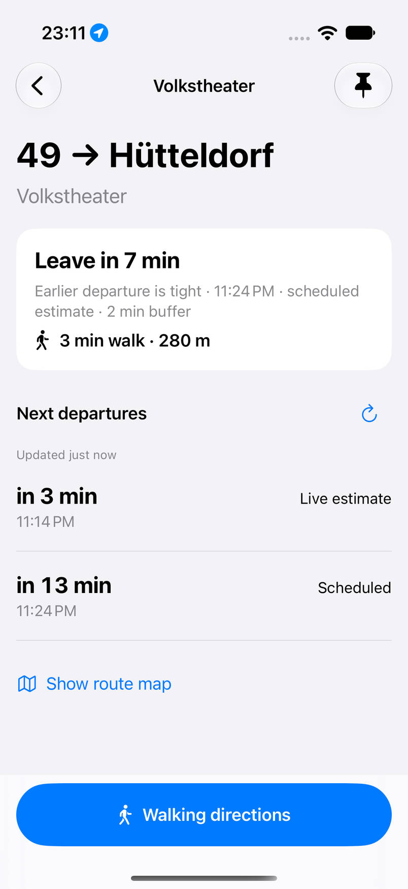
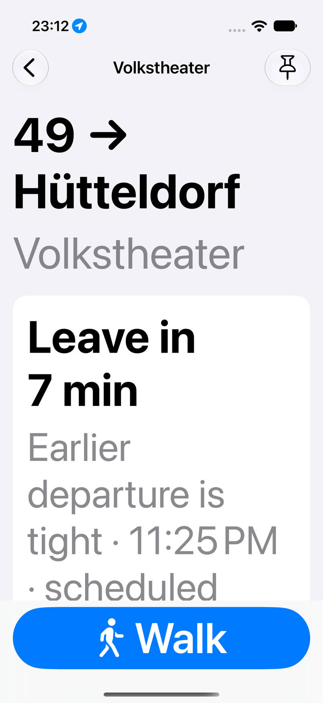

# Phase 2: answer-first list

Stop sections replace cards and paging. Nearby pins appear first in saved order, with their stop and walk; distant pins open in a sheet. Swipe or hold to pin, with a dismissible hint after the first section. The title menu and search, location and map buttons remain standard system controls. Answers use headline text, larger than directions. Saved/failed markers survive accessibility sizes.

## Acceptance measurements

Measured with Xcode 27.0 and the iOS 27.0 runtime; minimum deployment target iOS 26. These results supersede the original PR measurements and captures.

| Measure | Evaluation baseline | Reviewed result |
| --- | --- | --- |
| First answer row, 402 × 874 pt | 319 pt | 167.3 pt; target ≤170 |
| First answer row, 375 × 667 pt | 277 pt | 125.5 pt; target ≤130 |
| Complete running rows, 402 pt | 1 live | 8 fixture; 8 live plus a partly visible ninth; target ≥6 |
| Complete running rows, 375 pt | 1 clipped live | 7 fixture; 6 live; target ≥5 |
| Expanded idle rows above running rows | 3 of first 4 | 0; unknown and failed rows are not idle |
| Paging taps to reach all running lines | Up to 12 | 0; sections load while scrolling |
| Opening departure calls | 6 per-line | Grouped fixture: 2; legacy fixture: 12. Live legacy: 49/29 at 402/375 pt; see budget below |

Production captures were taken at **23:18 Vienna time on 15 November 2026**, at 48.20134, 16.34941. The API returned 17 provider stops and 73 line/direction options. The first physical stop had **four running options within 60 minutes**, the next two. The smaller phone shows all six; the larger phone also shows two complete running rows at the third stop. Later night departures do not count. A daytime production sample was not taken; fixtures supply eight running lines across two stops, plus empty and far-future lines.

Compared with the original PR, first-row positions improve from 169.7/128 pt to 167.3/125.5 pt. The 375-point fixture count changes from eight to seven while preserving headline answers. The earlier live count included night departures beyond the horizon; the new count excludes them. No answer font was reduced to reach a target.

App-drawn default rows are 52 pt high. Hint, disclosure and list-refresh targets are 44 pt; swipe pin is about 97.7 × 44 pt, unpin 71 × 50 pt, and Search farther 74 pt high. Tests also cover Settings. The 44-point assertions apply to app-drawn controls. A system toolbar item's accessibility frame is not its hit region; native bars and menus retain their styling and large-content behavior.

## Decisions clarified in review

The plan's author clarified these choices. Paolo can overrule them:

1. **Running means within 60 minutes**, as the named `TransitStore.runningHorizon`. Evaluate at board arrival, never on countdown ticks. Expanded future-only rows show clock times without leave advice.
2. **Keep provider stop order**, nearest first from the search centre. Walking routes do not reorder sections. Merged sections show the shortest available walk.
3. **Identify the advised departure.** The row names its clock time; earlier services that are too tight are struck through, and VoiceOver describes them as too tight.

A shared prefix is hidden only when at least three distinct directions all share their first word. This is display-only, with no city names in code. Full directions remain in identities, detail and spoken labels.

## Loading, stability and request budget

The store owns departure and walking queues independently of view-task cancellation. Each runs at most three requests concurrently. Nearby pins have priority on opening and refresh. Periodic refresh includes pins and on-screen sections; returning sections use the same 25-second recency throttle. Explicit refresh bypasses recency. Cancelled and failed requests remain retryable.

One published snapshot contains the complete active/idle partition. Boards arriving during scrolling cannot move rows into a different partition. Unknown boards say Checking or Unavailable, never Nothing soon. Memory retains all browsed boards; persistence stays capped at 40. Unused filter/paging state and refresh-key terms are removed.

Initial demand is pins plus three provider stops, followed by actually visible sections. Physical stops can merge multiple provider IDs. The budget limits concurrency and refresh to the viewport; **three calls is not a ceiling for the entire first screen**.

| Scenario | Opening | Later refresh |
| --- | --- | --- |
| Two-stop grouped fixture | 2 grouped calls | Visible stops only |
| Same fixture, legacy array | 2 probes + 10 per-line calls | No repeated capability probes |
| Twelve-stop model, all visited, two lines per stop | — | 2 grouped or 4 legacy calls for two visible stops |
| Ten-stop UI scroll, 402 pt | — | 5 grouped calls for five visible stops, not all ten visited |
| Ten-stop UI scroll, 375 pt | — | 4 grouped calls for four visible stops |
| Production 402 pt, 23:18 | 3 probes + 46 line calls across 10 provider IDs | 46 line calls across those 10 visible IDs |
| Production 375 pt, 23:18 | 3 probes + 26 line calls across 6 provider IDs | 26 line calls across those 6 visible IDs |

Production fallback costs more than the shipped six-option screen because it answers complete visible stop sections. It no longer grows with everything previously scrolled past. After deployment, the grouped endpoint removes the per-line fan-out. Live provider quota and latency for that handler are unverified.

## Additive backend and capped coverage

`GET /api/departures?stopId=…&groupBy=line` returns `{groups: [{line, departures}], complete}`, up to four departures per group. Existing calls retain their array response, filtering, cache headers and `https://departs.vercel.app` host. No provider keys enter the app.

The handler keeps one HERE request per provider stop, `maxPerBoard=50` and `maxPerTransport=4`. It checks **each raw board before flattening** to compute completeness. Only a decoded legacy array enables per-line fallback. A network error marks rows failed for a later retry. Neither network failure nor a capped response causes per-line fan-out.

An omitted line in an incomplete response has a separate optional saved-board coverage field. It stays collapsed, has no error flag and does not trigger Saved information or Refresh now. Expanded, it says **“No departure listed before [latest returned time]”**; without a valid time, it says later departures are not listed. A complete response replaces this normally. Opening a limited board refreshes the group, avoiding a futile filtered call. Old saved boards still decode.

This is an existing production limit: filtered calls use the same capped board and cannot recover later departures. Extending coverage needs a server-side change verified with HERE credentials. This checkout has no `.env.local`, HERE or Mapbox credentials, so **live provider behavior for the new handler is unverified**.

## Recovery and accessibility

Location denied, locating, failed location and an empty searched area have distinct states. Stops errors and Try again appear before sections. A restored device area without a current fix says Last area. Search farther uses the accent and is disabled while loading. Saved information names the check time and offers Refresh now. Row saved/failed markers remain at the largest text size. Rows have one answer-first VoiceOver label without an opaque identifier in their value.

All 23 review findings were confirmed against the code; none were disputed. Follow-up corrections restored system toolbar/title-menu controls, retained headline answers, replaced geometry tracking with `onScrollVisibilityChange`, and separated capped coverage from request failures.

## Checks and evidence

- `npm ci`, **65 Vitest/MSW tests**, `npm run lint` and `npm run build` passed. A local HTTP check returned JSON 400 for grouped departures without `stopId`. Valid local provider calls were not tested.
- **59 unit tests and 11 UI tests passed on each phone**, with `xcodebuild … test`, normal signing and unique iOS 27.0 simulator destinations. Derived data and result bundles are outside the repository.
- Final bundles: `/tmp/departs-p2-accepted-402.xcresult` and `/tmp/departs-p2-accepted-375.xcresult`. Every fixture PNG was exported from these bundles, including fresh 375-point captures. The denied-state capture precedes opening search.
- Regression coverage includes multiple stops, empty/future lines, gaining/losing service, a response during a drag, countdown order, cancellation, pin priority, throttling, viewport refresh, capped coverage without errors/refresh prompt, over 80 boards, legacy decoding and app-drawn hit targets.
- Production launches were read-only at the documented coordinate using the accepted build. They verify the existing API and native fallback, not a new backend deployment. No deployment, release, version change or physical-device/VoiceOver session was performed.

| 402 pt | Before | After |
| --- | --- | --- |
| Default |  |  |
| Largest text |  |  |

| Production sample | Default | Largest text |
| --- | --- | --- |
| 402 pt |  |  |
| 375 pt |  |  |

The [full capture archive](https://github.com/p3ob7o/Departs/tree/8bebd302f470f17692eb19601f5a74fc3c06aee6/docs/screenshots/ios-design-phase-2/) also includes both sizes for denied location, offline return, failed refresh, expanded idle/future rows, changed boards, legacy fallback and viewport loading. First advice remains visible at the largest size, including the live 375-point screen; following times can require scrolling when real names wrap.

## Additional curated captures

| Capture | Capture |
| --- | --- |
|  |  |

## Evidence storage

This phase keeps **8 curated images** in Git. Screenshots are stored upright at 2× as optimized JPEGs (quality 70); Phase 4's three icon-review panels remain lossless PNGs at their original pixel dimensions. No app artwork or application code was changed by this curation. Measurements refer to the original test exports.

The [full Phase 2 capture set](https://github.com/p3ob7o/Departs/tree/8bebd302f470f17692eb19601f5a74fc3c06aee6/docs/screenshots/ios-design-phase-2) is preserved at commit `8bebd302f470f17692eb19601f5a74fc3c06aee6` on **`evidence/ios-design-improvements`**, an evidence-only branch that must never be merged. Unembedded captures and earlier review versions are excluded from the rewritten phase history. Original filenames in capture manifests refer to that archive. The UI tests can regenerate the captures.
