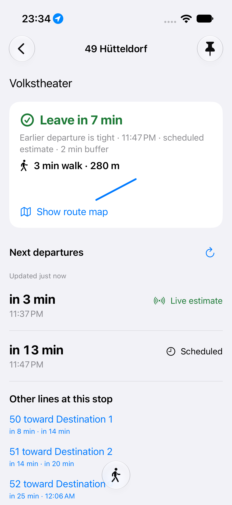
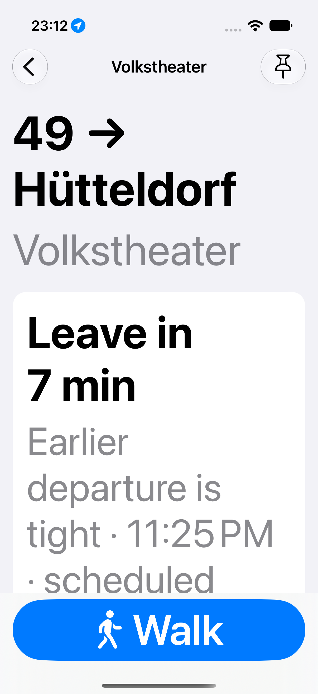
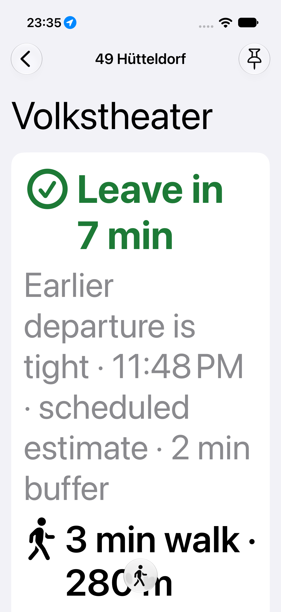
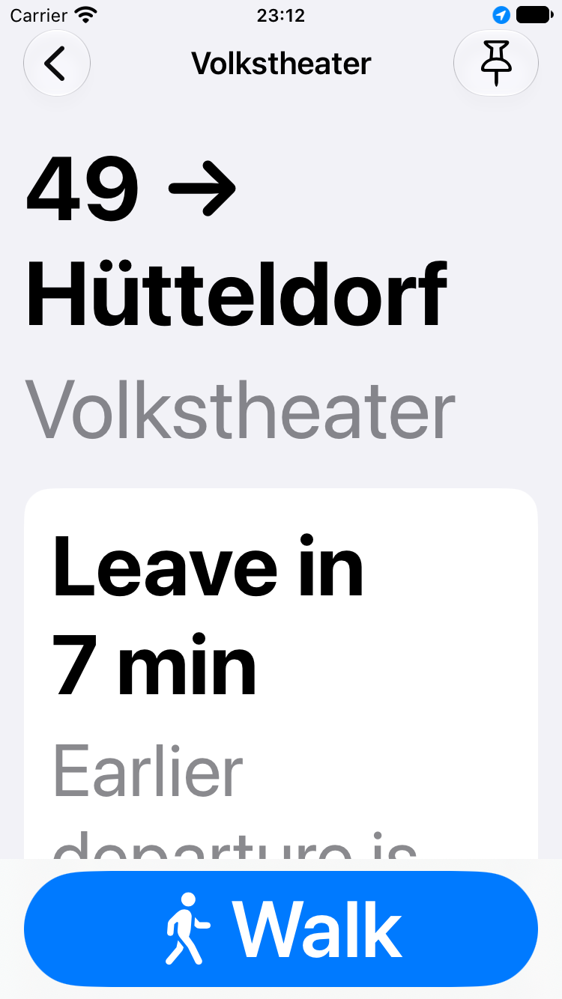
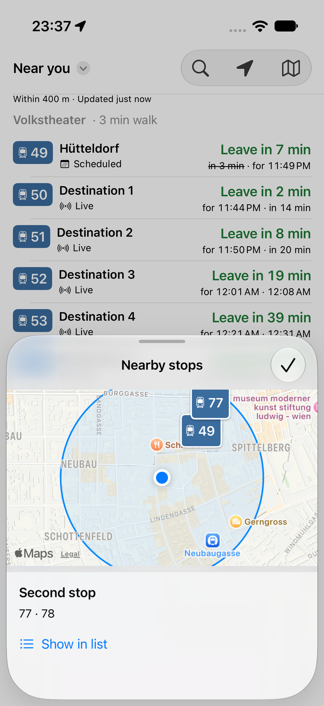
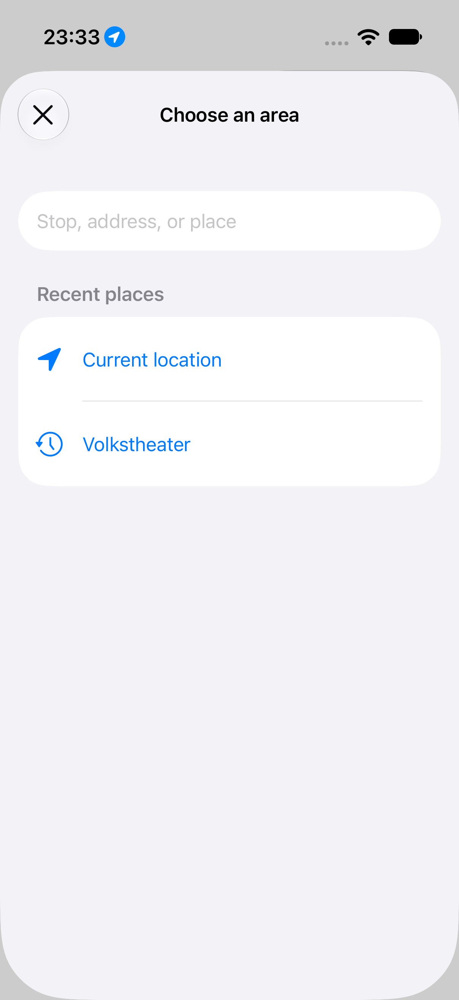

# Phase 3: detail, search and maps

The detail title identifies the line and direction, with the stop named once in the body. Saved advice includes Refresh now. A lightweight route preview opens a pannable, zoomable MapKit sheet, and other lines at the same physical stop offer their next two times. Pinning and walking directions are standard toolbar buttons with titles and symbols.

Search opens with Current location and the five most recently chosen places, persisted locally and also available in the system title menu. MapKit results show a category symbol and distance; transit results come first while preserving order within each category. The keyboard stays closed initially so recents are visible.

The stops map has a radius overlay and selectable, accessible line-number/mode badges using the same palette as the list. A selected stop shows its name and lines and offers Show in list. Both maps remain `UIViewRepresentable` wrappers and load on request. Their sheets use medium/large detents at default text sizes and large at accessibility sizes. Map titles use standard inline navigation titles to avoid the large-title truncation seen in capture review.

## Acceptance

| Criterion | Evaluation baseline | Result |
| --- | --- | --- |
| Stop name on detail | Twice | Once, asserted on both phones |
| Refresh inside saved advice | No action beside the instruction | One Refresh now button in the advice card; failed refresh/recovery test |
| Route map visible after opening | Fixed 250-pt map below the scroll position | Visible sheet after one tap on Show route map, default and largest text on 402 × 874 and 375 × 667 pt |
| Select a stop on the map | Display-only | Selectable labeled badge, selected-stop card and Show in list action |
| Search opens with recents | Empty field only | Current location plus up to five unique recent choices; relaunch persistence verified |
| Other services at the stop | No navigation to them | Next two times and navigation to another line at the same physical stop |

At the largest text size, reaching the route-preview button may require scrolling through the advice. Once tapped, the map itself is immediately visible; it is never inserted below the detail's scroll position. The standard walking action remains reachable throughout. The route preview preserves MapKit projection proportions and loads no map tiles.

Phase 2's measured fixture density remains 167.3/125.5 pt to the first row and eight/seven complete running rows at 402/375 pt. Its horizon, cancellation, viewport-refresh, legacy-fallback and capped-coverage rules are retained.

## Search comparison

The [bottom-search comparison](../screenshots/ios-design-phase-3/bottom-search-comparison.png) is a temporary visual prototype: one `searchable(text:placement:prompt:)` modifier on the outer NavigationStack, using toolbar placement. It shows the field's space cost and reach on a 390-point iPhone. The field was not connected to place results. That modifier was removed before the final build; the app keeps the toolbar button and title menu as requested. Apple's [system-search guidance](https://developer.apple.com/videos/play/wwdc2025/323/) describes this bottom placement on iPhone.

## Verification

- `xcodebuild … test` passed **62 unit tests and 14 UI tests on both phone sizes**, using unique iOS 27.0 simulator destinations, Xcode 27.0 and normal signing. Derived data and result bundles are under `/tmp`.
- Final app captures were exported from `/tmp/departs-p3-final-402.xcresult` and `/tmp/departs-p3-accepted-375.xcresult`. The 402-point viewport test was rerun successfully in `/tmp/departs-p3-viewport-402.xcresult` after replacing a fixed 34-second sleep with a condition-based wait: a late-loaded stop can remain inside the 25-second throttle at the next periodic tick. The test still rejects requests for the offscreen opening stops. This changed only test synchronization.
- Tests cover stop-name count, saved-advice refresh/recovery, map visibility after one tap at default/largest text, another-line navigation, stop-map selection/return, recent choices across relaunch, a five-item recent limit and stable transit-first search ranking. All Phase 2 loading/ranking regression tests continue to pass.
- The accepted source was launched against production on a 390-point iPhone at the documented coordinate around 23:35–23:36 Vienna time. Default and largest-text captures are included. `git diff --check` passed.

The live checks are separate from fixtures: read-only production launches at 48.20134, 16.34941 supply the realistic list captures. A macOS MapKit search for Volkstheater Vienna returned two results, categorized as public transport and theater. This verifies that query and category availability; UI search, recents and ordering use deterministic fixtures and unit tests. Native maps use real MapKit tiles over fixture stops/routes, which do not establish live walking-route accuracy.

There is no backend change in this phase and no deployment. The plan's author verified two uncapped grouped boards against live HERE data on the Phase 2 Vercel preview at 23:34; [PR #21](https://github.com/p3ob7o/Departs/pull/21) records the samples separately from fixtures and production. Capped boards, provider quota/latency under load and the new production handler remain unverified. The grouped endpoint must deploy to production before any native build containing this list is distributed. No releases, TestFlight uploads, version/build changes or minimum-OS increase beyond the approved iOS 26 target. No iOS 27-only API is required.

| Detail | Before Phase 3 | After Phase 3 |
| --- | --- | --- |
| Default |  |  |
| Largest text |  |  |
| 375 pt largest text |  |  |

| New flow | Capture |
| --- | --- |
| Route map |  |
| Route map at largest text, 375 pt |  |
| Selected stop |  |
| Recent places |  |

The [capture directory](../screenshots/ios-design-phase-3/) contains both phone sizes, saved-data recovery, search, the production list and the separate bottom-search prototype.
