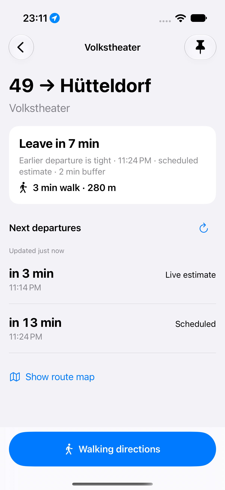
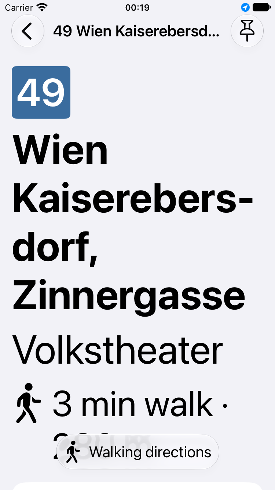
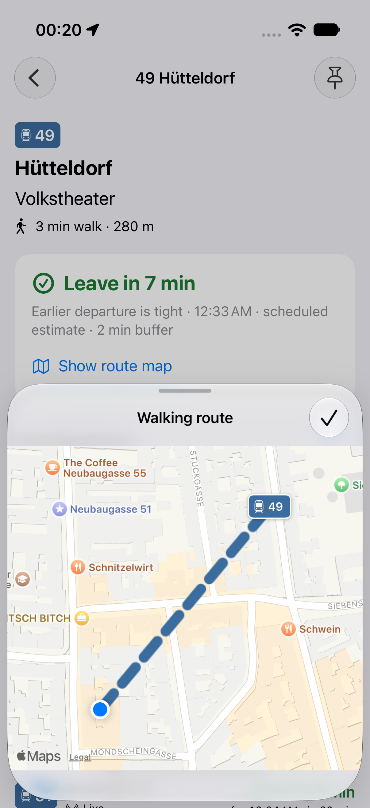
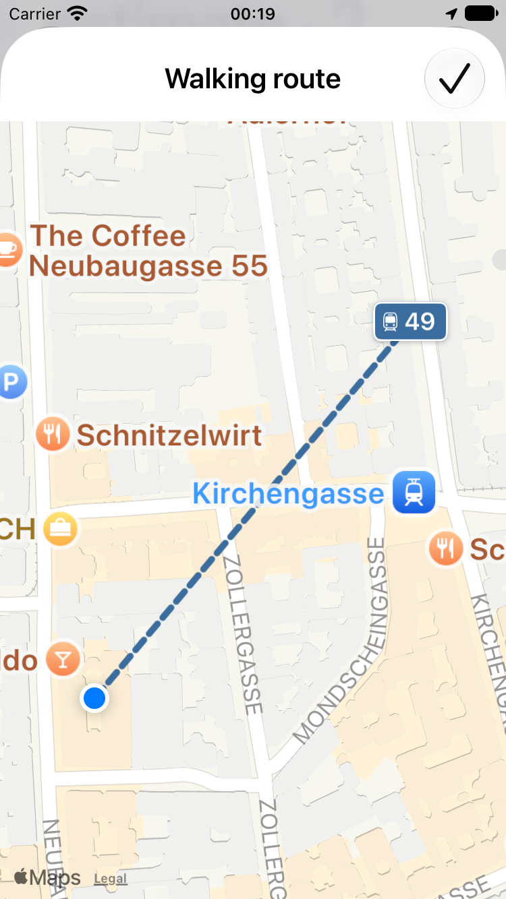
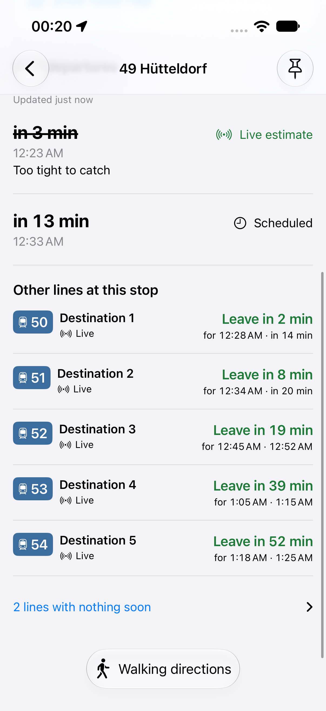

# Phase 3: detail, search and maps

The first detail block shows the line badge and full direction, wrapping and scaling with Dynamic Type, with the stop named once and the walk underneath. The inline navigation title also identifies the service. Saved advice includes Refresh now. Show route map opens a pannable, zoomable MapKit sheet; the ambiguous route sketch was removed. Other lines at the same physical stop reuse the list rows and its running/idle partition. Pinning and walking directions are standard toolbar buttons; walking directions explicitly displays both its title and symbol. Next departures strikes through services skipped by the advice and labels them "Too tight to catch".

Search opens with Current location in its own section, followed by the five most recently chosen places under Recent places, persisted locally and also available in the system title menu. MapKit results show a category symbol and distance; transit results come first while preserving order within each category. The keyboard stays closed initially so recents are visible.

The stops map has a radius overlay and one selectable, accessible badge per merged list section. Compact line-number/mode badges use the list palette and indicate additional distinct lines with +N. Their transparent hit regions remain at least 44 points. A selected badge has a blue outline and the accessibility selected trait; the stop card shows its name and lines and offers Show in list. Both maps remain `UIViewRepresentable` wrappers and load on request. Their sheets use medium/large detents at default text sizes and large at accessibility sizes. Map titles use standard inline navigation titles.

## Acceptance

| Criterion | Evaluation baseline | Result |
| --- | --- | --- |
| Stop name on detail | Twice | Once, asserted on both phones |
| Refresh inside saved advice | No action beside the instruction | One Refresh now button in the advice card; failed refresh/recovery test |
| Route map visible after opening | Fixed 250-pt map below the scroll position | Visible sheet after one tap on Show route map, default and largest text on 402 × 874 and 375 × 667 pt |
| Select a stop on the map | Display-only | One badge per list section, visible selection ring, selected-stop card and Show in list action |
| Search opens with recents | Empty field only | Current location plus up to five unique recent choices; relaunch persistence verified |
| Other services at the stop | No navigation to them | Shared list rows; running services first, future-only and empty services collapsed |
| Full direction at largest text | Navigation title only, small and truncated | Wrapping content heading; long "Wien Kaiserebersdorf, Zinnergasse" tested on both phone sizes |
| Map platform duplication | One pin per provider platform | Three fixture platforms become two pins; current production data has 17 platforms in seven list sections |
| Selected-map touch targets | 44-point drawing, no distinct hit region | Compact 28-point badge drawing inside a larger target; pin and Show in list measure 46.1/46.0 pt high on 402/375 pt phones |

At the largest text size, reaching Show route map may require scrolling through the service heading and advice. Once tapped, the map itself is immediately visible; it is never inserted below the detail's scroll position. The standard walking action remains reachable throughout. No map tiles load before opening the sheet. Map badges cap their spatial label at 18 points; the selected-stop card uses the full Dynamic Type size and VoiceOver reads the complete services.

All ten Phase 3 review findings were confirmed and addressed. The full content heading amends the original navigation-title-only design, as requested in review. The route sketch was replaced with the permitted plain map action. The two rewritten view files use the project's four-space indentation again. The directions fixture now uses the request's actual origin and stop endpoint, rather than ending beyond the stop. Friendly advice copy and locale-formatted measurements remain Phase 4 work.

The iOS 27 runtime rendered a toolbar `Label` as icon-only even with the [documented title-and-icon style](https://developer.apple.com/documentation/swiftui/label). The walking action therefore uses explicit symbol and text content inside the standard toolbar `Button`, preserving the system's bar and glass styling. Its label scales through XXXL, with the large content viewer enabled for accessibility sizes; the content heading and board still use the full requested text size. The accessibility test verifies an actual tap on the visible walking label opens Apple Maps, since this runtime's hit-point query reported that native toolbar item as unhittable despite the successful tap.

Phase 2's measured fixture density remains 167.3/125.5 pt to the first row and eight/seven complete running rows at 402/375 pt. Its horizon, cancellation, viewport-refresh, legacy-fallback and capped-coverage rules are retained.

## Search comparison

The [bottom-search comparison](../screenshots/ios-design-phase-3/bottom-search-comparison.png) is a temporary visual prototype: one `searchable(text:placement:prompt:)` modifier on the outer NavigationStack, using toolbar placement. It shows the field's space cost and reach on a 390-point iPhone. The field was not connected to place results. That modifier was removed before the final build; the app keeps the toolbar button and title menu as requested. Apple's [system-search guidance](https://developer.apple.com/videos/play/wwdc2025/323/) describes this bottom placement on iPhone.

## Verification

- `xcodebuild … test` passed **64 unit tests and 14 UI tests on both phone sizes**, using unique iOS 27.0 simulator destinations, Xcode 27.0 and normal signing. Derived data and result bundles are under `/tmp`.
- Forty captures were exported from `/tmp/departs-p3-accepted-review-402.xcresult` and `/tmp/departs-p3-accepted-review-375.xcresult`, including the long-direction accessibility case, default detail, corrected route endpoints, merged selected stop, other lines and recents. The viewport regression retains its condition-based refresh wait and rejects requests for offscreen opening stops.
- After increasing Show in list's minimum height to account for the system sheet's scale, the selected-map flow and both target-size assertions passed again on both phones in `/tmp/departs-p3-map-target-{402,375}.xcresult`. Those two final map captures replace the earlier exports.
- Tests cover the shared detail/list partition, merged map identity and distinct-line counts, skipped-departure markers, stop-name count, saved-advice refresh/recovery, map visibility after one tap at default/largest text, another-line navigation, stop-map selection/return, recent choices across relaunch, a five-item recent limit and stable transit-first search ranking. All Phase 2 loading/ranking regression tests continue to pass.
- This build was launched against production on a 390-point iPhone at the documented coordinate around 00:18–00:20 Vienna time on 16 November. Default and largest-text captures are included. `git diff --check` passed.

The live checks are separate from fixtures: read-only production launches at 48.20134, 16.34941 supply the realistic list captures. A macOS MapKit search for Volkstheater Vienna returned two results, categorized as public transport and theater. This verifies that query and category availability; UI search, recents and ordering use deterministic fixtures and unit tests. Native maps use real MapKit tiles over fixture stops/routes, which do not establish live walking-route accuracy.

There is no backend change in this phase and no deployment. The plan's author verified two uncapped grouped boards against live HERE data on the Phase 2 Vercel preview at 23:34; [PR #21](https://github.com/p3ob7o/Departs/pull/21) records the samples separately from fixtures and production. Capped boards, provider quota/latency under load and the new production handler remain unverified. The grouped endpoint must deploy to production before any native build containing this list is distributed. No releases, TestFlight uploads, version/build changes or minimum-OS increase beyond the approved iOS 26 target. No iOS 27-only API is required.

| Detail | Before Phase 3 | After Phase 3 |
| --- | --- | --- |
| Default |  |  |
| Largest text |  |  |
| 375 pt largest text |  |  |

| New flow | Capture |
| --- | --- |
| Route map |  |
| Route map at largest text, 375 pt |  |
| Selected stop |  |
| Recent places |  |
| Shared other-line rows |  |

The [capture directory](../screenshots/ios-design-phase-3/) contains both phone sizes, saved-data recovery, search, the production list and the separate bottom-search prototype.
