# Phase 4: content, motion and identity

This phase makes the interface localizable, explains departure advice in everyday language, animates countdown digits and adds selection feedback for pins. It derives dark and tinted icons from the owner's existing PNG without redrawing any artwork. System accent remains the control color.

## Acceptance and measurements

| Measure | Baseline | Result |
| --- | --- | --- |
| Localizable copy | No String Catalog; assembled English fragments | 129 keys in Localizable.xcstrings, plus location permission in InfoPlist.xcstrings; complete messages with reorderable arguments |
| Count forms | “1 lines” | Catalog singular/plural forms for idle and additional lines |
| Distance at 400 metres | Always “400 m” | German locale: “400 m”; US: “1,300 ft”; UK: “450 yd”; explicit metric override of US locale: “400 m” |
| Walking duration | Hard-coded “3 min” | Foundation duration formatting: “3 min” in English, “3 Min.” in German; upward walking rounding unchanged |
| Advice copy | “scheduled estimate · 2 min buffer”; “Saved prediction” | “scheduled arrival. Includes 2 min extra”; “Last known arrival” |
| Advice detail at largest text, 402 pt | Six lines in the Phase 3 review | Four lines / 232.7 pt in the final 01:04 AM fixture capture; clock length can change wrapping |
| Fixture density, 402 / 375 pt | Phase 2: first row 167.3 / 125.5 pt, 8 / 7 full options | Unchanged: 167.3 / 125.5 pt, 8 / 7 full options |
| Expanded German layout | No catalog or test | Disposable German pseudolocalization build, default and largest accessibility text, with screenshots exported from native tests |
| Default icon | One 1024 × 1024 PNG | Byte-identical SHA-256: d434b6d1494b397ad0427b3b5c6cd75028a579d1f95da01dfd3eb2d78039d0a3 |
| Appearance variants | None | Dark: only the 981,928 exact ground pixels made transparent. Tinted: deterministic grayscale with Gray Gamma 2.2 profile. Both remain 1024 × 1024 |

The pseudolocalization script copies the native project outside the repository and adds a bounded German stress catalog there. Selected phrases use German word order and lengths; remaining strings use accented, expanded English. This is a layout fixture, not a German translation. Only English ships. Xcode's double-length option on this runtime left format tokens in interpolations/plurals, so those captures were discarded in favor of a real compiled catalog. The search instructions are a wrapping label above the input, since even a vertical TextField truncates its placeholder at large sizes. Typed queries can grow vertically. Native navigation titles retain the system's truncation and overflow behavior; full task instructions and service directions remain in the content.

At accessibility sizes, fresh rows keep the badge, direction, answer and times. Live/scheduled wording remains in the spoken label and detail; saved/failed markers remain visible. The context line retains the radius while fresh, and still shows saved information and refresh recovery when needed. This keeps the answer visible with expanded text instead of shrinking its font.

Visibility callbacks now ignore unchanged state. A tall saved-state header could also push every row offscreen, make the status briefly appear fresh, shrink, and reveal those rows again. List status now retains the last nonempty viewport in that case, and an opening refresh revalidates the first three stop boards even before their rows appear. Periodic refresh still uses pins and visible stops. Regression tests cover both feedback paths. Countdown schedules retain a stable start date, and numeric transitions use the Reduce Motion environment to disable animation. Pin changes trigger the system selection feedback.

## Icon review

The asset-catalog implementation follows Apple's [current appearance instructions](https://developer.apple.com/documentation/xcode/configuring-your-app-icon): transparent dark ground and grayscale tinted input. Apple's [icon guidance](https://developer.apple.com/design/human-interface-guidelines/app-icons) still supports bitmap icons and applies the final system mask. No corners or lighting effects are baked into these variants.

The script at ios/scripts/derive-icon-appearances.py checks the source hash, preserves every RGB pixel in the dark variant, generates the grayscale variant, and exports unmodified-artwork size studies. It uses Pillow 13.0.0 as a local tool, not an app dependency. No image model was used.

| Icon size | Wordmark height | Route-line thickness | Stop diameter |
| --- | --- | --- | --- |
| 60 pt | 9.84 pt | 0.35 pt | 1.70 pt |
| 40 pt | 6.56 pt | 0.23 pt | 1.13 pt |
| 29 pt | 4.76 pt | 0.17 pt | 0.82 pt |

These measurements scale the source artwork's 168-pixel wordmark height, 6-pixel line and 29-pixel dots. Captures include both 2× and 3× rendering. The wordmark is recognizable at 60 pt; reading it and distinguishing the route details becomes harder at 40 and 29 pt. Proposal for a later owner-led brand review: explore a source-artwork variant with a larger route motif and fewer small details, while reviewing the wordmark's role at these sizes. No lettering, geometry or default artwork changes are included here.

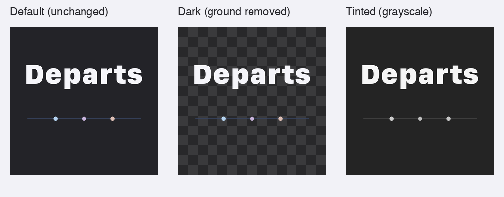
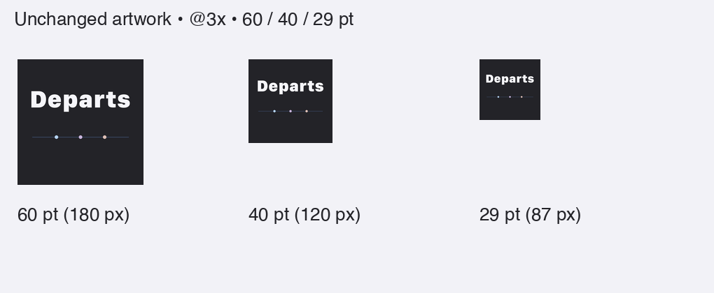
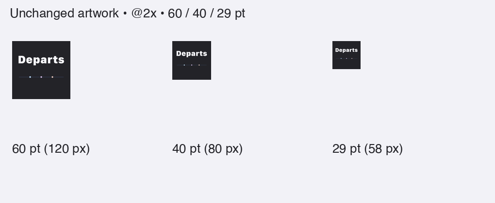

## Captures

| Screen | Before: Phase 3 | After: Phase 4 |
| --- | --- | --- |
| List, default | 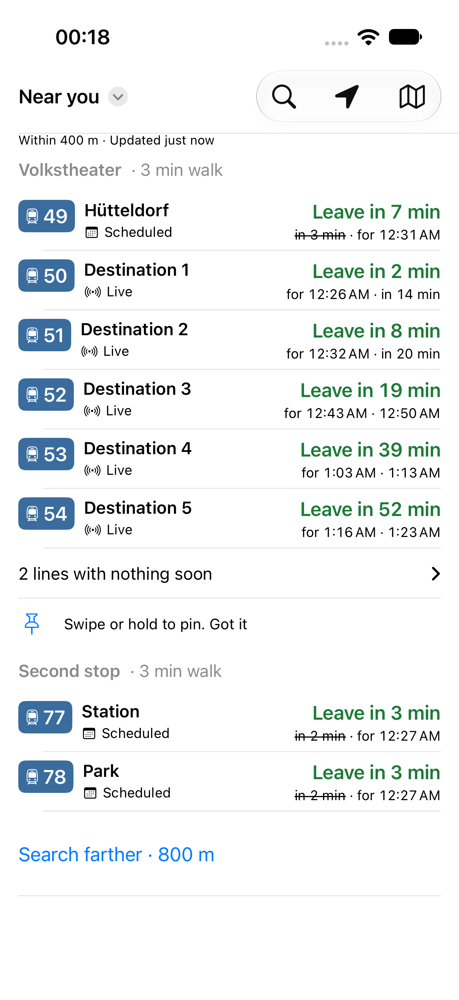 | 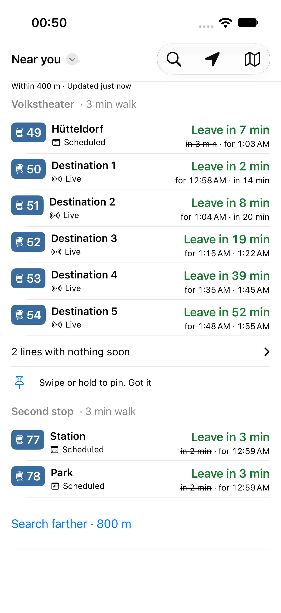 |
| List, largest text | 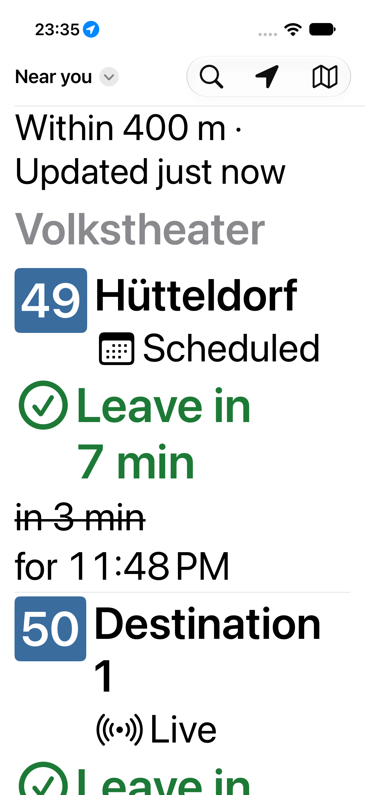 | 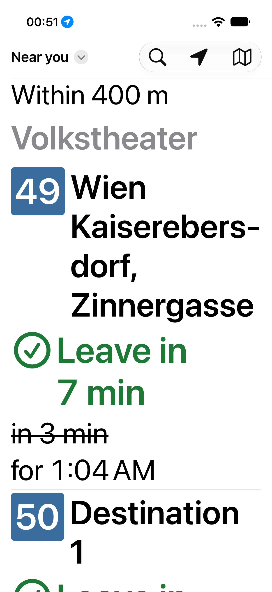 |
| Detail, default | 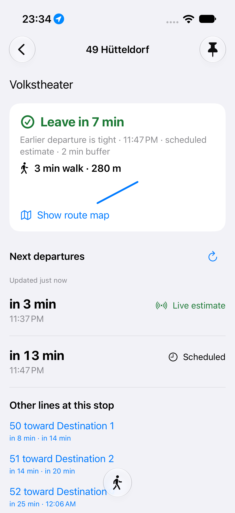 | 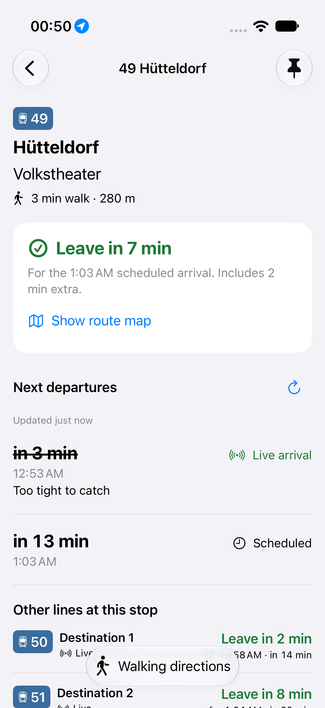 |
| Detail, largest text | 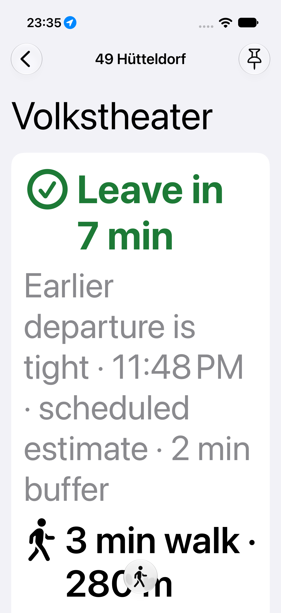 | 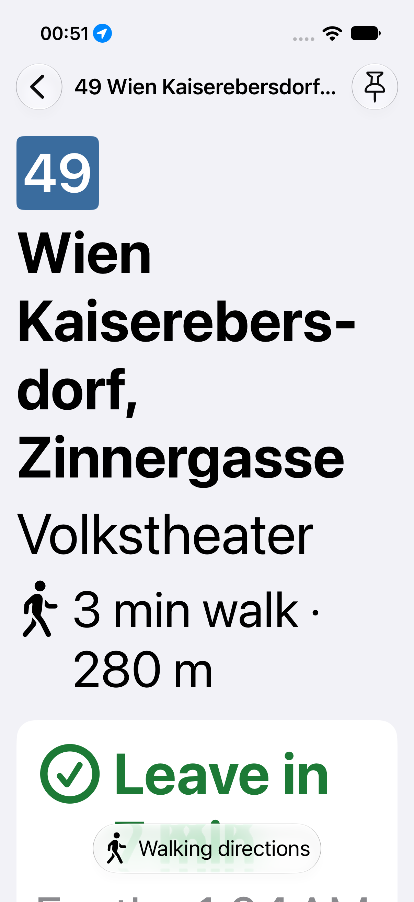 |

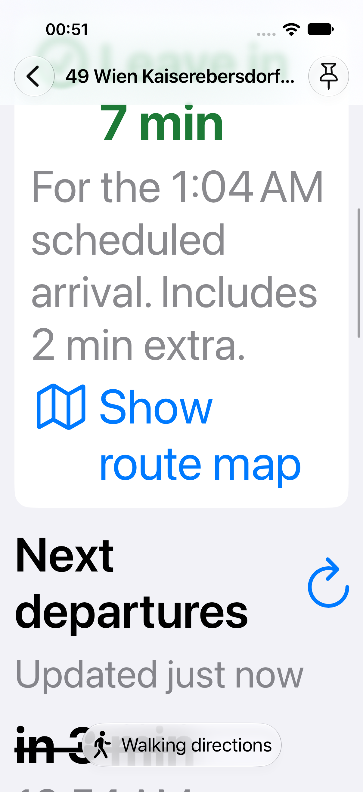

| German stress layout | Largest accessibility text |
| --- | --- |
| 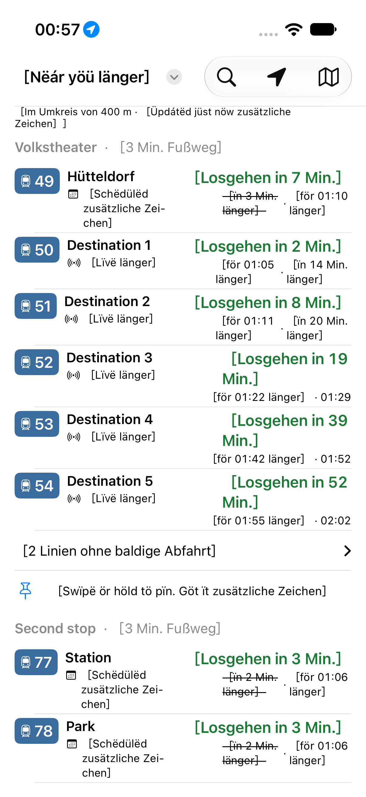 | 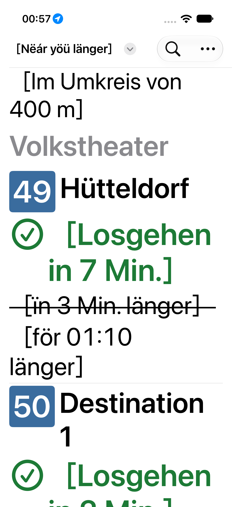 |
| 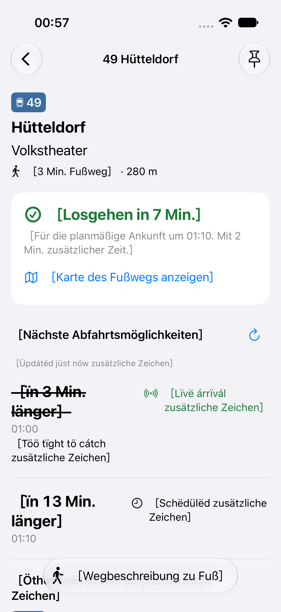 | 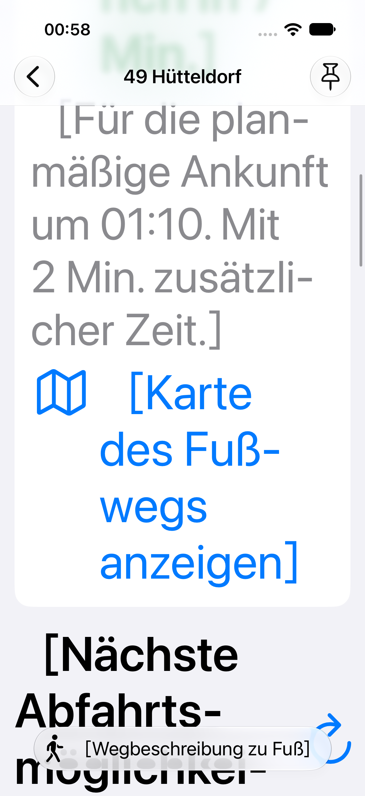 |
| 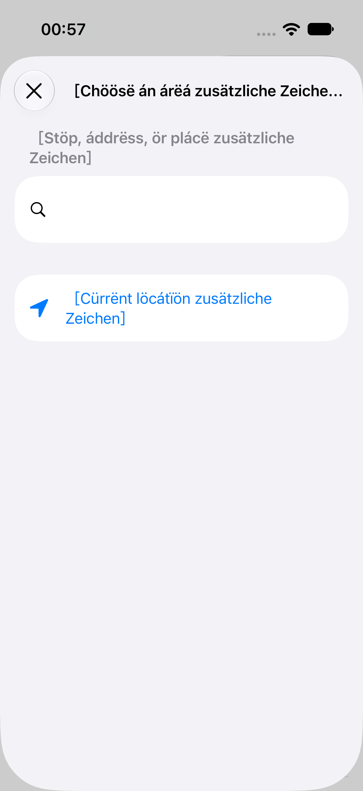 | 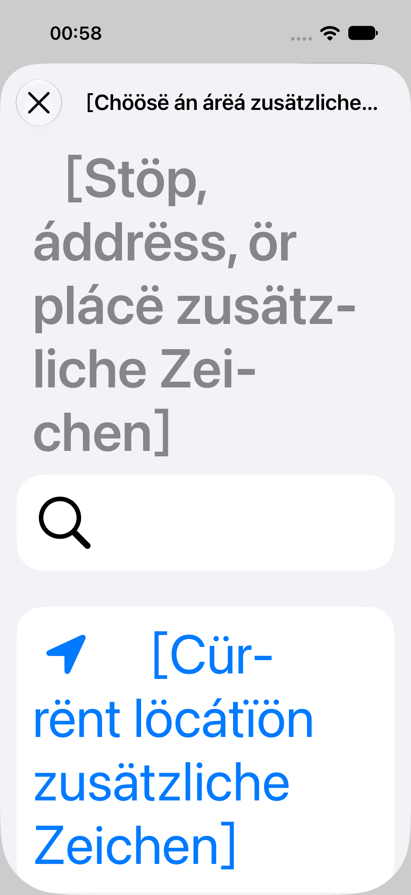 |

The 375-point equivalents are also committed, prefixed with 375-. Long German phrases wrap and can hyphenate at accessibility sizes. The map action remains wholly reachable above the walking toolbar; its largest stress-case height is 311.5 pt, without reducing the content font.

## Verification scope

Native unit/UI checks use Xcode 27.0, the pinned iOS 27.0 simulator runtime, normal simulator signing and derived data outside the repository. The existing countdown-order and arrival-during-scroll tests remain in the suite. No native dependency, version/build number or API contract changes.

- Full native runs: **68 unit tests and 14 UI tests passed on both 402 × 874 and 375 × 667 pt destinations**. Result bundles: /tmp/departs-p4-accepted-402.xcresult and /tmp/departs-p4-accepted-375.xcresult.
- After the search-label adjustment: **68 unit tests and all three affected search UI flows passed**, including choosing a place, denied-location recovery and walking handoff. Result bundle: /tmp/departs-p4-search-finished-402.xcresult.
- **German pseudolocalization UI checks passed at both widths**, at default and largest accessibility text sizes, including the search sheet and the native toolbar overflow menu. Final bundles: /tmp/departs-p4-german-402-label.xcresult and /tmp/departs-p4-german-375-finished.xcresult.
- Catalog compilation, app-icon asset compilation, source hash/pixel checks and git diff whitespace checks passed. Only English resources are included in the normal app.

Production checks are read-only app launches at 48.20134, 16.34941 around 00:41–00:42 Vienna time on 16 November 2026, at default and largest accessibility text sizes. These verify the current production API's legacy fallback and actual list content. They do not verify deployment of the grouped handler.

| Production, default | Production, largest text |
| --- | --- |
| 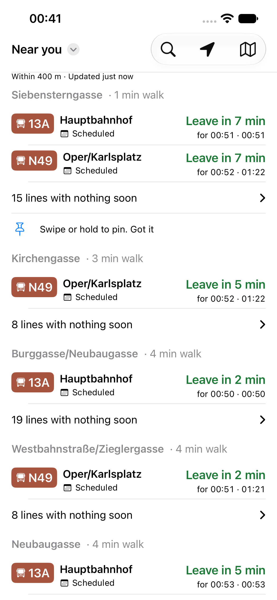 | 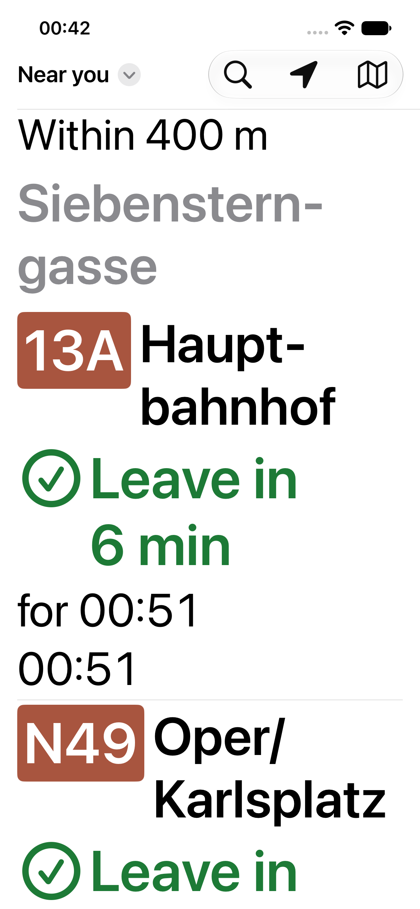 |

There are no backend changes in this phase. Phase 2's preview-provider evidence remains separate from production. The grouped endpoint must deploy to production before any build containing this list is distributed; the legacy fallback has a higher request cost. No release or TestFlight upload was performed. Haptic feel, VoiceOver use and Home Screen appearance should still be reviewed on a physical device.
