# Phase 5: resizable foundation

The app now owns one transit session, store, location service and refresh clock. Pins, caches and the current search area are shared. Each window owns its selection, scroll targets and sheets. A single NavigationSplitView shows list and detail together where space permits and collapses to push navigation at compact width. Sheets remain attached to the window root through those changes.

The committed app target remains **iPhone-only**, with `TARGETED_DEVICE_FAMILY = 1` in both configurations. The only project-setting change in this phase enables the two landscape orientations on iPhone, after compact-height checks passed. iPad tests use **only** a command-line `TARGETED_DEVICE_FAMILY="1,2"` override and separate derived data. Mac and Vision Pro availability, scene configuration, required capabilities, deployment target iOS 26, and version/build 1.1 (5) are unchanged. The Duo and iPad adaptation branches were not modified.

## Acceptance and measurements

| Measure | Before: Phase 4 | Phase 5 result |
| --- | --- | --- |
| Store, location service and refresh clock | One set per ContentView/window | One app-owned TransitSession; window demand is combined without starting another clock |
| Native unit/UI tests on iPhone and iPad | 69 unit + 14 UI on two phone sizes | 72 unit + 16 UI passed on each phone; 72 unit + 14 UI passed on the 11-inch iPad with the device-family override |
| Width matrix | Phone portraits at 375 and 402 pt | Exact containers at 320, 402, 466, 669, 834, 1024 and 1200 pt; default and largest accessibility text |
| Selected board during resize | Push navigation only | The same board remains selected across compact/regular transitions and back to 320 pt |
| Scroll retention | Not measured across width changes | The list anchor and detail section remain visible through 320 → 1200 → 320 pt. Detail heading reflow: at most 20 pt at default text and 0.01 pt at largest text; neither returns to the header. Native window tests also retain the first visible list identity. |
| Open sheet during resize | Presented from individual screens | Route sheet survives 320 → 1200 pt container changes, native window resizing and phone rotation; search retains its query |
| Readable width | Detail content fills the available width | Detail and list text columns cap at 640 pt; native bars remain at pane edges |
| Compact height | Portrait-only phone target | List, detail, route map, selected-stop map and search exercised at 667 × 375 pt, default and largest text; exact 669 × 375 pt container also checked |
| Fixture first-row top, 402 / 375 pt | 167.3 / 125.5 pt | Unchanged: 167.3 / 125.5 pt |
| Fully visible fixture options, 402 / 375 pt | 8 / 7 | Unchanged: 8 / 7 |
| App-drawn controls | At least 44 × 44 pt | Minimum asserted width 71 pt; minimum height 44 pt. Row, disclosure, pin, recovery and map-action assertions retained; native toolbar accessibility frames are not treated as their hit regions |

The iOS 27 iPad window manager does not allow this window below 375 pt, even with a proposed smaller scene minimum. No scene sizing keys or device support were changed to work around it. A Debug-only fixture host drives the same ContentView at exact container sizes, including 320 pt. Separate tests resize real iPad windows between approximately 375 and 1200 pt, preserving the selected board, visible list anchor, scrolled detail section and route sheet. The final native run measured widths of **381, 663, 1194 and 1200 pt**, with heights of 650–657 pt; capture names give requested widths, which the window manager rounds. Exact-container evidence and native-window evidence are labeled separately. The test host and its fixture-server polling are absent from Release builds.

At the largest text size, content wraps and scrolls instead of shrinking. The selected-stop card is limited to half its map pane and scrolls independently, leaving the map visible at 375 pt height. Search accepts wrapping text, treats Return as submission, and dismisses the keyboard so results remain reachable in compact height. Both MapKit UIViewRepresentable wrappers are retained and maps still load on request.

Visibility and interaction tokens are scoped to a window and pane. Closing or backgrounding one window cannot clear another's demand or release its deferred partition. Returning another window to the foreground refreshes it immediately while retaining the one shared clock. The Phase 4 stable status set remains separate from live request demand. Countdown ticks still never reorder rows, and all freshness and leave-guidance thresholds are unchanged.

## Captures

The fixture originals were exported from the native result bundles; the embedded copies are curated and compressed as described below. Full-screen exports preserve the surrounding native window or exact-size test container, rather than cropping away its dimensions.

| Screen | Before: Phase 4 | After: Phase 5 |
| --- | --- | --- |
| List, default | 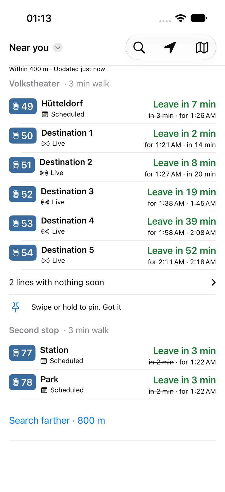 | 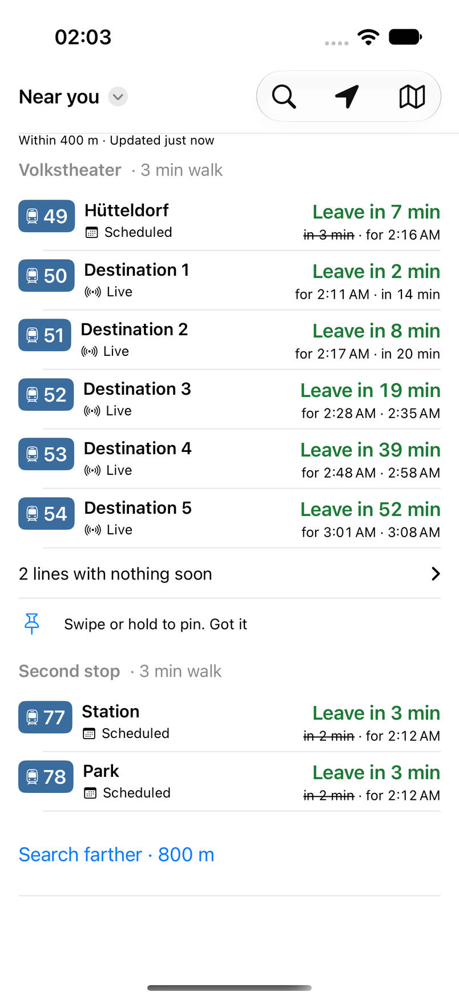 |
| List, largest text | 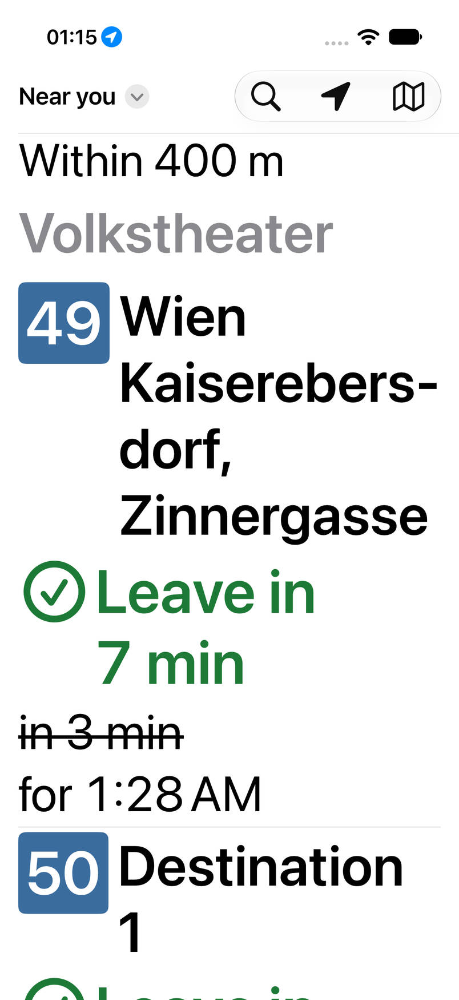 | 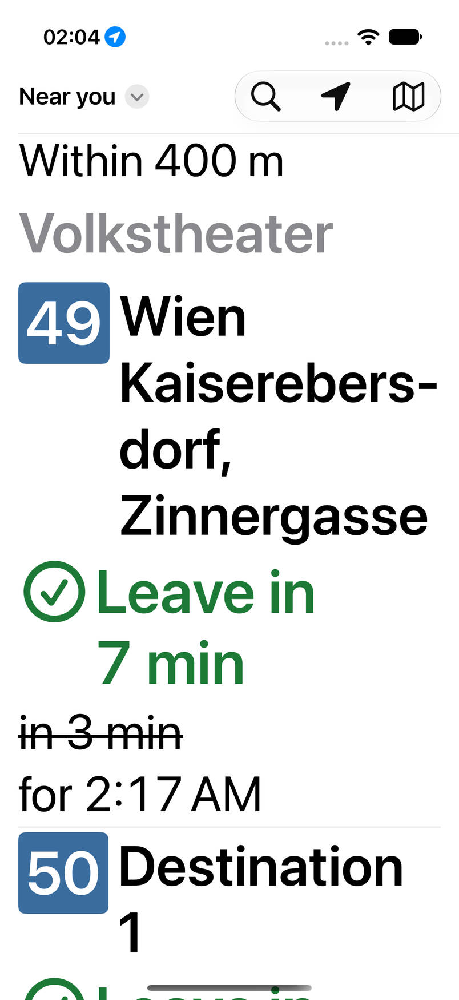 |
| Detail, default | 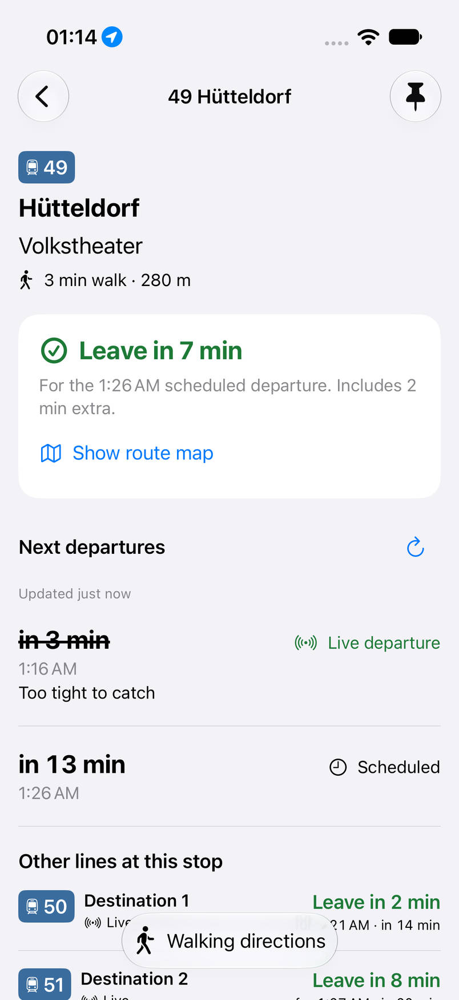 | 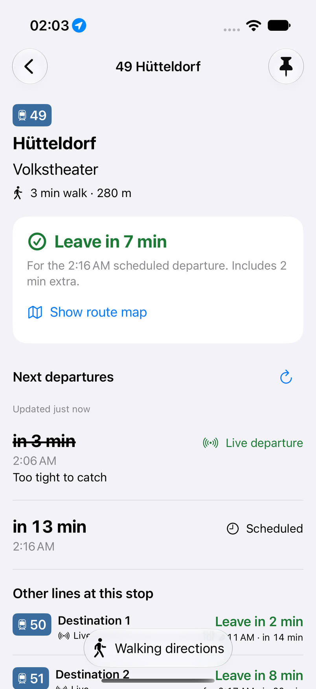 |
| Detail, largest text | 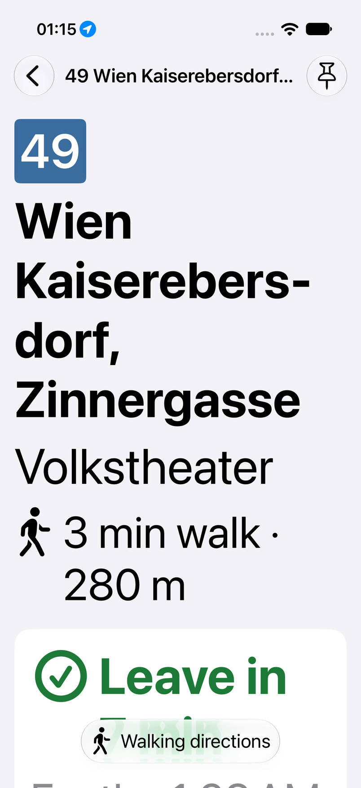 | 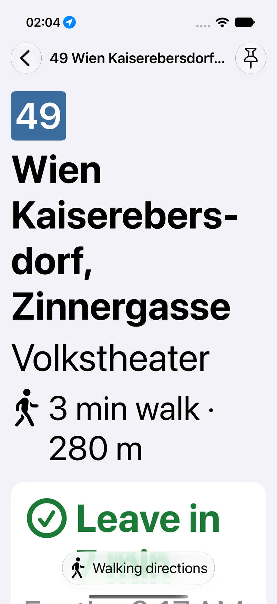 |

The 375-pt phone equivalents use the `375-` prefix. The `matrix-` captures show exact container dimensions; `window-` captures show native iPad window resizing with the device-family test override. Landscape captures include the two maps, selected-stop card and search at both text sizes.

| Exact 320-pt container, largest text | Exact 1200-pt container, largest text |
| --- | --- |
| 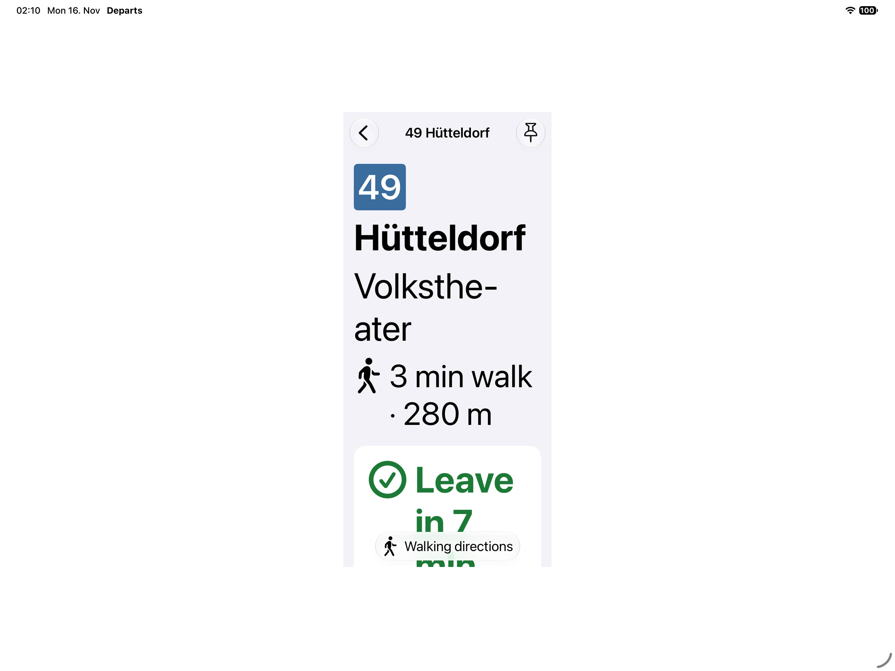 | 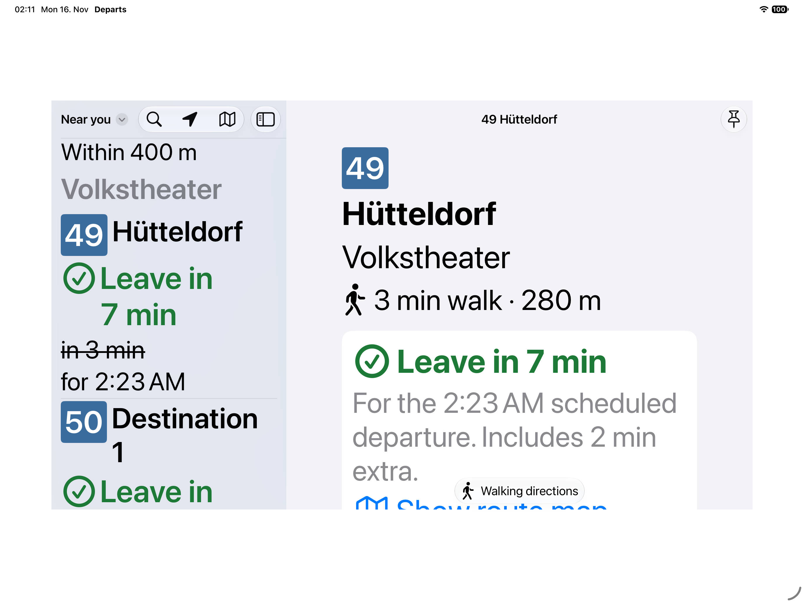 |
| [Retained list position](https://github.com/p3ob7o/Departs/blob/8bebd302f470f17692eb19601f5a74fc3c06aee6/docs/screenshots/ios-design-phase-5/matrix-320-retained-list-scroll-accessibility.png) | [Retained detail section](https://github.com/p3ob7o/Departs/blob/8bebd302f470f17692eb19601f5a74fc3c06aee6/docs/screenshots/ios-design-phase-5/matrix-1200-scrolled-accessibility.png) |

| Native window, requested 375 pt | Native window, requested 1200 pt |
| --- | --- |
| 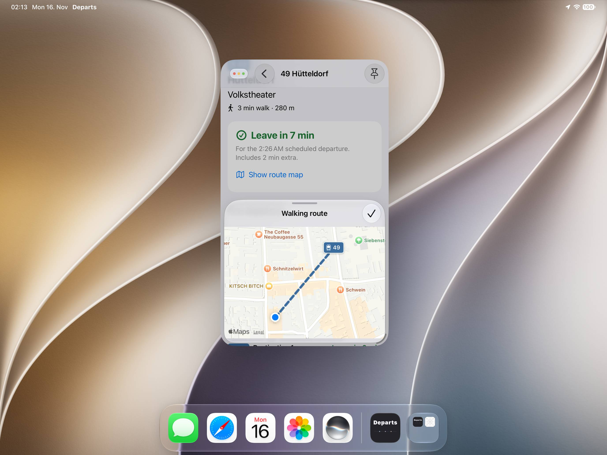 | 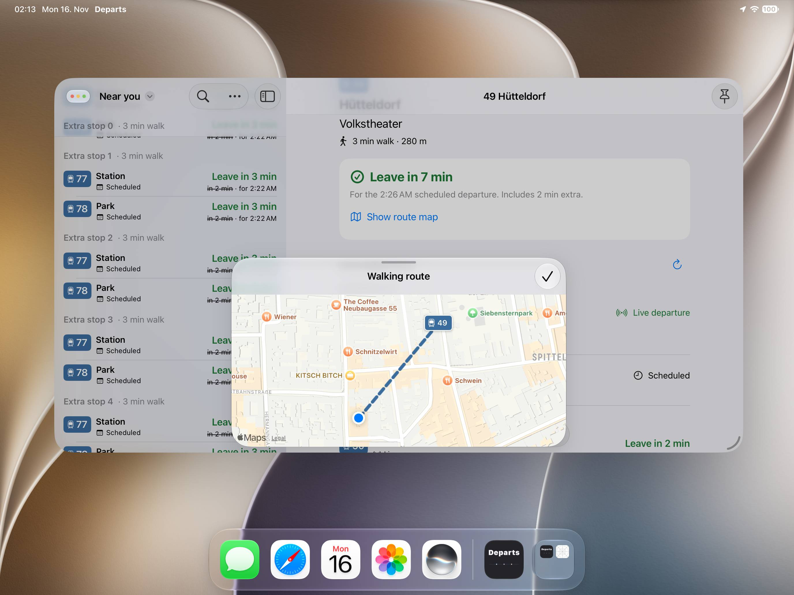 |

| 375-pt-high phone, default text | 375-pt-high phone, largest text |
| --- | --- |
| [Landscape detail](https://github.com/p3ob7o/Departs/blob/8bebd302f470f17692eb19601f5a74fc3c06aee6/docs/screenshots/ios-design-phase-5/375-landscape-detail.png) | [Landscape large detail](https://github.com/p3ob7o/Departs/blob/8bebd302f470f17692eb19601f5a74fc3c06aee6/docs/screenshots/ios-design-phase-5/375-landscape-detail-accessibility.png) |
| 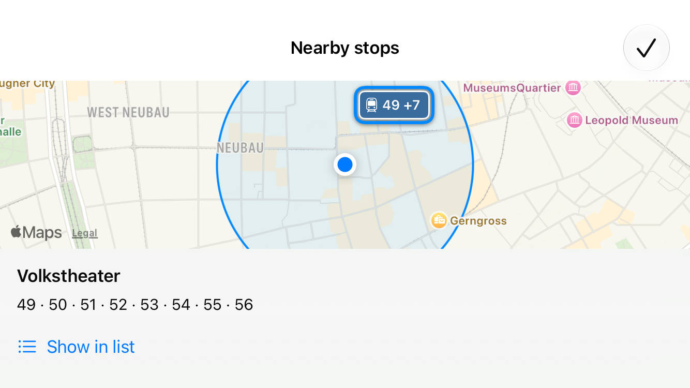 | 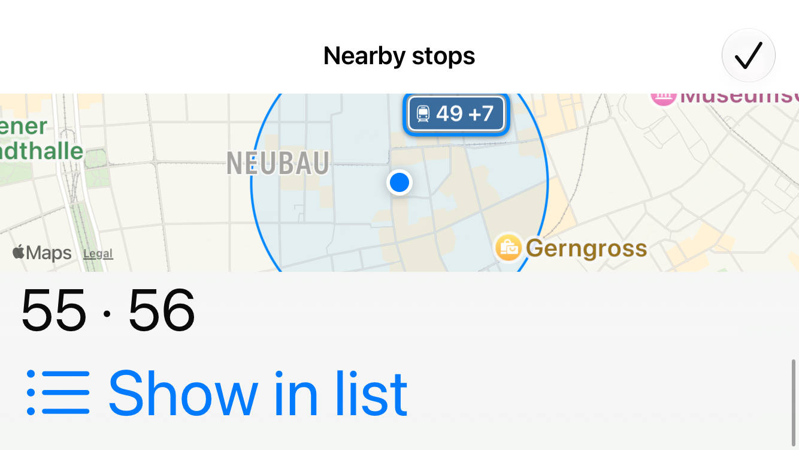 |

## Verification scope

Native commands pin Xcode 27.0's iOS 27.0 runtime, use normal simulator signing, disable parallel testing within each destination, and keep derived data outside the repository. iPhone, 375-pt iPhone, 11-inch iPad and 13-inch iPad each reuse one derived-data directory. iPad commands add `TARGETED_DEVICE_FAMILY="1,2"`; phone commands use the committed project settings.

The full post-cleanup native runs passed on both phones and the 11-inch iPad. Each phone run passed **72 unit and 16 UI tests**, skipping the three iPad-only resize tests. The 11-inch iPad run passed **72 unit and 14 UI tests**, skipping the two phone-rotation tests and three tests requiring a 13-inch iPad. **All three focused resize tests passed on the 13-inch iPad**, including default and largest text. Together these runs execute every test in the shared scheme. Machine-readable summaries, capture manifests and measurements are in the capture directory.

A Release simulator build passed. Its built Info.plist contains device family `[1]`, minimum OS `26.0`, the three authorized iPhone orientations, and version/build `1.1 (5)`. The existing multiple-scenes declaration remains unchanged. The Release binary contains neither `LayoutTestHost` nor the `DEPARTS_TEST_VIEWPORT` switch. Existing MapKit placemark deprecation warnings remain; no iOS 27-only API is introduced. Backend tests are not rerun because this phase changes no backend code. Phase 2's 65 Vitest tests, lint and build results remain recorded separately.

A full-disk incident interrupted a temporary build. Only task-owned outputs were removed. Git object integrity, local/remote Phase 1–4 heads, modified JSON/plists and new PNG checksums were checked; no repository corruption was found. Runs overlapping the incident were discarded and rerun. Captures and compact test summaries are retained here; temporary result bundles were deleted after export. The remaining task build directories and both task-created simulators were removed after verification. Pre-existing simulators, global caches and the owner's other build outputs were preserved.

Production verification was repeated after cleanup, with read-only app launches at 48.20134, 16.34941 around **02:10–02:12 Vienna time on 16 November 2026**, at default and largest text sizes. The default night-time capture has **three running N49 options**, plus an unavailable N71 row with a visible refresh action. The other loaded rows keep their useful answers. This is a real partial-failure capture, not a claim of provider reliability. The answer font was not reduced to increase the count.

Read-only HTTP checks returned 17 stops and HTTP 200 for both nearby stops and the departures request. Adding `groupBy=line` still returned a legacy array of four departures on production. These checks exercise the fallback and recovery UI; they do not verify deployment of the grouped handler, provider quotas or latency under load.

| Production, default | Production, largest text |
| --- | --- |
| [Production list](https://github.com/p3ob7o/Departs/blob/8bebd302f470f17692eb19601f5a74fc3c06aee6/docs/screenshots/ios-design-phase-5/production-390.png) | [Production large list](https://github.com/p3ob7o/Departs/blob/8bebd302f470f17692eb19601f5a74fc3c06aee6/docs/screenshots/ios-design-phase-5/production-390-accessibility.png) |

Phase 2's live-provider checks were on its preview deployment. The grouped endpoint must reach production before any build containing this list is distributed, because the legacy fallback has a higher request cost. No deployment, release, TestFlight upload, version/build change or merge was performed. Physical-device haptic feel, VoiceOver use, live GPS, and iPhone Mirroring are not established by these simulator checks. Supporting iPad, Duo, Mac or Vision Pro remains work for the separate plans and owner decisions.

## Evidence storage

This phase keeps **10 curated images** in Git. Screenshots are stored upright at 2× as optimized JPEGs (quality 70); Phase 4's three icon-review panels remain lossless PNGs at their original pixel dimensions. No app artwork or application code was changed by this curation. Measurements refer to the original test exports.

The [full Phase 5 capture set](https://github.com/p3ob7o/Departs/tree/8bebd302f470f17692eb19601f5a74fc3c06aee6/docs/screenshots/ios-design-phase-5) is preserved at commit `8bebd302f470f17692eb19601f5a74fc3c06aee6` on **`evidence/ios-design-improvements`**, an evidence-only branch that must never be merged. Unembedded captures and earlier review versions are excluded from the rewritten phase history. Original filenames in capture manifests refer to that archive. The UI tests can regenerate the captures.

## Evidence-history audit

The five accepted heads are preserved locally under `refs/backup/ios-design-before-curation-20261116/phase-1` through `phase-5`. Each rewritten phase is one commit on the rewritten previous phase; Phase 1 still starts at the unchanged plan branch. Blob-level comparison of every phase confirms that only screenshot images and these five validation documents changed. Application and test sources, backend sources, artwork assets and project settings are byte-identical to their accepted heads. All 412 original and superseded phase-screenshot blobs are excluded from the rewritten stack's reachable history. No other existing branch was rewritten.

| Phase | Curated images in that phase | Cumulative `docs/screenshots`, bytes |
| --- | --- | --- |
| 1 | 2 | 1,304,558 |
| 2 | 8 | 2,117,607 |
| 3 | 10 | 3,149,209 |
| 4 | 10 | 3,976,536 |
| 5 | 10 | 5,488,171 |

The cumulative sizes include the unchanged 1,168,881-byte baseline already on `feat/ios-design-improvements`, plus small measurement/manifest files. The 40 curated images add **4,224,759 bytes** across the five phases. Including the plan's baseline additions, the image increase over `main` is **4,995,781 bytes**, below 5 MB. The incremental Git pack is measured over `feat/ios-design-improvements` with `git pack-objects --stdout --revs --window=10 --depth=50 --compression=6 --threads=1`, using the phase head and `^` followed by the plan-base SHA; PR #24 records the final byte count and fresh test rerun results. The separate evidence branch is excluded from that pack measurement.
