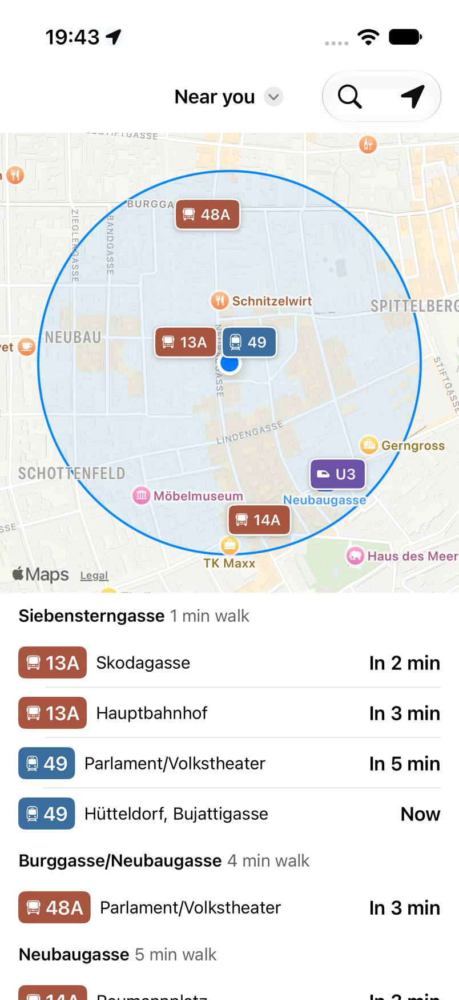
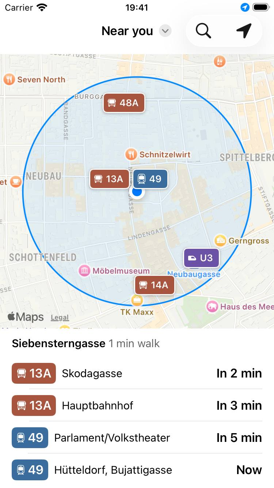
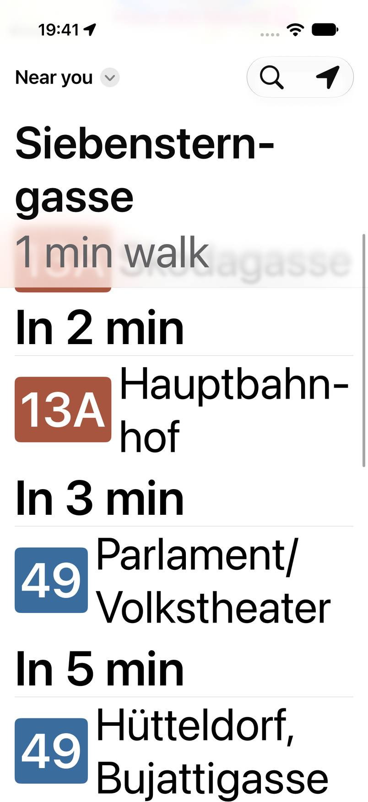
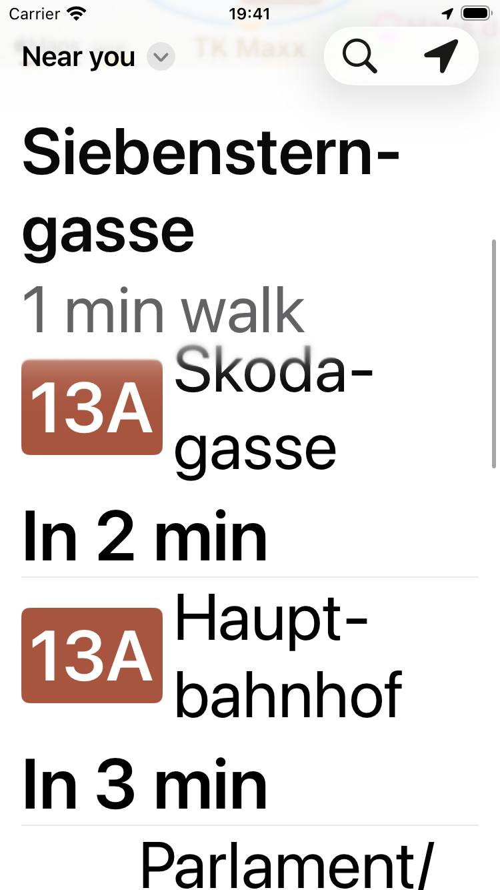
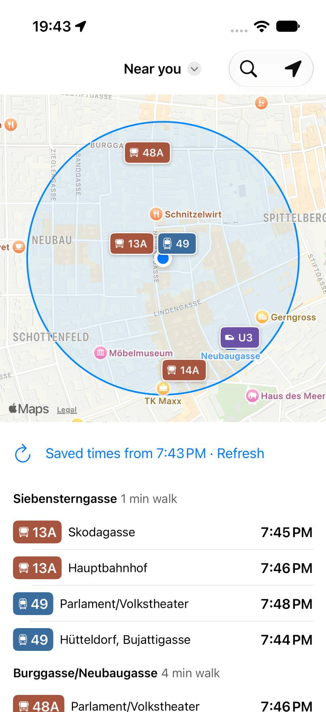
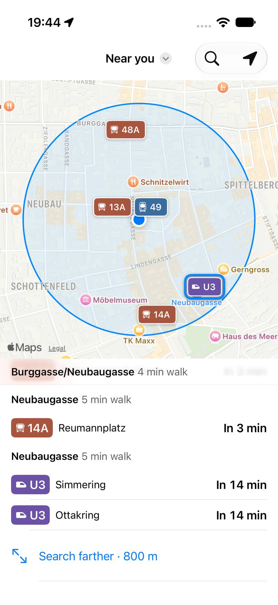
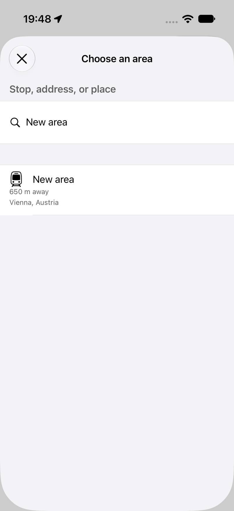
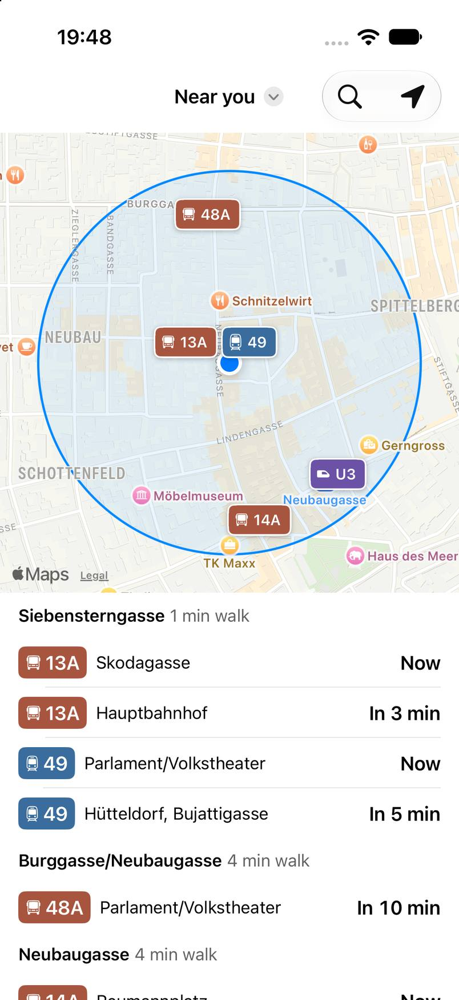

# Two screens — Phase 1 validation

16 November 2026. Implements the home screen in [the two-screen plan](ios-two-screens.md). Phase 0 is in production through PRs #26 and #27. This phase does not change the app version or distribute a build.

## Acceptance

| Measure | 1.1 (6) baseline | Phase 1 result |
| --- | --- | --- |
| Vienna sample | 17 running rows, 56 idle options | Exactly 8 rows at 4 physical stops, in both the derived fixture and production at 19:48 CET |
| Duplicate line and destination | Repeated across stops | 0; service identity includes transport mode, line name and destination |
| Stops per line | Repeated across stops | At most 2 in selection tests; sample has 1 per line |
| Map | Separate sheet | 402 × 402 pt on iPhone 17 Pro; 375 × 375 pt on SE |
| Fully visible default rows | Previous list used the whole screen | 5 on 17 Pro, 4 on SE; targets ≥5 and ≥3 |
| Single-line row height | 52 pt | 44 pt |
| Opening requests | 1 stops + 10 departures + 10 walks = 21 | 1 stops + 1 batch + 4 walks = 6 |
| Departure requests per refresh | 10 | 1 batch; no per-line fallback |
| Failed refresh | Promoted failed/idle rows | Same identities and order; clock times and one refresh banner |
| Chosen area after scrolling | Old offset retained | List returns to top; square map recenters |
| Search subtitle / distance contrast | 1.99:1 / 4.02:1 | Both 5.99:1 on white; header 5.37:1 on grouped background; primary text 21:1 |

The 8 sample rows are 13A toward Skodagasse and Hauptbahnhof plus 49 toward Parlament/Volkstheater and Hütteldorf at Siebensterngasse; 48A toward Parlament/Volkstheater at Burggasse/Neubaugasse; 14A toward Reumannplatz at Neubaugasse bus stop; and U3 toward Simmering and Ottakring at Neubaugasse U3. U3 follows the provider's order. Core Location measures the U3 stop at 326 m when rounded, versus 325 m in the plan's table; the fixture allows 1.5 m measurement tolerance.

## Checks and provenance

- `xcodebuild … -destination 'platform=iOS Simulator,name=iPhone 17 Pro,OS=27.0' … test`: **66 unit + 16 UI tests passed**. After the final search header color adjustment, the affected search/area-reset UI test passed again.
- `xcodebuild … -destination 'platform=iOS Simulator,id=F935035F-D36A-4855-B7EE-D83AF4BA1704,OS=26.2' … test` with the default-density and accessibility-layout tests selected: **2 passed** on iPhone SE (3rd generation). Its first boot completed before testing. Full suites on all three destinations belong to Phase 3.
- Unit tests cover rules 1–6, the exact 17-platform sample, one-way pairs, three destinations, pinned duplicates, missing line metadata, the 60-minute boundary, provider timestamps, cancellation, request coalescing, partial/failing responses and atomic publication after touch ends. Countdown changes are checked against the whole snapshot, including services at multiple stops and changed/idle departures.
- UI tests cover S1–S11, both map actions, pin/deep-link persistence, default and largest accessibility text, and app-drawn 44-pt rows. The system toolbar, menus and swipe actions retain their native styling; their accessibility frames are not used as hit-region measurements.
- Search foreground colors were sampled from exported PNGs before JPEG compression. The subtitle/distance and header use `#636366` rather than the tint color. Dark uses `#AEAEB2` (7.69:1 against `#1C1C1E`); the actual dark-mode run is reserved for Phase 3 on iOS 26.2.
- **Fixtures:** the shared test-only sample keeps the platform geometry and relevant service identities from the supplied 16 November responses, with small relative-time departure lists. No raw provider response is committed. Live/delay behavior is fixture-only.
- **Preview:** Phase 0's protected Vercel preview passed Vienna and Berlin checks, including 50 requested IDs. The Berlin difference between two-per-line batch and four-per-line legacy calls remains documented in [Phase 0 validation](ios-two-screens-phase-0-validation.md).
- **Production backend:** after merging #26 and #27, Vienna returned 17/17 boards and Berlin 24/27, with the same three genuinely absent boards as preview. The comparison run had no departure mismatches. A wider Vienna query returned 26/26. A CDN hit retained the original `fetchedAt`.
- **Production app session:** Debug app through a logging proxy at `(48.20134, 16.34941)`, 19:48–19:49 CET. Exactly 8 published rows at 4 stops, no missing boards, 6 opening requests plus 1 batch refresh 30 seconds later, all HTTP 200. All returned departures were scheduled. Session ended after the first refresh. Raw proxy logs stay outside git.
- `git diff --check` passed. App device family remains `1`; deployment target remains iOS 26. No backend code changed in this phase, so Phase 0's 95-test backend/lint/build result applies.

## Decisions made

- A partial response freezes all existing row membership and order until a complete response, while updating available times. This prevents a missing nearer platform from promoting a farther duplicate. First-load missing platforms get one retry row per physical stop.
- Within a merged physical stop, duplicate services use the nearest eligible platform while retaining the first provider position. Sections use computed distance; walking responses never reorder them.
- Old stored pins with the same service at different platforms display once, using the first pin in pin order. Stored pin identities remain unchanged for Shortcuts and deep links.
- The persisted home snapshot is separate from the detail's four-departure cache. A detail open still fetches four departures even when home already supplied two. Tests use an unreachable loopback endpoint for the host app, so unit-test startup cannot silently hit production.
- The map keeps the native selection callback. XCUITest waits for that callback after MapKit's tap animation; an immediate assertion ran before selection and was corrected. All temporary diagnostic logging was removed.
- Phase 1's PR targets `main`, because the owner has already merged its Phase 0 base into `main`. Later open phases remain stacked; each must be retargeted to and merged into `main` in order with approval.

## Captures

Eight upright JPEGs at 2× total **834,613 bytes**. These are the only new images. UI tests regenerate the other captures; full sets are not committed or put on an evidence branch. Exported result bundles were removed after capture export.

| Default 402 pt | Default 375 pt |
| --- | --- |
|  |  |

| Largest accessibility, 402 pt | Largest accessibility, 375 pt |
| --- | --- |
|  |  |

| Saved times | Selected map stop |
| --- | --- |
|  |  |

| Search contrast | Production at 19:48 CET |
| --- | --- |
|  |  |

## Remaining verification

Phase 2 replaces the old detail, advice and route sheet; Phase 3 removes retired code/strings, restores portrait-only, checks Release, pseudolocalization and dark mode, and runs all suites on all three destinations. Provider quota/latency under load and a capped hub remain unverified. VoiceOver speech, haptics and GPS accuracy require a device. No TestFlight build is authorized by this phase.
