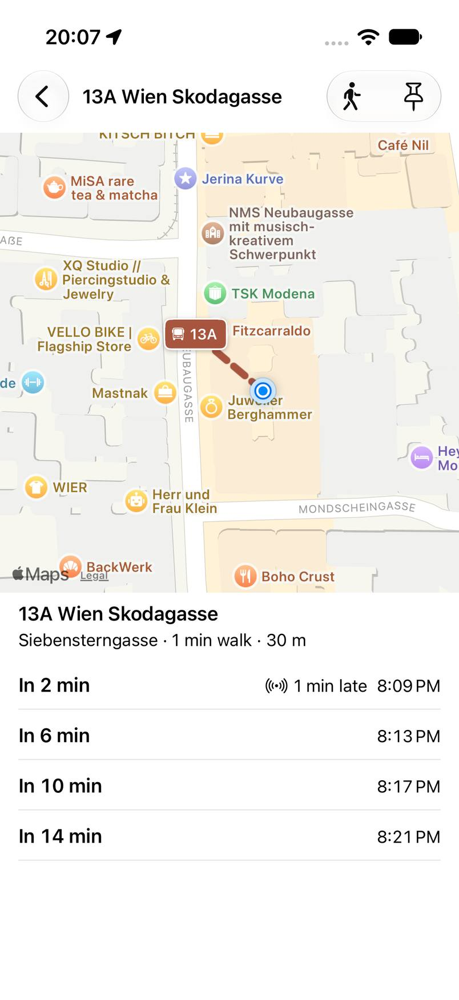
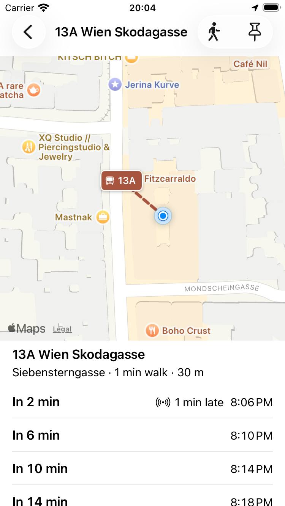
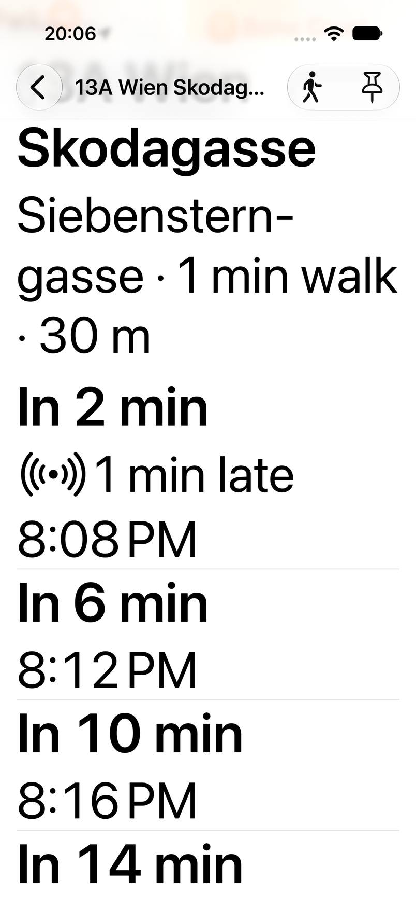
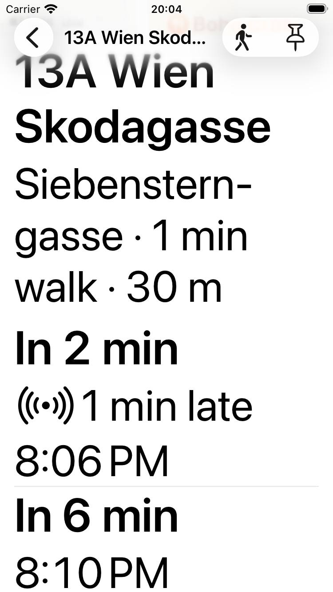
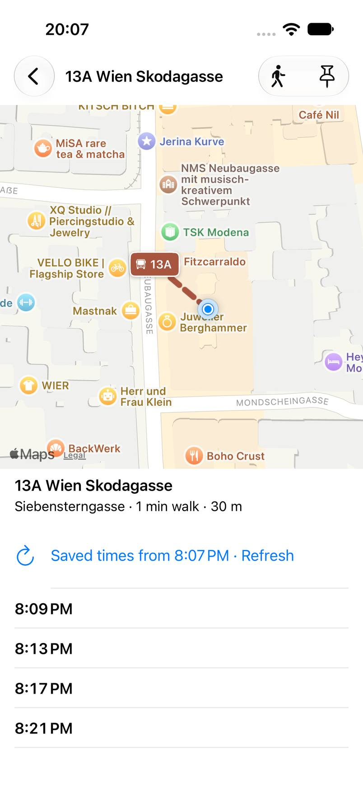
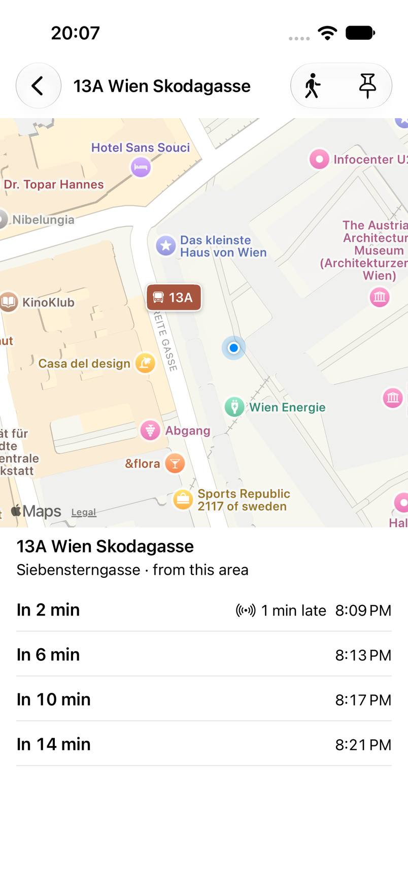
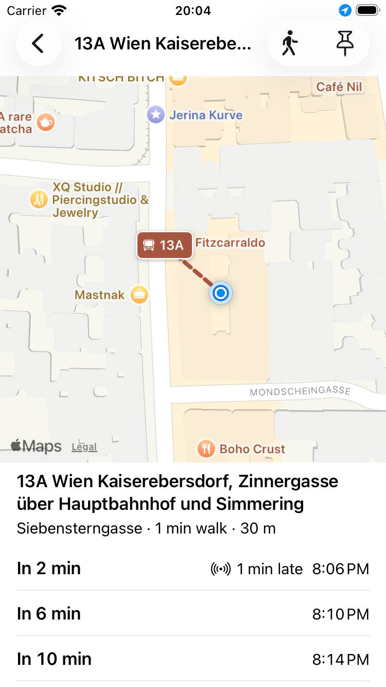
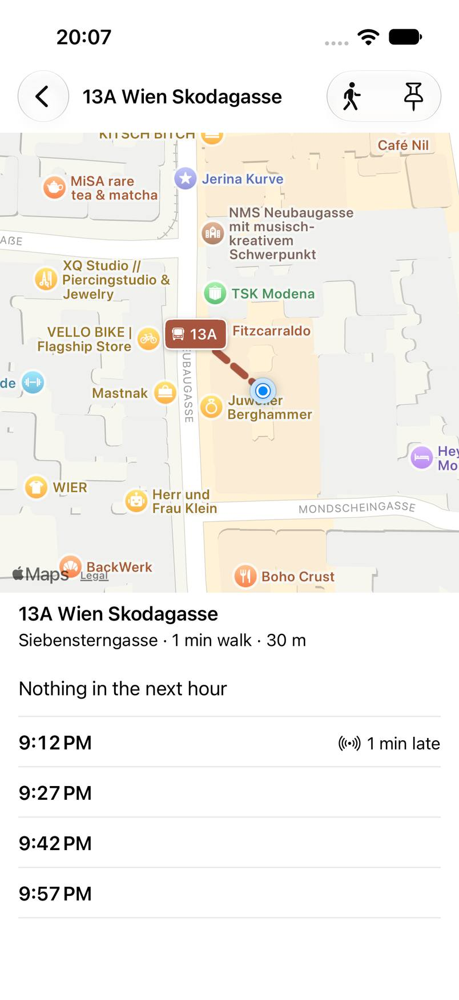
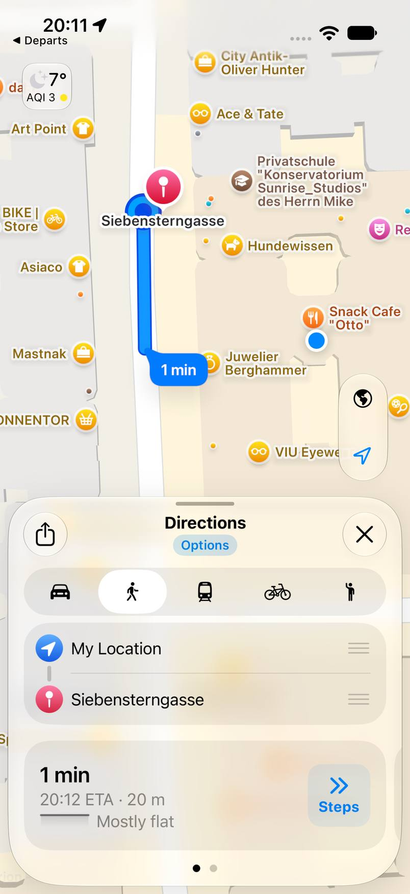

# Two screens — Phase 2 validation

16 November 2026. Replaces the old advice/detail screen with the line screen in [the two-screen plan](ios-two-screens.md). Stacked on Phase 1, PR #28. No version, build number or distribution changes.

## Acceptance

| Measure | Previous design | Phase 2 result |
| --- | --- | --- |
| Stop name | Content heading | Once in the line's stop/walk summary; map drawing shows the line badge |
| Map | A separate route sheet, one tap away | Immediate square walking-route map: 402 × 402 pt / 375 × 375 pt |
| Default departures visible | Advice before departures | 4 on iPhone 17 Pro; 3 on SE, fourth after one scroll |
| Failed refresh | Advice card refresh | Four saved clock times, one Refresh button; one successful per-line request restores countdowns |
| Directions | Bottom toolbar | System top-bar walking action targets the selected platform |
| Pinned entry | Shortcut and deep link | Stable identity retained; App Intent perform test and UI deep-link test reach the selected line |
| Largest accessibility text | Long advice before answers | Square map scrolls away; full destination, stop/walk and departure text wrap |

The default departure rows are 44 pt high. SE's list is 218 pt high, starting at y=449. The wrapping service heading plus stop/walk summary uses 58.5 pt in the sample, leaving three complete departure rows. Long headsigns use additional lines rather than being clipped; the density acceptance uses the plan's default sample.

## Checks and provenance

- Full `xcodebuild … test` on iPhone 17 Pro, iOS 27.0: **72 unit + 23 UI tests passed**. After the final cache-ownership regression was added, the full unit suite passed again on SE/iOS 26.2: **73 tests**. The Apple Maps test passed again with an explicit walking-mode assertion.
- SE/iOS 26.2 default density, largest accessibility layout and long-destination checks: **3 UI tests passed**. One earlier long-title test incorrectly expected a two-line height for text that fitted on one line; its fixture now uses a genuinely long destination and passes.
- Apple Maps opened the selected platform as **Siebensterngasse**, with **Walk selected**. The platform's exact latitude/longitude is also asserted in the unit test, independently of Maps' displayed place name. No navigation session was started.
- `git diff --check` passed. Build output is outside the repository, reused per destination. App target remains iPhone-only with iOS 26 minimum. No backend changes; Phase 0's backend tests/lint/build apply.

The new tests cover the two-to-four-departure handoff, correct walking platform, keeping four times after a later home batch, independent home/detail failure states, one-refresh recovery, the 60-minute clock boundary, minute-floor delay formatting, scheduled departures without a marker, long destinations, missing walking routes and area-origin wording.

- **Fixtures:** in-process HTTP server for all app state and layout checks. The walking fixture ends exactly at the requested platform. Its straight segment is a test route, not live walking geometry. Live/delay styling uses fixtures because Vienna's provider responses have been scheduled only.
- **Preview/backend production:** Phase 0's two-location verification and the Berlin provider-limit difference remain as recorded in the Phase 0 and Phase 1 validation documents. This phase changes no backend code.
- **Production app:** Phase 1's 19:48 CET home session verified 8 rows/4 stops and the 6-opening/1-refresh request budget. The new line-screen states in this phase are fixture-verified; a final live session belongs to Phase 3.
- **Device-only checks:** spoken VoiceOver output, Siri/Shortcuts system invocation, haptics and physical GPS/navigation remain device checks. The real App Intent's `perform()` and navigation identity are unit-tested; the `departs://pin` entry is exercised in UI tests.

## Decisions made

- Keep the full line/destination in the system navigation title and repeat it as a wrapping content heading under the map. Native titles can truncate and do not follow accessibility text size; the content heading keeps the boarding destination readable. This still meets the three-departure SE target.
- Home supplies two initial times. Once a per-line request begins, later home batches cannot replace its board or clear its failure. A failed home request also keeps its cached times saved when that line opens, until the line request succeeds.
- The line's saved state keeps the received departure order and clock times. Beyond 60 minutes, it shows the next clock times alongside the calm “Nothing in the next hour” state. Saved rows omit live/delay claims.
- The map draws an explicit walking-origin dot, including a searched-area origin, so both endpoints remain present when the route request fails. MapKit still supplies the current-location indicator separately.
- The Apple Maps destination uses the iOS 26 `MKMapItem(location:address:)` initializer, verified in the installed SDK header. No iOS 27-only API was introduced.
- All toolbar controls remain system items declared with a title and symbol. No custom hit-region frames, principal menus or bottom toolbar are added.

## Captures

Nine upright 2× JPEGs total **833,554 bytes**. Only these curated images are committed; UI tests regenerate the rest. There is no evidence branch. Result bundles were removed after exporting their attachments.

| Default 402 pt | Default 375 pt |
| --- | --- |
|  |  |

| Largest accessibility 402 pt | Largest accessibility 375 pt |
| --- | --- |
|  |  |

| Saved times | Missing walking route |
| --- | --- |
|  |  |

| Long destination at 375 pt | Beyond the hour |
| --- | --- |
|  |  |

## Landing

Merge only with owner approval. Phase 1 must reach `main` first; then retarget this PR from the Phase 1 branch to `main`, inspect the resulting diff/checks and merge. Phase 3 follows the same sequence. Backend-first is satisfied by #26/#27; it does not authorize TestFlight distribution or version 1.2 preparation.
