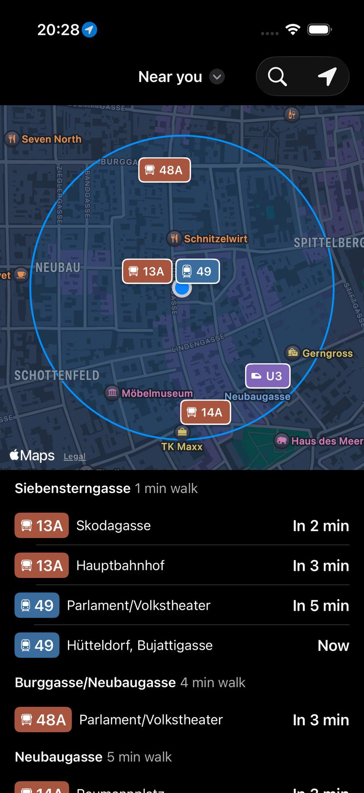
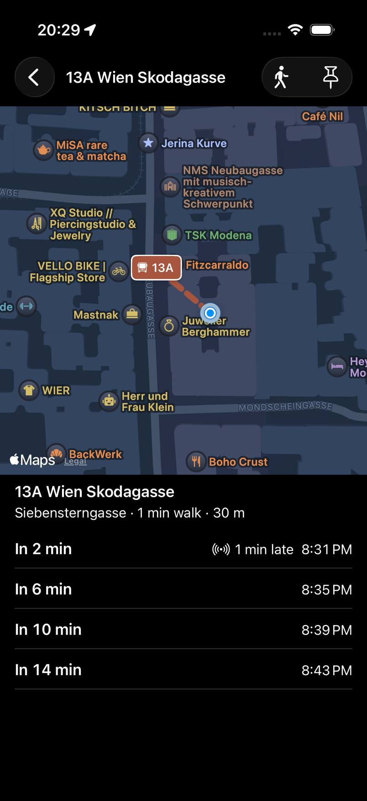
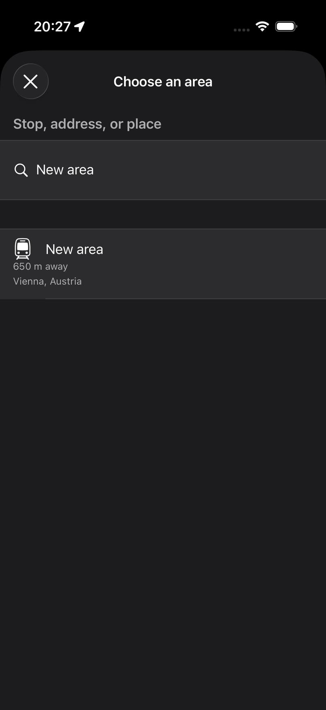
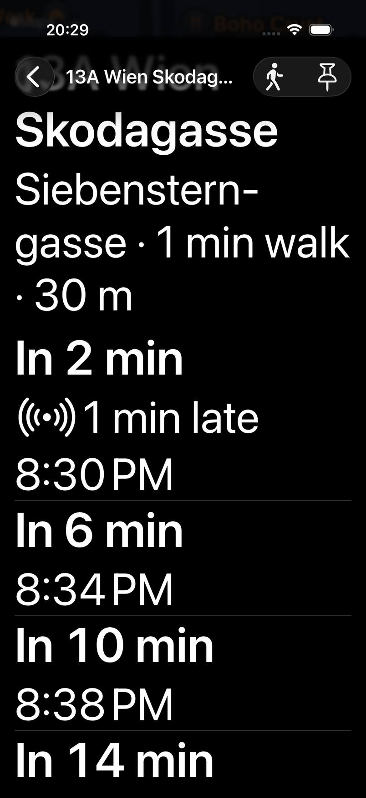
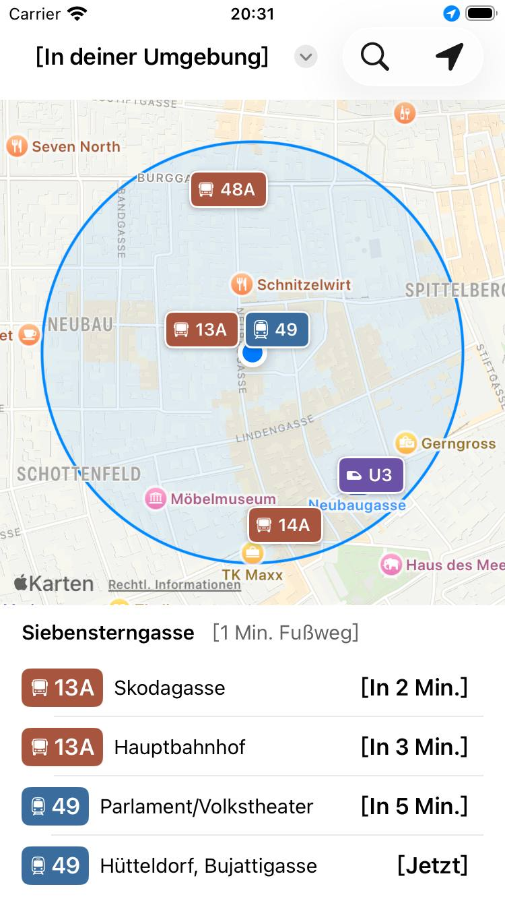
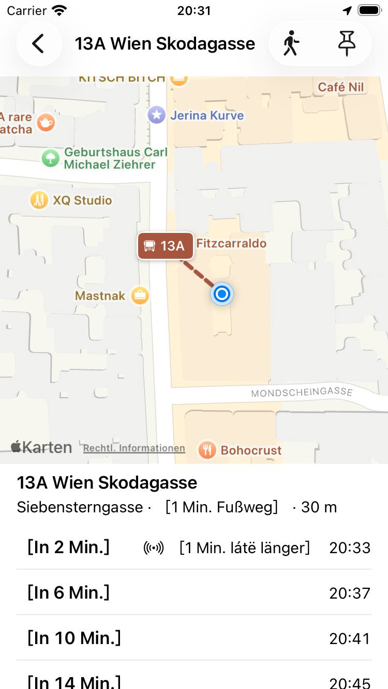
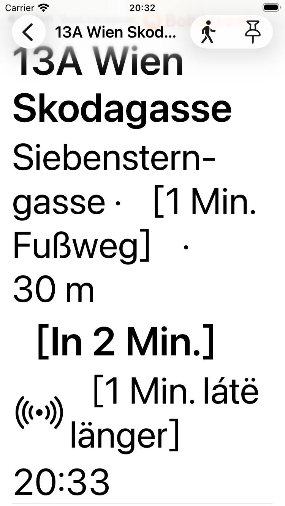
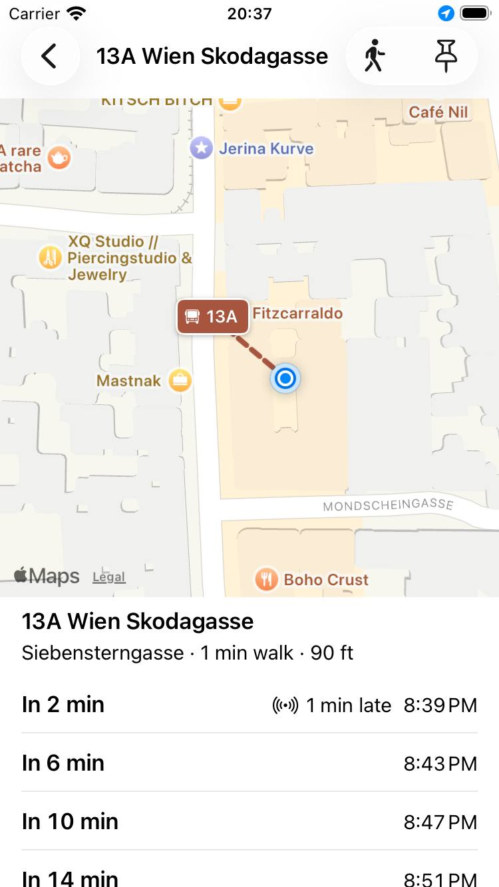
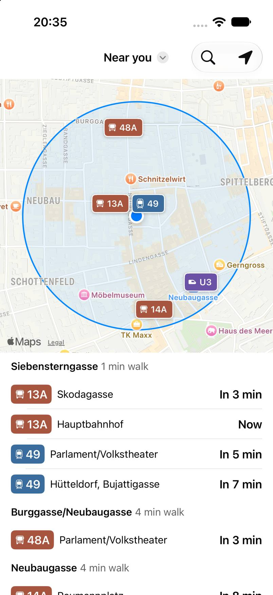
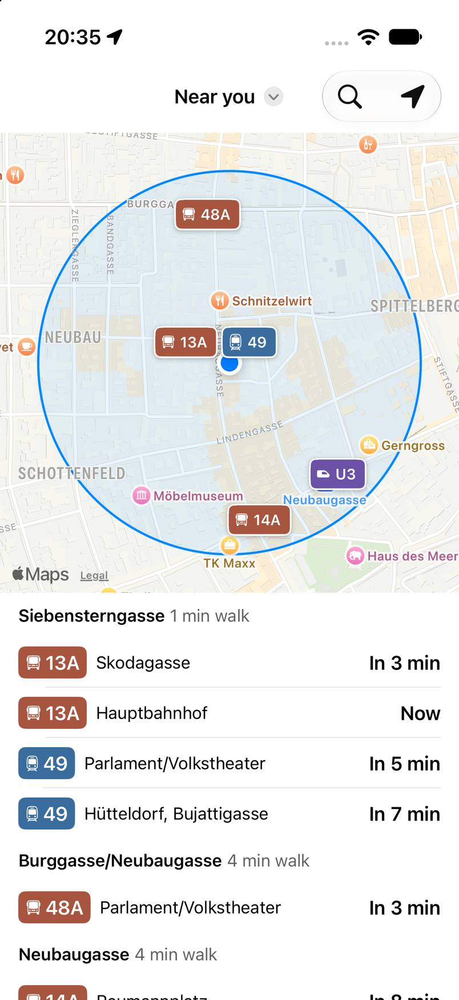

# Two screens: Phase 3 validation

16 November 2026. Final cleanup and verification of the [approved two-screen plan](ios-two-screens.md), stacked on [home #28](https://github.com/p3ob7o/Departs/pull/28) and [line #29](https://github.com/p3ob7o/Departs/pull/29).

## Changes

Removed the remaining leave-advice model, presentation code, strings and tests; idle-line and coverage-bound state; unused grouped client and fallback error; the Debug size host and resize previews. The home snapshot and shared session stay. The app returns to portrait only on iPhone, with device family `1`. Info.plist preprocessing includes local networking only in Debug.

Active behavior and workflow docs now describe the two-screen product. PRs #18 and #19 are marked as needing rewrites; their branches are unchanged. Version 1.1 and build 6 are unchanged. No build was uploaded.

## Acceptance

| Requirement | Result |
| --- | --- |
| iPhone 17 Pro, iOS 27.0 | 62 unit and 24 UI tests passed |
| iPhone 17 Pro, iOS 26.2 | 62 unit and 24 UI tests passed, in dark appearance |
| iPhone SE 3rd generation, iOS 26.2 | 62 unit and 24 UI tests passed |
| German pseudolocalization | Passed on SE, default and accessibility XXXL; reviewed expanded home and line captures, no clipped/concatenated content |
| Live Vienna sample | 8 rows at 4 physical stops, exactly the Phase 1 table |
| Opening / refresh requests | 6 opening requests: 1 stops, 1 batch, 4 walks; 1 batch per refresh |
| Dark appearance and contrast | Dark maps, bars and lists on 26.2; search secondary text `#AEAEB2` on `#2C2C2E` measures 6.30:1 |
| Release | Simulator Release build and signature check passed; no test hooks or local-networking exception, production data loaded directly |
| Shipping configuration | iPhone family `1`, portrait only, iOS 26 minimum; unchanged version 1.1, build 6; English only |

All runs use `xcodebuild … test`, normal simulator signing, explicit UUID/runtime destinations, `-parallel-testing-enabled NO`, and one reused derived-data directory per destination outside Git. The new SE simulator completed `bootstatus -b` before testing. The owner's booted iPhone 17e was not used.

The map remains 402 × 402 pt with a 356-pt list on both 17 Pro runtimes, showing five full home rows and four line departures. The SE has a 375 × 375-pt map and 218-pt list. It shows four full home rows and three line departures, with the fourth after one scroll. App-drawn default rows remain 44 pt. Phase 1 and Phase 2 validation contain the earlier captures and baselines.

Run the German stress test with `python3 ios/scripts/test-pseudolocalization.py <SE_UUID> 26.2 /tmp/departs-pseudo /tmp/departs-derived-se26`. It adds an expanded German catalog to a disposable copy, verifies that it loaded, and checks both text sizes. Scroll gestures start below the map so they scroll the list rather than pan MapKit. The repository and Release bundle contain English only. The catalog now has 77 active keys; 74 retired keys were removed and 19 current keys added.

## Production and Release

The final cold Debug session at `(48.20134, 16.34941)` ran from **20:34:46 to 20:35:18 CET on 16 November** through a logging proxy. A fresh proxy address and preferences avoided URLCache hits for the opening budget. The seven API calls were one stops, two batches and four walks, all HTTP 200. Each batch returned 17 boards and 56 departures, all scheduled. Both batches retained the same provider timestamp, demonstrating CDN age rather than a newly assigned receipt time. Published rows matched the plan exactly with no missing boards.

An earlier warm session used cached stops/walks and made only two batch calls. It is excluded from the cold-opening measurement. Both proxies were stopped after their short sessions. Raw responses are excluded from Git and removed with task output.

The Release build launched from **20:35:52 to 20:35:59 CET** with an unreachable `DEPARTS_API_BASE_URL=http://127.0.0.1:9`, test-search/viewport flags and a fresh preferences override. It ignored those hooks, loaded a new production snapshot with the same eight rows and wrote no test preferences suite. Binary inspection found the production host and none of the test environment names, fixture paths, `TransitSample`, `PreviewData` or layout host. The processed Info.plist has no `NSAppTransportSecurity` exception. `codesign --verify --deep --strict` passed. This is a simulator Release build, not an archive, upload or Apple distribution validation.

No backend code changes in this phase. Phase 0's `npm ci`, 95 Vitest/MSW tests, lint and production build remain the backend verification. `git diff --check` passes. Fixture live markers do not establish provider realtime coverage.

## Findings from 1.1 (6)

| Finding | Test or recorded check |
| --- | --- |
| T1: failure promotes rows | `testFailedBatchKeepsEveryRowAndTimeButUsesClockWithoutFanout`, `testPartialRefreshRetainsOrderAndNeverPromotesHiddenLines`, failed-refresh UI recovery; one snapshot holds rows and boards |
| T2: unexplained provider 500 | Phase 0's 95 backend tests cover retry, sanitized status/error logging and batch 502; legacy error status stays compatible |
| T3: changed area retains scroll | `testChoosingAreaResetsListToTopAndSearchTextIsNotTinted`; map/list reset after a moved fixture coordinate |
| T4: ten departure requests | Unit opening budget plus UI proxy counters; final live proxy session below |
| T5: first stops failure looks empty | `testFirstStopsFailureShowsErrorAndTryAgain` and store test; separate failure, no-stops and no-departures states |
| T6: denied notice persists after search | `testDeniedLocationOffersSettingsAndChosenAreaRemovesNotice` |
| T7: low-contrast search text | Phase 1 sampled light colors and contrast; dark captures below verify the iOS 26.2 appearance |
| T8: landscape toolbar overlap | Configuration test asserts portrait only; walking and pin actions are standard top toolbar items; old map sheet action removed |
| T9: recovery actions look like plain text | UI target checks and captures for saved, partial, first-load failure, empty and denied states; actions retain tint and a symbol |
| T10: empty spoken sentence | `testCountdownLeavesOrderUntouchedAndRowsSpeakNoDecorativeState`; full destination and stop in the row label, no empty sentence |
| T11: Selected trait on answers | Same UI test and both accessibility-size tests assert rows are not selected |
| T12: wrong denied location label | Denied/chosen-area UI test asserts "Location is off" on the native location control |
| T13: map badge text size | Intentional 18-pt cap in map wrappers; largest accessibility captures show fully scaled list text |
| T14: stale other-lines state | Other-lines section and its loader/presentation paths removed; source search confirms no retained implementation |
| T15: advice below first SE screen | Advice removed; SE line test measures three visible departures and reaches the fourth in one scroll; accessibility map scrolls away |
| T16: CDN age hidden | Timestamp starts at successful provider attempt; unit tests age by `fetchedAt`; preview/production CDN HIT kept that timestamp |
| T17: local networking in Release | Info.plist Debug-only definition, configuration unit assertion and Release package inspection below |

## Decisions made

- Retain compatibility for existing saved pins and boards. Removing the optional coverage field is safe because Swift's decoder ignores that old key; the line cache otherwise keeps its shape.
- Keep the provider's timestamp on home. The unchanged per-line array has no timestamp, so the line request retains its existing receipt-based check time. No backend contract extension beyond Phase 0 is added.
- Preserve the content copy of the full line/destination because the native navigation title can truncate and does not scale. Phase 2 records the extra heading height and small-screen density.
- Reuse each simulator destination's derived-data directory for pseudolocalization and Release. The temporary German catalog lives in a copied project outside Git and is deleted after testing.
- Test visible saved rows instead of assuming four offscreen rows exist in XCUITest's lazy-list tree. Store tests verify retention of all four, and the density UI test separately verifies the fourth after one scroll.

## Verification boundaries

Fixtures cover live markers, delays, partial boards, outages, empty nighttime states, text size, unit formatting and recovery. They do not establish live provider coverage. The protected Phase 0 preview checked Vienna, Berlin and 50 IDs. Production checks after #26/#27 confirmed both locations and CDN timestamp behavior; [Phase 0 validation](ios-two-screens-phase-0-validation.md) records the Berlin preview time difference under different per-line limits.

Provider quota/cost, latency under load, a platform hitting the 50-departure cap and operator-wide realtime coverage remain unmeasured. Physical-device VoiceOver speech, haptics, GPS, Home Screen appearances, Siri/Shortcuts discovery and mobile-data startup remain device checks. The simulator tests Intent execution and deep-link navigation, not Siri invocation.

## Landing and release order

Plan #26 and backend #27 are merged into `main` and deployed. Native #28, then #29, then this phase must each reach `main`, retargeting the next after the previous merge. All remain drafts until the owner approves landing. Recheck the production batch endpoint before any distributed build. Version 1.2 preparation and TestFlight upload need a separate owner instruction.

## Captures

Ten upright 2× JPEGs total **972,462 bytes**. These are the only images added by this PR. Full sets are discarded after export; there is no evidence branch. The preceding phase documents hold the light/default and accessibility baselines.

| Dark home | Dark line |
| --- | --- |
|  |  |

| Dark search | Dark accessibility text |
| --- | --- |
|  |  |

| German stress home, SE | German stress line, SE |
| --- | --- |
|  |  |

| German accessibility text, SE | US units, SE |
| --- | --- |
|  |  |

| Production through the Debug proxy | Release directly against production |
| --- | --- |
|  |  |
