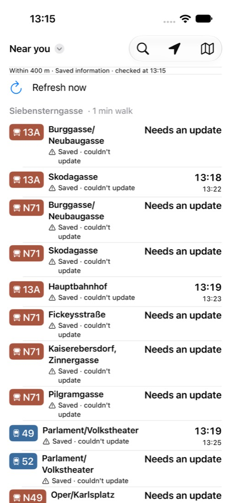
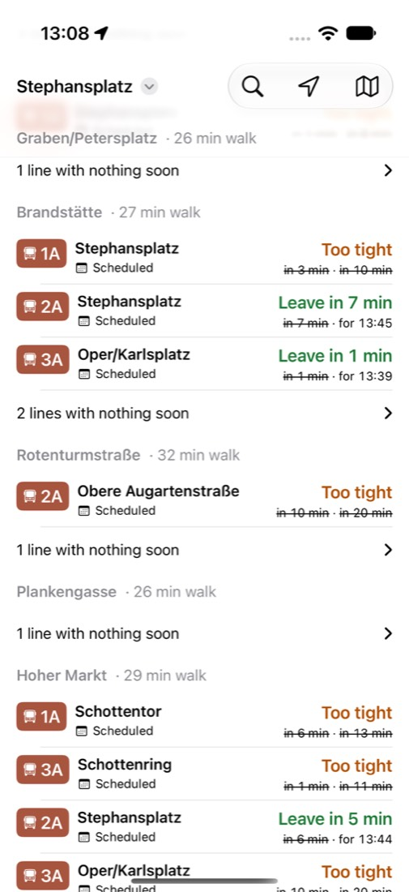
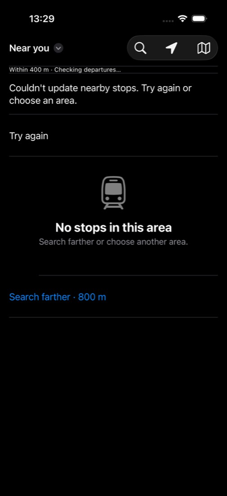

# Two screens: map over list

| | |
| --- | --- |
| Status | Approved on 16 November 2026, including O1–O9 and A1–A9. Implementation and final evidence: [Phase 3 validation](ios-two-screens-phase-3-validation.md). Amended the same evening by O10–O12: see [Amendment: around you only](#amendment-around-you-only). Amended again on 17 and 18 November by O13–O17: see [Second amendment: the map at the top](#second-amendment-the-map-at-the-top). Amended on 18 November by O18: see [Third amendment: the map under the status bar](#third-amendment-the-map-under-the-status-bar). Amended on 19 November by O19: see [Fourth amendment: a tap on a map label](#fourth-amendment-a-tap-on-a-map-label). Amended later on 19 November by O20–O23: see [Fifth amendment: the line screen's controls under its map](#fifth-amendment-the-line-screens-controls-under-its-map). Amended on 22 November 2026 by O24: see [Sixth amendment: pins in the current city](#sixth-amendment-pins-in-the-current-city). |
| Date | 16 November 2026 |
| Based on | Departs 1.1 (6), `main` at `6430c94` |
| Branch | `feat/ios-two-screens` |
| Replaces | The list, detail and map design in [ios-design-improvements.md](ios-design-improvements.md): its sections 1 to 5 and 7, and the split view and landscape work of its Phase 5 |
| Keeps | That plan's accessibility repairs, string catalog, icon variants, mode colors, pins, and the 60-second freshness rule. Search with recent places was kept at first and removed by O11 |
| Affects | The iPhone Duo and iPad plans (PRs #18 and #19). Both must be rewritten on top of this plan |

## Summary

The owner redefined the product on 16 November 2026. Departs shows which transport is available around you. It is not a complete timetable. The app becomes two screens with the same shape: a square map on top and a short list underneath.

Departs 1.1 (6) was tested against the previous plan on the same day. It met that plan while every request succeeded and broke down when one failed. This plan fixes those findings or removes the screens they belonged to.

At the Vienna test location, on the 16 November sample:

| | 1.1 (6), measured | This plan |
| --- | --- | --- |
| Rows in the home list | 17 running, plus 56 idle lines behind 7 disclosure rows | 8 |
| Requests when the app opens | 21 (1 stops, 10 departures, 10 walking routes) | 6 (1 stops, 1 departures, 4 walking routes) |
| Departure requests per 30-second refresh | 10 | 1 |

The work has four phases. Phase 0 is the backend. Phases 1 and 2 build the two screens. Phase 3 removes what is retired and verifies the result.

## Owner decisions

Paolo made these on 16 November 2026. They are settled.

| ID | Decision |
| --- | --- |
| O1 | A line with no departure in the next 60 minutes is not shown. The "N lines with nothing soon" rows go. |
| O2 | A line appears once per direction, at the nearest stop where it leaves soon. It is not repeated at farther stops. |
| O3 | Rows say less: badge, destination and "In N min". "Scheduled" and the calendar symbol go everywhere. Stop headers stay. |
| O4 | Leave advice goes everywhere: "Leave in", "Leave now", "Too tight" and crossed-out times. People can count. |
| O5 | Home is a square map on top with the list underneath. The layout is always vertical. |
| O6 | Tapping a row opens the line screen: the walking route on a square map, and the next four departures of that line underneath. |
| O7 | The home map has one label per stop, showing its line numbers. Tapping it opens the line when the stop has one row. Otherwise it scrolls the list to that stop. This is a trial. The trial ended on 19 November: O19 replaces the second half. |
| O8 | Pins stay for now. A pinned line with nothing soon is still shown, dimmed. The owner is undecided about pins as a whole. |
| O9 | iPhone Duo and iPad will put map and list side by side, later. |

Where this plan fills a gap the owner did not decide, it says so and lists the choice under [Accepted choices](#accepted-choices) as A1 to A9.

## Amendment: around you only

After Departs 1.2 (7) reached TestFlight, Paolo added three decisions on the evening of 16 November 2026. They are settled, and they ship as Departs 1.2 (8).

| ID | Decision |
| --- | --- |
| O10 | The search radius is 400 m, always. "This app is minimalistic and opinionated. It looks in a 400m radius, period." The "Search farther" link and its 800 m and 1600 m steps go. |
| O11 | Place search goes entirely: the search button, the title menu, recent places and every "Choose an area" action. The app shows only what is around you. |
| O12 | With location off, the app shows pinned routes only. |

These follow from the three decisions and were chosen while implementing them. Paolo has not reviewed them one by one.

| ID | Question | Choice |
| --- | --- | --- |
| A10 | What stays in the top bar | The location button, as in the option Paolo picked. It asks for a new fix and brings a panned map back to the circle. The title is plain text |
| A11 | What "pinned routes only" means for the last area | With location off the last area is forgotten, not refreshed. Every saved pin is reachable behind "Pinned elsewhere (n)", because there is no area centre (A44). A pinned line opened then shows its stop without a walking origin |
| A12 | No usable fix: none within 8 seconds, an error, or accuracy worse than 100 m, which is what Precise Location off produces | Without a saved area: "Couldn't find your location. Check that Precise Location is on.", with "Try again" and "Open Settings". With a saved area the list stays, titled "Last area". Before, home waited on "Finding departures…" for a request that was never made |
| A13 | Saved data from 1.2 (7) that describes a searched place or a wider radius | Discarded on first launch |
| A14 | The backend | Unchanged. The app still sends `radius=400`. The endpoint keeps accepting 100 to 2000 m for installed builds |
| A15 | A new fix at the same spot | Within 150 m the centre of the area stays, and stops older than five minutes are refreshed in place. Found by the test of 1.2 (7): on a phone the list was emptied and reloaded about every five minutes, because two fixes never have identical coordinates |

The home sketch, the states table and the risks below are updated. The phases, test findings and appendices keep their original wording as a record. T6, T7 and T12 concerned search results and a chosen area. They no longer apply.

## Second amendment: the map at the top

Paolo used Departs 1.2 (8) on his phone and asked for four corrections on 17 November 2026, each with an annotated screenshot. On 18 November he corrected how the first had been read, and added O17 after seeing the first implementation. These are settled.

| ID | Decision |
| --- | --- |
| O13 | Home has no bar, and the map takes its place. "Remove "Near you" and the location button at the top. The map should start at the top of the viewport, and remain centered on the current location at all times (even when moving)." Then: "The map should remain square." And on 18 November: "the map shouldn't occupy the status bar. That remains with time, bars, dynamic island, etc. The space I wanted the map to use is what was before reserved for "Near me" and the location button on the right." The square's top edge is the bottom of the status bar. The rider and the ring are centred in the whole square, at the scale of 1.2 (8). |
| O14 | A stop's name leaves with its last line. "I like the name of the stop remaining stuck as we scroll up, but it should disappear once no more lines are visible for that stop." Reviewed on 17 November: the name stays while the stop's lines pass under it and leaves together with the last one, name first. It never covers the last line. A stop with one line does not stick. |
| O15 | "The direction names should be left aligned, regardless of the width of the pill on their left." |
| O16 | "We don't need "In " in front of each time here." |
| O17 | A line's badge shows its number and letter identifier only. At Berlin Alexanderplatz one provider line is called "FlixBus N70", and its badge widened the shared column (O15) for every row: "Let's solve that by using only number/letter identifiers, so "FlixBus N70" becomes "N70"". |

O13 supersedes A10: there is no location button. Pull to refresh asks for a new fix as well as new times.

These choices filled the gaps. Paolo reviewed A17 to A22 on 17 November. A20, A23 and A24 have not been reviewed by him. A16 is not used: an earlier proposal for the map's size was withdrawn, and O13 records the owner's own decision instead.

| ID | Question | Choice | Review |
| --- | --- | --- | --- |
| A17 | Pan and zoom on the home map | None. Nothing could bring a moved map back, and it stays centred. The line screen's map stays interactive | Approved |
| A18 | The 400 m ring | Drawn around the point the map is centred on, beneath the stop labels. The list's area still changes only after a 150 m move (A15), so for a while the ring can be ahead of the stops listed. The framing never depends on the ring: hiding it is one line, `StopsMapView.showsRing` | Approved. "Ok, although I plan to hide the circle later, but still thinking about it." Hidden on 19 November by O23 |
| A19 | No usable location, but a saved area | The map stands on the saved area's centre, with the ring. Once the location request has failed, one tinted row at the top of the list reads "Couldn't find your location · Try again". It replaces the "Last area" title and the location button's retry, and never shows while a request is still running | Approved |
| A20 | What the map centres on | In order: MapKit's live location when it is precise (100 m or better) and the app holds a usable fix; else the app's usable fix; else the saved area's centre; else nothing, with no ring. MapKit's coarse location, which Precise Location off gives, never moves the map. The app's own fix arrives only every 30 to 60 seconds, so MapKit's location is what makes the map follow a walk | Not reviewed |
| A21 | Destinations at accessibility text sizes | No shared badge column. Rows stay as they are, because a wide column would force more wrapping | Approved |
| A22 | "In" on the line screen | Dropped as well: "12 min" on the left, "00:00" on the right, so the two screens read the same. The owner pointed at the home list only | Approved |
| A23 | How a pinned stop name looks | It sits on the list's own background, so the lines passing under it are hidden instead of showing through, blurred. At standard text sizes the list has no top edge effect, and the name is drawn as one layer. In 1.2 (8) the lines showed blurred behind a pinned name and dimmed it. With an opaque background alone, iOS 26 still lightened a pinned name: darkest pixel 10 instead of 0 in light, 245 instead of 255 in dark | Not reviewed |
| A24 | Which words of a line's name are kept (O17) | The words that carry a number, with a one- or two-letter prefix written apart from its number ("S 1", "RE 5"). A name with no number, or of one word, is shown whole. It applies wherever a line is shown or spoken: badges, map labels, the line screen's title, "Pinned elsewhere" and Shortcuts. Pins, `departs://pin` links and the per-line request keep the provider's full name | Not reviewed |

The sketches, the rules on rows, time wording, the stop header and the home map, the states and the risks below are updated. VoiceOver keeps the full phrases: "Bus 13A toward Wien Skodagasse. In 3 min. From Siebensterngasse." and "In 12 min. 00:00".

## Third amendment: the map under the status bar

On 18 November 2026, with 1.2 (9) built, Paolo asked: "Is it possible to extend the map upwards to use the status bar but in a way that: 1. Leaves the current square portion exactly as it is now. 2. Fades under the status bar so that the Dynamic Island, clock, battery, and network status remain visible?" He was shown four treatments captured from the app, in light and dark, and chose the first: "I prefer 1, the blur".

| ID | Decision |
| --- | --- |
| O18 | The home map reaches the top of the screen. Under the status bar it is covered only by the blur iOS draws there by itself: no fade and no frosted layer is added. The square below the status bar stays exactly as it was. |

O18 changes one thing in O13: the map no longer stops at the bottom of the status bar. The square has not moved, and the status bar keeps its own items.

These choices filled the gaps.

| ID | Question | Choice | Review |
| --- | --- | --- | --- |
| A25 | Text sizes | Standard sizes only. At accessibility sizes the map stays a square that scrolls away with the list (A2) | Approved |
| A26 | Touches under the status bar | None. That part of the map is shown and takes no touch. A stop label can drift there after a move shorter than 150 m (A15, A18) | Approved |
| A27 | A short status bar: the 20 pt of an iPhone SE | The layout of 1.2 (9) stays, with the square alone under the status bar. In the captures a map label sat right behind the clock and stayed sharp, because the bar is too short for the system's blur. The map reaches the top only where the status bar is at least 44 pt tall: a Dynamic Island or a notch | Not reviewed. Recommended to the owner on 18 November, who chose a treatment and did not answer this |

Found while the four treatments were captured:

- iOS draws the blur by itself. A map view that lies under the status bar gets UIKit's scroll edge effect. MapKit's headers offer no setting for it, and neither reporting no safe area nor zero layout margins removed it. A fade or a frosted layer would have been drawn on top of it.
- MapKit treats the safe area as margin. `setRegion` and `setCenter` keep the rider at the centre of the square under the status bar, so the framing code is unchanged. Laid over a capture of 1.2 (9), the square showed no shift at a quarter of a pixel.
- A label that the square's top edge used to cut is whole now.

The home sketch and the rules on the home map and text size below are updated.

## Fourth amendment: a tap on a map label

Paolo used Departs 1.2 (10) on his phone on 19 November 2026 and reported: "tapping these overlapping labels on the map fails. Tapping this one out of the circle fails also. This one, on the other hand, although overlapping, works".

All three taps had registered. The two labels that failed stood for stops with more than one row, and the one that worked for a stop with one. O7's trial rule answered the first two by jumping the list, and the jump showed nothing: one stop was already first in the list, and the other was last, so the list could only go to its end. A second defect was found while this was reproduced: a label that was already selected ignored the next tap, so a line opened from the map could not be opened again from the same label.

He was shown two fixes captured from a prototype and chose the first, with one change: "1, but when a stop has two directions, and we show the choice, we don't need the time to next depart there. It's already in the list below, and it'll be in the line detailed list."

| ID | Decision |
| --- | --- |
| O19 | Each badge of a map label is its line. A badge whose line runs one way from the stop opens that line. A badge whose line runs more than one way offers its directions at the badge, without times, and the one picked opens. Every tap counts, also on a label that is already selected. |

O19 replaces the second half of O7: the list no longer jumps to the stop.

These choices filled the gaps. None has been reviewed by the owner.

| ID | Question | Choice |
| --- | --- | --- |
| A28 | "+N", on a stop with more than three lines | It offers the rows of the lines that have no badge |
| A29 | VoiceOver, which has no finger on a badge | Activating a label offers every row of the stop, or opens the line when the stop has one row |
| A30 | The ring on a label | It marks the stop whose choice is open, or whose line was opened last. Closing a choice without picking removes it |
| A31 | Two labels under one finger | The selected label wins, because it is drawn on top. Otherwise the one whose centre is nearer |
| A32 | A touch beside the badges, inside the label's 44 pt region | It counts for the nearest badge |
| A33 | A long direction | The choice is as wide as its longest direction, up to 320 pt. Past that the direction wraps |

The rule on tapping a label below is updated.

## Fifth amendment: the line screen's controls under its map

Paolo used Departs 1.2 (11) on his phone on 19 November 2026 and sent a screenshot of the line screen of 14A toward Reumannplatz with four requests.

| ID | Decision |
| --- | --- |
| O20 | "On the detailed page the times to next departures on the left should be properly aligned (i.e., right aligned in their column, so that 4 in "4 min" is above the 0 in "10 min"!" |
| O21 | "The first time the walk icon on top is tapped, it should offer a choice between Google Maps and Apple Maps. After that it'll retain what was used last time. A long press on the icon will show the choice again." |
| O22 | "I'd like the back button, the line and direction, the walk and pin buttons to move under the map, so that the map can have the same exact size as on the home, including the blur under the status bar." |
| O23 | "Lastly, hide the blue circle on the map on the home." |

O22 changes rule 21: at standard text sizes the line screen has no bar. O23 ends A18: the ring is no longer drawn.

These choices filled the gaps. None has been reviewed by the owner.

| ID | Question | Choice |
| --- | --- | --- |
| A34 | Which times share the column (O20) | The countdowns of the departures shown, "Now" included, right-aligned in a column as wide as the widest of them. The width is measured from the data, as for the badges on home (O15). A clock alone, for saved times or beyond the hour, keeps its place on the left. Every row's divider still starts at the row's leading edge, as before. At accessibility sizes the stacked layout stays, with no column |
| A35 | When the choice is offered (O21) | Only when Google Maps is installed, which the app asks with `canOpenURL` on `comgooglemaps://`. Without it the button opens Apple Maps at once, as before, and a long press offers nothing. A remembered Google Maps that has been removed is forgotten, so after a reinstall the first tap asks again |
| A36 | Where Google Maps goes | Walking directions to the stop's coordinate. Apple Maps opens as before, in walking mode to the platform |
| A37 | The choice itself | A menu at the walk button, Apple Maps then Google Maps, with a checkmark on the remembered one. Picking an app opens it and remembers it, on this phone, for every line. The app names are not translated |
| A38 | The controls under the map (O22) | Back (`chevron.backward`, spoken "Back"), the line and direction with the stop under them, then walk and pin, left to right. Plain symbols in the label colour, without glass capsules, each with a 44 × 44 pt target, aligned with the title's first line. The title wraps in full beside the buttons and is never truncated. The stop line below it runs from the title's leading edge to the list's 16 pt margin, under walk and pin, so a usual stop line fits on one line on a 402 pt phone. A no-break space keeps each "·" with the word before it, so a stop line that still wraps never starts with one. The line is named once on the screen |
| A39 | The line screen at accessibility text sizes | As before: the bar holds back, walk and pin, and the map is a list row that scrolls away. A back button that scrolled out of reach would be worse than a bar |
| A40 | Touches on the line map | Its strip under the status bar takes none, as on home (A26). The square pans and zooms as before (A17) |
| A41 | Going back | The swipe from the left edge goes back from every height, over the map as over the list. Hiding the bar stopped it, so the app lets it begin again while the line screen is shown. A pan that starts on the map, even 30 pt from the edge, still pans the map |
| A42 | What replaces the ring (O23) | Nothing. The location dot stays at the centre, and the framing is unchanged |

Found while implementing:

- With the bar hidden, UIKit refuses the swipe from the left edge. While the line screen is shown the app becomes the gesture's delegate, through public API only, and returns it afterwards, so the root screen never starts a pop it cannot finish. It lets the swipe begin and makes every other gesture on the screen wait for the swipe to fail, so a swipe from the edge goes back over the map instead of panning it. The swipe gives up when a touch starts away from the edge or moves along it: a tap on the back button's outer part, a tap at a home row's left end after going back, a long press on walk, and a pull to refresh or a scroll that starts at the edge still work. At accessibility sizes a 150 pt scroll from the edge moves the list 119 pt against 136 pt from the middle, the same on `main`. The first version, reviewed at `9bd828f`, went back over the list but not over the map. The second, reviewed at `ac483d2`, passed UIKit's private delegate calls on to the system's delegate and named one of them in the app, which App Store Connect may flag.
- MapKit keeps the route inside the safe area, so inside the square: with the map reaching the top, both ends of the walk measured inside the square on iPhone 17 Pro and on the SE.
- In UI tests, a fast horizontal drag that starts on a home row opened that row's line, on `main` as on this branch. A finger was not tried.
- Not tried: VoiceOver's two-finger scrub to go back with the bar hidden. It needs VoiceOver on a phone.

The sketches and the rules on the home map and the line screen below are updated.

## Sixth amendment: pins in the current city

On 22 November 2026, the owner asked to see the pins for the city he is in.

| ID | Decision |
| --- | --- |
| O24 | "I'd like for pinned stops to only appear at the top of the list when in the city where thy can be found. So that I can have pinned stops in NYC and in Vienna, but not see both at the same time." |

These choices fill the gaps. On 22 November the owner was shown A43, A44, A45 and A47 as built and answered "ship", so they went out in 1.2 (13). He has not reviewed the others.

| ID | Question | Choice | Review |
| --- | --- | --- | --- |
| A43 | What counts as the current city | Use the straight-line distance from the list's area centre to the saved stop. Include stops up to and including 50 km away. This includes suburbs and airports in range and avoids a network lookup or geocoder names that split a city by borough | Shown to the owner on 22 November, who answered "ship" |
| A44 | Location off or no usable centre yet | List all saved pins behind "Pinned elsewhere (n)", in keeping with O12 when location is off. A saved area still supplies a centre while the app waits for a fix | Shown to the owner on 22 November, who answered "ship" |
| A45 | Which pins get their own row | Only pins among the stops in the 400 m area get rows with times. Other pins in range go in the sheet. O24 could also be read as asking for rows with times for every pin in the city | Shown to the owner on 22 November, who answered "ship" |
| A46 | The disclosure row | Keep "Pinned elsewhere (n)" and count only the pins in its sheet. Hide the row when the count is zero | Not reviewed |
| A47 | Access to another city's pins | Shortcuts and existing `departs://pin` links still open any saved pin. The rider can unpin it from the line screen | Shown to the owner on 22 November, who answered "ship" |
| A48 | Data and requests | Use coordinates already saved with each pin. Keep the saved format and compute the filter on the phone without extra requests | Not reviewed |
| A49 | Changing cities | Recompute the count and sheet as soon as the list's area centre changes. The rider can keep the app open | Not reviewed |
| A50 | A saved stop with invalid coordinates | Keep the pin saved and reachable, but omit it from the sheet when filtering by centre, since its distance is unknown | Not reviewed |
| A51 | The sheet becomes empty while it is open | Close it automatically | Not reviewed |

Rules 27 to 30, A11 and states S9, S12 and S13 describe the resulting pin behavior.

## The two screens

### Home

```
┌──────────────────────────────────────────┐
│ 9:41                             ▮▮▮ ▭   │  status bar, over the blurred map (O18)
│ ─ ─ ─ ─ ─ ─ ─ ─ ─ ─ ─ ─ ─ ─ ─ ─ ─ ─ ─ ─ ─  │  the square starts here, no bar (O13)
│                                          │
│              ▐13A·49▌                    │
│                  ◉          ▐48A▌        │  square map: always centred on
│       ▐14A▌                              │  you, one label per listed stop,
│                ▐U3▌                      │  no ring (O23), no pan or zoom
│                                          │
├──────────────────────────────────────────┤
│ Siebensterngasse · 1 min walk            │  leaves with its last line (O14)
│ ▐13A▌ Skodagasse                  2 min  │
│ ▐13A▌ Hauptbahnhof                3 min  │  destinations start at one x (O15)
│ ▐49▌  Parlament/Volkstheater      5 min  │  "N min", no "In" (O16)
│ ▐49▌  Hütteldorf, Bujattigasse      Now  │
│ Burggasse/Neubaugasse · 4 min walk       │
│ ▐48A▌ Parlament/Volkstheater      3 min  │
└──────────────────────────────────────────┘
```

### Line

```
┌──────────────────────────────────────────┐
│ 9:41                             ▮▮▮ ▭   │  status bar, over the blurred map (O22)
│ ─ ─ ─ ─ ─ ─ ─ ─ ─ ─ ─ ─ ─ ─ ─ ─ ─ ─ ─ ─ ─  │  the square starts here, no bar
│                                          │
│          ◉┄┄┄┄┄┄┐                        │  square map: the walking
│                 ┆                        │  route from you to the stop
│                 └┄┄▐48A▌                 │
│                                          │
├──────────────────────────────────────────┤
│ ‹  48A Wien Parlament/            🚶  ⚑  │  back · line · walk · pin (O22);
│    Volkstheater                          │  the title wraps beside them
│    Burggasse/Neubaugasse · 5 min walk ·… │  the stop line runs under walk
│                                          │  and pin, to the 16 pt margin (A38)
│  2 min                            12:58  │  no "In" (A22), countdowns
│  6 min                            13:02  │  right-aligned in one column (O20)
│ 10 min                            13:06  │
│ 14 min                            13:10  │
└──────────────────────────────────────────┘
```

## Rules

### Which lines are listed

1. A candidate is a line and destination with a departure within 60 minutes, at a platform inside the search radius. The 60 minutes are measured when the board arrives, as today (`TransitStore.runningHorizon`).
2. Candidates come from the departures the provider returns, not from a stop's list of lines. The two can disagree. In the sample, one Burggasse/Neubaugasse platform returned 13A departures that its line list does not contain.
3. Platforms with the same name within 150 m form one stop, as today.
4. Stops are taken nearest first, by straight-line distance from the search point. The stops endpoint returned no distance in the sample, so the app computes it from coordinates. Walking time is shown and never reorders.
5. A line is listed at its nearest stop, with one row per destination leaving from there. If that stop has only one destination of the line, the next nearest stop with a different destination adds one row. That covers one-way streets, where the two directions use different stops. A line never has rows at more than two stops.
6. A line and destination that is already shown, or pinned in this area, is never repeated.

Rule 5 is this plan's way of making O2 exact. It is assumption A4.

The sample, with these rules applied:

| Stop | From the search point | Leaving within the hour | Result |
| --- | --- | --- | --- |
| Siebensterngasse | 29 m | 13A → Skodagasse, 13A → Hauptbahnhof, 49 → Parlament/Volkstheater, 49 → Hütteldorf | 4 rows |
| Kirchengasse | 180 m | 49, both directions | Nothing: already shown |
| Burggasse/Neubaugasse | 286 m | 13A, both directions; 13A → Volkstheater; 48A → Parlament/Volkstheater | 1 row: 48A. The 13A already has two destinations at its nearest stop |
| Westbahnstraße/Zieglergasse | 306 m | 49, both directions | Nothing |
| Neubaugasse (bus) | 312 m | 13A, both directions; 14A → Reumannplatz | 1 row: 14A |
| Neubaugasse (U3) | 325 m | U3 → Ottakring, U3 → Simmering | 2 rows |
| Stiftgasse | 371 m | 49 → Parlament/Volkstheater | Nothing |

### Order and stability

7. Sections follow stop order. Rows inside a stop follow the provider's order.
8. Which rows exist is decided when a board arrives. A countdown tick never adds, removes or moves a row.
9. A failed refresh never adds, removes or moves a row. It only changes how the time is written (rule 20).
10. Nothing moves while the list is being touched, as today.

### What a row says

11. Badge, destination, time. The badge shows the line's number and letter identifier only, so "FlixBus N70" reads "N70" (O17, A24), with its mode color and mode symbol. The destination takes up to two lines and hides a city prefix shared by every destination, as today. At standard text sizes the badges sit in one column as wide as the widest badge of every listed line, pinned rows included, so every destination starts at the same x (O15). The width comes from the data, not from the rows on screen, so nothing shifts while scrolling. At accessibility sizes there is no shared column (A21).
12. The time reads "Now" under one minute and "N min" up to 60 minutes (O16). VoiceOver still says "In N min". It uses the locale's duration format. It is the largest text in the row and uses the label color.
13. There is no second line. Home has no live or scheduled label.
14. The stop header shows the stop name in primary text and the walking time in secondary text. In 1.1 (6) the stop name is secondary gray at 3.44:1. The name stays at the top while the stop's lines pass under it and leaves together with the last line, name first. It never covers that line, and a stop with one line does not stick (O14). A "Couldn't load this stop · Retry" row counts as the last line, and the "Pinned" header follows the same rule. A pinned name keeps the colour of an unpinned one and hides what passes under it (A23).
15. A row is 44 pt tall at the default text size with a one-line destination.

### Home map

16. The map is a square as wide as the screen. Home has no bar, so the square's top edge is the bottom of the status bar (O13). Where the status bar is at least 44 pt tall the map continues above the square to the top of the screen: iOS blurs it there, nothing there takes a touch, and the square shows what it showed without it (O18, A26, A27). It shows the user's location and one label per stop that has at least one row, pinned rows included. The map is always centred on the rider and spans 960 m, so the 400 m radius reaches to the width ÷ 2.4 from the centre. Between the app's fixes it follows MapKit's live location (A20). It cannot be panned or zoomed (A17). No ring marks the radius (O23, A42); until 19 November one was drawn around the map's centre (A18).
17. A label holds the line numbers of that stop's rows, in list order, each drawn as the list badge. It shows up to three, then "+N".
18. Tapping a label follows O19. Each badge is its line: with one direction from this stop it opens that line, and with several it offers them at the badge, without times. "+N" offers the lines that have no badge (A28). Every tap counts, also on a label that is already selected. The ring marks the stop whose choice is open or whose line was opened last (A30).
19. The list never waits for the map. Rows appear even when map tiles fail to load.

### Freshness and failures

The freshness rules in [ios-fast-answers.md](../ios-fast-answers.md) stay: a board is fresh for 60 seconds, and a failed refresh marks it saved at once.

20. A saved board shows clock times ("13:18"), never a countdown.

| ID | Situation | What the list shows |
| --- | --- | --- |
| S1 | First launch, nothing saved | "Finding departures…" under the map |
| S2 | Relaunch with a saved list | The saved rows at once, with clock times, until the first response |
| S3 | Fresh data | Rows only. No status line (A3) |
| S4 | A refresh failed | The same rows in the same order, with clock times. One banner row: "Saved times from 13:15 · Refresh" |
| S5 | A response lacks some platforms | Rows from those platforms as in S4. Banner: "Some times couldn't update · Retry". A stop with nothing saved gets one row under its header: "Couldn't load this stop · Retry". Never one row per line |
| S6 | The stops request failed on first load | The error and "Try again". Not "No stops in this area", and not "Checking departures…" |
| S7 | No stop inside the radius | "No stops within 400 m". No other search is offered (O10, O11) |
| S8 | Stops, but nothing within 60 minutes | "Nothing leaves here in the next hour". No other search is offered (O10) |
| S9 | Location off | The explanation and "Open Settings". No departures, no map labels and no ring. Every saved pin is reachable through "Pinned elsewhere (n)" (O12, A11, A44) |
| S10 | Location denied, area chosen | Removed with place search (O11) |
| S11 | The rider moves more than 150 m | The list returns to the top around the new position. The map has followed the rider all along (O13). A fix closer than 150 m reloads nothing (A15) |
| S12 | No usable fix, nothing saved | "Couldn't find your location. Check that Precise Location is on.", with "Try again" and "Open Settings" (A12). With no centre, all saved pins are available through "Pinned elsewhere (n)" (A44) |
| S13 | No usable fix, an area saved | The saved rows, with their times updating, under one row: "Couldn't find your location · Try again" once the request has failed (A19). The map stands on the saved area. Walks are measured "from this area". The saved centre also scopes "Pinned elsewhere" (A44) |

"Try again", "Retry", "Refresh" and "Open Settings" are drawn as buttons, in the tint color with a symbol.

### Line screen

21. At standard text sizes the line screen has no bar (O22). Under the map, fixed above the list: the back button, spoken "Back", the line and its full destination, then the walk and pin buttons (A38). The swipe from the left edge goes back, over the map as over the list (A41). The walk button opens Apple Maps; with Google Maps installed its first tap offers both, a tap then opens the one used last, and a long press offers the choice again (O21, A35 to A37). At accessibility sizes the bar keeps back, walk and pin, as before (A39).
22. At standard text sizes the map has home's frame: a square under the status bar, and above it the strip under a status bar at least 44 pt tall, blurred by iOS (O22, A27). The strip takes no touch (A40); the square pans and zooms (A17). The map shows the walking route from the walking origin to the platform, the stop label and the user's location, inside the square. Without a route it shows both points. At accessibility sizes it is a square that scrolls away with the list.
23. The stop is named once, with walking time and distance, directly under the line and its direction. It runs from the title's leading edge to the list's margin, under walk and pin, and wraps only after a "·" (A38). Without a usable location it says "from this area", as today.
24. Up to four departures follow. Each shows "N min" and the clock time (A22). The countdowns sit right-aligned in one column, as wide as the widest of them (O20, A34). Each divider starts at the row's leading edge. Beyond 60 minutes it shows the clock time only. A live departure carries the live symbol, and "N min late" from one minute of delay. A scheduled departure carries nothing (A8).
25. Nothing is crossed out or greyed. There is no advice card and no "Other lines at this stop".
26. States mirror home: checking, "Couldn't load · Retry", saved clock times with "Refresh", and "Nothing in the next hour".

### Pins

27. The "Pinned" section comes first. Pins at stops in the 400 m area have rows in pin order, with the stop name under the destination (A45).
28. A pinned line in the area with nothing within 60 minutes stays, dimmed, and reads "Nothing soon" (O8).
29. "Pinned elsewhere (n)" is the section's last row when its sheet has pins. The sheet lists pins outside the 400 m area's stops and within 50 km of the area centre, inclusive. With no centre it lists all pins. The count and sheet follow changes to the centre. An open sheet closes if it runs out of pins (O24, A43 to A46, A49 to A51).
30. Pin with a swipe or a long press on a row, and with the button on the line screen. The first-run hint row goes (A6). Shortcuts and `departs://pin` links reach every saved pin, including pins in other cities (A47).

### Text size

31. Up to the largest standard size, the map is fixed and the list scrolls under it.
32. At accessibility sizes the map is the square alone (A25). It stays on top and scrolls away with the list (A2). With the list at the top it starts under the status bar. Text scrolled under the status bar is faded by the system's scroll edge effect, so the status bar stays readable. On a 667-pt display the list area is 272 pt since O13, and at the largest size a stop header alone measured 137 pt.

### Accessibility

33. A row is one VoiceOver element: "Bus 13A toward Wien Skodagasse. In 3 minutes. From Siebensterngasse." It speaks the full destination. It has no empty sentence, and decorative symbols are hidden.
34. Map labels are buttons: "Siebensterngasse, Bus 13A and Tram 49". The list offers everything the map does.
35. Every control is at least 44 × 44 pt. App-chosen text meets 4.5:1.

## Requests

1.1 (6) asks for departures once per platform. The first screen of the sample spans 10 platforms, so it makes 10 departure requests on opening and 10 more every 30 seconds. The earlier plan estimated about 3.

The new list needs every platform in the radius, because it must know the nearest stop for each line. One request per platform would mean 17 in the sample. So the backend takes them in one call.

### Backend change

`GET /api/departures?stopIds=a,b,c` is additive. The existing `stopId` calls, with and without `lineName`, `direction` and `groupBy`, keep their exact responses for installed builds.

```json
{
  "fetchedAt": "2026-11-16T12:56:09+01:00",
  "boards": [
    { "stopId": "77704_312",
      "groups": [ { "line": { "name": "13A", "direction": "Wien Skodagasse", "type": "bus" },
                    "departures": [ { "time": "…", "realTime": false, "delay": null } ] } ] }
  ],
  "missing": ["77704_999"]
}
```

- The handler sends the ids to HERE in one call. HERE documents `ids` as a comma-separated list and returns one board per id ([Next Departures: send a request](https://docs.here.com/transit/docs/send-request-1)). The maximum number of ids is not on that page. Phase 0 verifies it on a preview deployment and splits the list server-side if needed.
- The call asks for two departures per line: the next one and a spare. The provider caps a platform board at 50 departures, so two per line lets a capped board cover more lines than today's four. A line missing from a capped board is not listed.
- `missing` lists requested ids that came back without a board.
- `fetchedAt` is the time of the provider call. The app counts freshness from it. Today the app counts from receipt, while production serves departures from the CDN for up to 30 seconds (`x-vercel-cache: HIT`, `age: 29` during the test).
- The handler accepts 1 to 50 ids, matching the 50 stops the nearby endpoint returns.

### Logging and retry

The handler's `catch` returns 500 and logs nothing, so the two 500s seen in the test cannot be explained. The handler will log the upstream status or error class, never the request URL, which contains the API key. It retries once on a network error or a 5xx. An upstream failure returns 502.

### App side

- One departures request on opening and one per refresh. It covers pins in the area.
- One walking-route request per listed stop, to its nearest platform, cached for ten minutes as today. The line screen requests the route to its own platform.
- The line screen keeps the existing per-line call for its four departures. It opens with the two the home list already holds.
- The demand queue, the visibility tracking and the per-line fallback in the list loader go. There is no fallback to a backend without `stopIds` (A7). The backend deploys first.

## Test findings and what happens to each

From the test of 1.1 (6) on 16 November 2026.

| ID | Finding | In this plan |
| --- | --- | --- |
| T1 | A failed refresh turns every line of the stop into a full row and promotes failed lines above running ones. The header says "Saved information" when one stop failed | Rules 8, 9 and 20; states S4 and S5 |
| T2 | Production returned 500 for 2 of 446 grouped requests. The handler logs nothing | Logging and retry, Phase 0 |
| T3 | Choosing an area keeps the old scroll position | State S11 |
| T4 | 10 departure requests on opening and per refresh | One request, Phase 0 and Phase 1 |
| T5 | A failed first load says "No stops in this area" and "Checking departures…" | State S6 |
| T6 | With location denied, the notice stays above the answers after an area is chosen | State S10 |
| T7 | Search results: subtitle 1.99:1, distance 4.02:1 | Name in primary text, distance and subtitle in secondary text, none in the tint color. Phase 1 |
| T8 | In landscape, "Walking directions" covers "Show route map" | Both gone: portrait only (A1), and the button moves to the top bar (A5) |
| T9 | "Try again" and "Open Settings" do not look like buttons | Under the states table |
| T10 | Spoken labels contain an empty sentence | Rule 33 |
| T11 | Rows with leave advice carry the Selected trait at accessibility sizes | The symbol goes with the advice. Rule 33 |
| T12 | The location button reports "Following your location" while denied | State S10 |
| T13 | Map badges do not follow text size | Kept on purpose: they scale up to 18 pt so the map stays readable. The list carries the full size |
| T14 | "Other lines at this stop" keeps "couldn't update" after a refresh | The section is removed |
| T15 | On the SE at the largest text size, the detail's advice is below the first screen | The advice is removed. Rule 32 |

Also seen during the test and not in the report:

| ID | Observation | In this plan |
| --- | --- | --- |
| T16 | Freshness counts from receipt, but responses can be 30 seconds old | `fetchedAt`, Phase 0 |
| T17 | `NSAllowsLocalNetworking` ships in the Release Info.plist. Only the UI tests' fixture server needs it | Debug only, Phase 3 |

| A failed refresh (T1) | After choosing an area (T3) | A failed first load (T5) |
| --- | --- | --- |
|  |  |  |

## What is removed

- Leave advice: `DepartureAdvice`, its rules in `ios-fast-answers.md`, its strings and its tests.
- Idle lines: the disclosure rows, the coverage-limit state and their strings.
- The stops-map sheet and its toolbar button, the route-map sheet, the advice card, and "Other lines at this stop".
- The split view, the Debug layout host, the size-matrix and window-resize tests, and the two landscape tests. The iPhone returns to portrait only (A1).
- The demand queue, visibility tracking and status set in `TransitStore`, and the legacy per-line fallback for the list.
- The pin hint row.

`TransitSession` stays: one store, one location service and one refresh clock for the app.

## Phases

Sizes are relative: S is days, M is about a week.

### Phase 0. Backend (S)

Add `stopIds`, `fetchedAt`, `missing`, logging and the retry to `app/api/departures/route.ts`.

Acceptance:

- With the 17 sample ids, one request returns 17 boards. Each lists the same lines and next departures as the single-stop grouped response for the same id at the same time.
- The existing tests for `stopId` calls pass unchanged.
- A simulated upstream failure produces one log line with the status and a 502. No log line contains the API key.
- Verified against live provider data on the preview deployment at two locations, then on production after the merge.

### Phase 1. Home (M)

Views: `ContentView`, `NearbyStopsView`, `StopRowView`, `StopsMapView`, `AreaSearchView`. Data: `TransitStore`, `APIService`, `TimeFormatter`.

Acceptance:

| Measure | Target |
| --- | --- |
| Rows for the 16 November sample | Exactly the 8 in the table above |
| A line and destination listed twice | Never |
| Stops per line | 2 at most |
| Map size, iPhone 17 Pro and 667-pt display | 402 × 402 pt and 375 × 375 pt |
| Rows visible without scrolling, default text size | 5 or more on iPhone 17 Pro, 3 or more on the 667-pt display |
| Requests on opening | 1 stops, 1 departures, one walking route per listed stop |
| Departure requests per refresh | 1 |
| After a failed refresh | Same rows, same order, clock times, one banner (S4) |
| After choosing an area while scrolled | List at the top, map recentered (S11) |
| Search results | Every text at 4.5:1 or better |

Unit tests cover rules 1 to 6 with the sample, a one-way pair, three destinations at one station, a pinned duplicate, and a destination missing from the line list. UI tests cover S1 to S11 and both label behaviors from O7.

### Phase 2. Line screen (S to M)

Views: `DepartureDetailView`, `RouteMapView`.

Acceptance:

- The stop name appears once. On the 667-pt display at least three departures are visible without scrolling, and the fourth after one scroll.
- The walking route is on screen without a tap.
- A failed refresh shows clock times and "Refresh". Recovery returns to countdowns within one refresh.
- The Apple Maps button opens walking directions to the platform.
- A pinned line opens from a shortcut and from a `departs://pin` link.

### Phase 3. Removal, documents and verification (S)

- Delete what [What is removed](#what-is-removed) lists, and the strings and tests that go with it.
- Restrict the iPhone to portrait. Move `NSAllowsLocalNetworking` to Debug.
- Update `ios-fast-answers.md`, `ios-roadmap.md`, `CLAUDE.md` and `AGENTS.md`. The roadmap's first, second and seventh improvements describe the design this plan replaces.
- Mark PRs #18 and #19 as needing a rewrite.

Acceptance:

- The unit and UI suites pass on iPhone 17 Pro with iOS 27.0, on iPhone 17 Pro with iOS 26.2, and on iPhone SE (3rd generation) with iOS 26.2.
- The German pseudo-localization test passes with no clipped or concatenated strings.
- A live session at the Vienna test location matches the Phase 1 table, with requests counted at a proxy.
- Dark mode is checked on the iOS 26 simulator or on a device. The iOS 27.0 simulator did not apply dark appearance during the test.
- A Release build contains no test hooks and loads production directly.
- No build is uploaded to TestFlight before the backend is in production.

## Accepted choices

These filled gaps in the owner's initial decisions. Paolo reviewed A1–A9 on 16 November and asked for all nine to be implemented unchanged. They are settled for this work.

| ID | Question | This plan's choice |
| --- | --- | --- |
| A1 | Landscape on iPhone | Portrait only. A square map as wide as a landscape screen leaves no room for the list |
| A2 | The square map at accessibility text sizes | It stays square and on top, and scrolls away with the list. Fixed, it would leave less than one row on a 667-pt display |
| A3 | The line "Within 400 m · Updated just now" | Removed while data is fresh. The map draws the radius. A banner appears only for saved or failed data |
| A4 | What "once per direction" means when a line has more than two destinations nearby | Rule 5: all destinations at the nearest stop, one more from the next stop if the nearest has only one, never more than two stops |
| A5 | Where the Apple Maps button goes | The top bar, next to the pin. A bottom bar would cover the fourth departure on small screens |
| A6 | The first-run pin hint | Removed. It costs a row in a short list, and the pin button stays on the line screen |
| A7 | An app build that meets a backend without `stopIds` | No fallback. The backend deploys from `main` before any build is distributed, and the release steps check production first |
| A8 | A live marker | None on home. On the line screen, a live symbol and the delay. Scheduled departures carry nothing |
| A9 | Version number | 1.2, since both screens change |

## Risks

- **A line's other direction can be missed.** Rule 5 hides a direction when the nearest stop serves one direction with two destinations and the opposite direction leaves from a differently named stop. Check with the one-way pairs around the test location before release.
- **One request, one failure.** A failed departures call now affects the whole list. Rules 9 and 20 keep the last list on screen, and the server retries once.
- **Night.** With idle lines hidden, state S8 will be common at night. Since O10 it offers nothing else to do. Its wording needs a check on a device.
- **Location is the only input.** Since O11 there is no way around a missing or coarse fix. States S9, S12 and S13 cover it. They need a check on a device, indoors and with Precise Location off.
- **Less room for the list.** The square map leaves 410 pt on an iPhone 17 Pro and 272 pt on a 667-pt display since O13. It left 356 pt and 218 pt under the bar.
- **The ring could lead the list**, until O23 hid it. The map follows the rider continuously, but the list's area changes only after 150 m (A15). Until then the ring is drawn around the rider while the stops listed belong to the earlier centre (A18).
- **A coarse fix freezes the map.** With Precise Location off, MapKit's location never moves the map (A20). The map then follows only the app's fixes, which a coarse fix never provides, so it stays on the saved area. This needs a check on a phone.
- **Provider limits.** The number of ids per HERE call and its cost per call are unverified until Phase 0.
- **Large hubs.** A platform with more than 25 lines and destinations can still exceed the 50-departure cap. Lines beyond it are not listed. No such platform is in the sample.
- **Pins may still go.** O8 keeps them as a trial. Rules 27 to 30 are written so they can be removed without touching the rest.

## Out of scope

Widgets, Live Activities, notifications, accounts, journey planning, German, the iPhone Duo and iPad layouts, searching by moving the map, and any backend change beyond Phase 0.

## How this will be verified

- Fixtures: the unit suite, and the UI suite against the local fixture server in the test runner.
- Preview: the backend against live provider data, fetched through the Vercel connector.
- Production: the same checks after the merge, and a Debug build pointed at a logging proxy in front of production to count requests and inject failures. Debug builds accept `DEPARTS_API_BASE_URL`.
- Not possible in a simulator: VoiceOver speech, haptics, GPS, the Home Screen icon variants and iPhone Mirroring. These need a device.

## Appendix A. Measurements from the test of 1.1 (6)

Vienna test coordinate (48.20134, 16.34941), Monday 16 November 2026, 12:55 to 13:45, against production.

| Item | Value |
| --- | --- |
| Stops response | 17 platforms, 7 stops, 73 line and destination options |
| Running rows in the list | 17 |
| Idle lines behind disclosure rows | 56 |
| Top of the first answer, iPhone 17 Pro | 167 pt |
| Top of the first answer, 667-pt display | 125.5 pt |
| Navigation bar bottom, iPhone 17 Pro and 667-pt display | 116 pt and 74 pt |
| Row height, one-line and two-line destination | 52 pt and 63 pt |
| Requests on opening | 1 stops, 10 departures, 10 walking routes |
| Departure requests per refresh | 10 |
| Grouped requests that reached production | 446, of which 2 returned 500 |
| Cache headers | Stops 24 hours, walking routes 1 hour, departures 30 seconds, all served from the CDN |
| Leave advice, "Too tight", badges | 5.40:1, 5.20:1, 4.70 to 5.50:1 |
| Stop header text | `#8A8A8E` on white, 3.44:1 |
| Search result subtitle and distance | `#7FBCFF` on white, 1.99:1; `#007AFF` on white, 4.02:1 |
| Suites | 72 unit and 16 UI tests pass on three iPhone simulators. The iPad runs use a test-only override and are retired by this plan |

## Appendix B. Where things change

| Area | File |
| --- | --- |
| Navigation, sheets, refresh clock | `ios/Departs/Departs/Views/ContentView.swift`, `DepartsApp.swift` |
| Home list and states | `Views/NearbyStopsView.swift` |
| Row | `Views/StopRowView.swift` |
| Home map and labels | `Views/Map/StopsMapView.swift` |
| Line screen | `Views/DepartureDetailView.swift`, `Views/Map/RouteMapView.swift` |
| Search results | `Views/AreaSearchView.swift` |
| Loading, line selection, freshness | `ViewModels/TransitStore.swift`, `Models/TransitState.swift` |
| Requests | `Services/APIService.swift`, `app/api/departures/route.ts` |
| Time and distance wording | `Utilities/TimeFormatter.swift`, `Localizable.xcstrings` |
| Tests | `DepartsTests/FastDepartureTests.swift`, `DepartsUITests/DepartsUITests.swift`, `app/api/departures/route.test.ts` |
