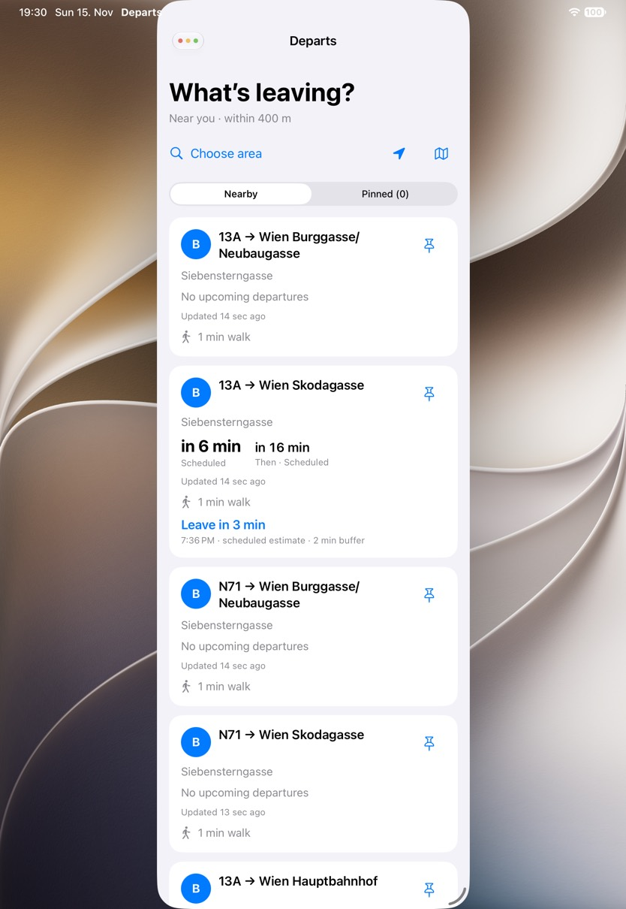
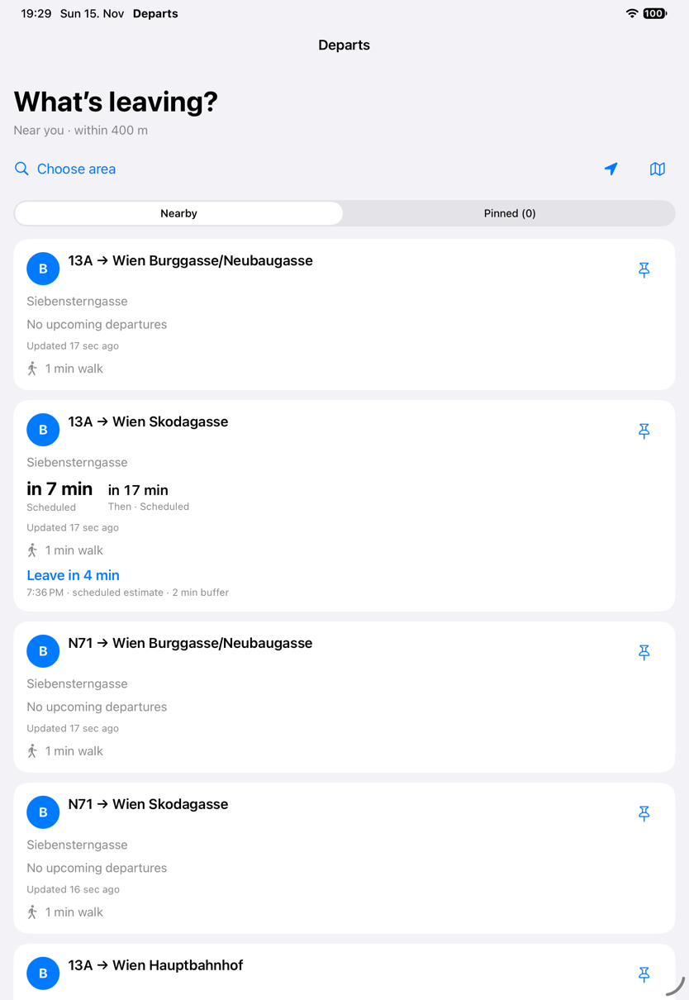
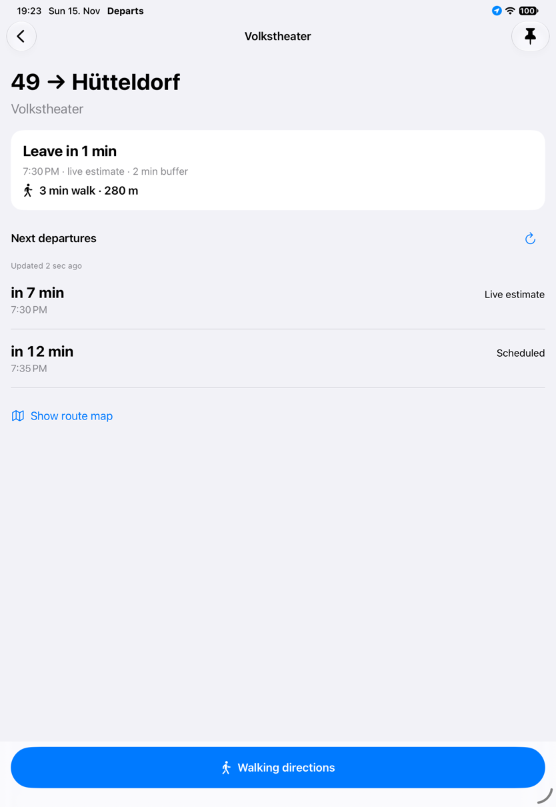

# iPad adaptation plan

| | |
| --- | --- |
| Status | Proposal. This branch changes no app code. |
| Date | 15 November 2026 |
| Branch | `feat/ipad-adaptation`, based on `feat/ios-design-improvements` |
| Builds on | [iOS design evaluation and improvement plan](ios-design-improvements.md), Phases 2 and 5 |
| Sibling | [iPhone Duo adaptation plan](iphone-duo-adaptation.md) |

## Summary

Departs is built for iPhone only. On an iPad it runs today as a phone-width window. Two things were tried for this plan, without changing the project:

- **Today's build on an iPad Pro 11-inch simulator.** The system gives it a window 416 pt wide on an 834-pt screen.
- **The same code built for iPad** by passing `TARGETED_DEVICE_FAMILY=1,2` on the command line. It launches, and all six UI tests pass. The layout is the phone column stretched to the full width.

So enabling iPad is not a compatibility problem. It is a design problem, and a product question:

- **An iPad is not a device for a pinch.** People use it before they leave, at a desk or a kitchen counter, or as a board that stays on. The iPad design should lead with pinned routes and a map, not with speed alone.
- **Most of the layout is shared.** The regular-width layout this plan needs is the one the iPhone Duo's inner display needs.
- **Shipping iPad support is a one-way door.** Apple does not accept an update that supports fewer devices than the version before it. A 13-inch iPad screenshot set also becomes mandatory.

Recommendation: do this after the Duo work, and ship only when the layout, keyboard and pointer support in Phases 1 and 2 are done. The stretched layout should never reach the App Store.

## Baseline

Captured on an iPad Pro 11-inch (M5) simulator, iPadOS 27.0, Xcode 27.0, with the production API at the Vienna test coordinate.

| Today's iPhone-only build | Built for iPad, list | Built for iPad, board |
| --- | --- | --- |
|  |  |  |

What the captures show:

- The stretched list puts the line name at the left edge and the pin about 700 pt away. Three of the four visible cards say "No upcoming departures".
- On the board, each departure time and its "Live estimate" label sit at opposite edges of an 834-pt row. The walking button is 800 pt wide. Half the screen is empty.
- The search sheet is a centered form sheet and works as it is.

Project facts that matter:

| Setting | Value | Consequence |
| --- | --- | --- |
| `TARGETED_DEVICE_FAMILY` | `1` on the app target | iPhone only |
| iPad orientations | All four already declared | Nothing to add |
| `UIApplicationSupportsMultipleScenes` | `true` in the built Info.plist | iPad users could open several windows at once |
| Store and location service | One per window, saved to the same keys | Windows would disagree about pins and overwrite each other. Fixed by improvements Phase 5. |
| Mac and Vision Pro availability | Both off | A later decision |
| Layout code | No device, idiom, orientation or screen checks | Nothing to remove |
| UI tests | Pass unchanged on iPad | A regression net exists from the first day |

## What an iPad is for

| Job | Situation | What the design owes it |
| --- | --- | --- |
| Before I leave | At home or a desk, checking the usual routes | Pinned routes and their leave times, readable at a glance, without relying on GPS |
| A board that stays on | An iPad on a stand in a hallway, kitchen or office | Large type, slow steady refresh, nothing to tap |
| Looking around an area | Planning a trip, or a hotel's surroundings | A large map with stops and their boards together |
| iPad mini on the go | Same as an iPhone | The compact and regular layouts already cover it |

Not planned: journey planning, accounts, or a dashboard of several cities.

## Layout

The layout follows the width of the window, never the device. It is the same system the Duo plan uses.

| Window width | Layout | Where it occurs |
| --- | --- | --- |
| Compact | The iPhone layout: list, then board | Narrow iPad windows |
| Regular, detail pane under about 760 pt | Two panes: list and board, with the map inside the board pane | iPad mini and 11-inch in portrait, 13-inch in portrait, iPhone Duo open |
| Regular, detail pane about 760 pt or more | Three zones: list, board, map | 11-inch and 13-inch in landscape, iPad mini in landscape, large windows |

The split is one shell for every width. The detail pane decides for itself whether the map sits under the board or beside it.

Three zones, iPad Pro 11-inch in landscape (1210 × 834 pt):

```
┌─────────────────────┬──────────────────────────┬─────────────────────────────┐
│ Near you ▾    ⌕  ➤  │ ▐49▌ Hütteldorf    ⚑  ↻  │                             │
│ updated just now    │ Volkstheater · 3 min walk│      map of nearby stops    │
│ PINNED              │ ┌──────────────────────┐ │                             │
│▌▐49▌ Hütteldorf    ▐│ │ ● Leave in 1 min     │ │          ▐49▌               │
│      Leave in 1     │ │ to catch the 19:30   │ │            ┊ walking route  │
│ ▐U3▌ Ottakring      │ └──────────────────────┘ │            ┊                │
│      Leave in 6     │ NEXT DEPARTURES          │            ◉ you            │
│ SIEBENSTERNGASSE    │ in 7 min   19:30  ◉ live │                             │
│ ▐13A▌ Skodagasse    │ in 12 min  19:35  ◔      │     ▐13A▌                   │
│       Leave in 4    │ OTHER LINES AT THIS STOP │                             │
│ ▐52▌ Baumgarten     │ ▐52▌ Baumgarten  4 · 14  │        ( Walking directions )│
│ 3 with nothing soon │                          │                             │
└─────────────────────┴──────────────────────────┴─────────────────────────────┘
      about 340 pt            about 420 pt                 the rest
```

Two panes, iPad Pro 11-inch in portrait (834 × 1210 pt):

```
┌───────────────────────┬──────────────────────────────────┐
│ Near you ▾     ⌕  ➤   │ ▐49▌ Hütteldorf            ⚑  ↻  │
│ updated just now      │ Volkstheater · 3 min walk        │
│ PINNED                │ ┌──────────────────────────────┐ │
│▌▐49▌ Hütteldorf      ▐│ │ ● Leave in 1 min             │ │
│      Leave in 1       │ │ to catch the 19:30 · live    │ │
│ SIEBENSTERNGASSE      │ └──────────────────────────────┘ │
│ ▐13A▌ Skodagasse      │ ┌──────────────────────────────┐ │
│       Leave in 4      │ │                              │ │
│ ▐52▌ Baumgarten       │ │   map: stop and walking route│ │
│      Leave in 6       │ │                              │ │
│ 3 with nothing soon   │ └──────────────────────────────┘ │
│ KIRCHENGASSE          │ NEXT DEPARTURES                  │
│ …                     │ in 7 min    19:30   ◉ live       │
│                       │ in 12 min   19:35   ◔ scheduled  │
│                       │        ( Walking directions )    │
└───────────────────────┴──────────────────────────────────┘
      about 320 pt                  about 514 pt
```

Rules:

- **The list is always visible at regular width.** It is the app's content, not a sidebar to hide.
- **Text columns stop at a readable width**, about 560 to 640 pt. Extra width goes to the map.
- **A time and its status sit together.** No row spreads two related facts to opposite edges.
- **The map is a pane, not a sheet.** It shows every nearby stop with the list's badges. Selecting a stop on the map selects it in the list. Selecting a row draws the walking route.
- **The map loads after the answers.** The rule that a map never delays the first answer still holds.
- **With nothing selected** the map fills the detail area.
- **Type does not scale up for the larger screen.** The same text styles apply. Only board mode uses larger type.
- **Search** opens as a popover from the area control at regular width, and as the current sheet at compact width.

## What is specific to iPad

**Windows.** A window can be almost any size and shape, and the phone-width capture shows the system's window controls already. The layout must hold from the smallest window to full screen and must keep the selection, scroll position and any open sheet while resizing. Apple has deprecated `UIRequiresFullScreen`, so opting out of resizing is not a lasting option.

**Several windows.** Two boards side by side is a real use: two ways to get home, for instance. It needs the shared store from improvements Phase 5. Pins, the cache and the shortcut target must be the same in every window.

**Keyboard and pointer.**

| Action | Shortcut |
| --- | --- |
| Search for a place | ⌘F |
| Refresh | ⌘R |
| Use current location | ⌘L |
| Pin or unpin the selected route | ⌘D |
| Move through the list, open a board | ↑ ↓, Return |
| Walking directions | ⌘↩ |

The same commands appear in the menu bar on iPadOS 26 and later. Rows and buttons respond to the pointer. Every control can be reached with Tab.

**Location.** Wi-Fi iPads have no GPS. Leave advice needs a fix under two minutes old and accurate to 100 m, so it will be withheld more often than on a phone. Two responses, both decisions below:

- Saved places ("Home", "Work") as one-tap areas, since an iPad is usually at one of them.
- Leave advice measured from a saved place the person has confirmed they are at, labeled as such. This changes a rule in [ios-fast-answers.md](../ios-fast-answers.md).

**Pins.** Pins live in `UserDefaults` on one device. A person who has pinned routes on their iPhone opens the iPad app to an empty Pinned section. The "before I leave" job depends on fixing this. iCloud key-value storage would sync pins with no account screen.

**Board mode (optional).** A full-screen view of pinned routes in large type, for an iPad on a stand. It refreshes every 60 to 120 seconds, not every 30, dims at night, and keeps the screen awake only when asked. An always-on board at today's 30-second interval would make up to about 2,900 requests a day per pinned route.

**Mac and Vision Pro.** An iPad-capable app can be offered on Apple silicon Macs and Vision Pro with little engineering. Each is another surface to test. Both stay off until the iPad version has shipped.

## Phases

### Phase 0. Decide (S)

- Take the one-way-door decision (decision 1).
- Decide pin syncing and saved-place advice (decisions 3 and 4), because they change what Phase 3 builds.
- The baseline is captured in this branch.

### Phase 1. Layout (M)

Needs improvements Phases 2 and 5. If the Duo plan's Phase 2 is done first, most of this already exists.

- Add iPad to the device family.
- Two panes and three zones as above.
- The map as a pane with selectable stops.
- Readable-width limits on text columns and the walking button.

Acceptance:

- The six UI tests pass on iPad mini, 11-inch and 13-inch simulators in both orientations.
- At regular width the list is visible together with a board or the map.
- No text column is wider than 640 pt. No button is wider than its text column.
- A resize sweep from the smallest window to full screen loses no selection, scroll position or sheet.
- A compact-width window shows the iPhone layout.

### Phase 2. Input and windows (M)

- Keyboard shortcuts, menu commands, pointer effects, and full keyboard navigation.
- Search as a popover at regular width.
- Two windows that agree on pins and cache.

Acceptance: every action in the app can be done without touching the screen. A pin added in one window appears in the other at once.

### Phase 3. Planning features (M)

- Recent and saved places. Recents come from improvements Phase 3.
- Pin syncing, if approved.
- Advice from a saved place, if approved.

Acceptance: a route pinned on an iPhone appears on the iPad signed in to the same iCloud account. Choosing "Home" shows its boards in one tap.

### Phase 4. Board mode (M, optional)

Build only after decision 6, with a request ceiling agreed first.

### Phase 5. Release (S)

- Screenshots: the 13-inch set is required for an app that runs on iPad (2064 × 2752 or 2048 × 2732 px). The 11-inch set is optional.
- TestFlight on a physical iPad, including a Wi-Fi model for the location behavior.
- Update `CLAUDE.md`, `AGENTS.md`, the roadmap and `docs/ios-fast-answers.md`. The product-scope line "iOS app" and the architecture notes need iPad added.

## Decisions needed

| # | Decision | Recommendation |
| --- | --- | --- |
| 1 | Ship iPad support at all. It cannot be withdrawn in a later update, and it adds a screenshot set, a test matrix, and input methods to maintain. | Yes, after the Duo work, and only at the quality of Phases 1 and 2. |
| 2 | Order against the Duo plan. | Duo first. This plan then reuses its regular-width layout. |
| 3 | Sync pins through iCloud key-value storage. | Yes. Without it the iPad starts empty. No account screen is needed. |
| 4 | Allow leave advice from a saved place that the person confirms. | Yes, always labeled with the place, never applied silently. It also helps iPhone users with location off. |
| 5 | Several windows. | Support, once the store is shared. |
| 6 | Board mode. | Later, behind a request ceiling. It is the feature most specific to iPad and the one that costs API calls while nobody is looking. |
| 7 | Mac and Vision Pro availability. | Revisit after the iPad version ships. |

## Risks

- **The one-way door.** If iPad use turns out to be negligible, the support cost stays.
- **Product focus.** The roadmap puts time to a useful answer first. iPad work should not delay the improvements plan or the Duo's cover display.
- **Location accuracy.** Untested on a real Wi-Fi iPad. Advice may be rarer than expected.
- **Request volume.** Larger screens show more rows, a board and a map at once, and board mode runs unattended. The roadmap already asks for provider usage alerts before wider distribution.
- **Test matrix.** Three sizes, two orientations, free-form windows, keyboard and pointer. The repository has no CI yet.
- **Dependency on the improvements plan.** Without its split navigation and row design, Phase 1 here has to build both.

## Verification

| Check | iPad mini | 11-inch | 13-inch |
| --- | --- | --- | --- |
| Six UI flows, both orientations | ✓ | ✓ | ✓ |
| Window resize sweep | | ✓ | ✓ |
| Two windows | | ✓ | |
| Keyboard-only pass | | ✓ | |
| Largest text size | ✓ | ✓ | |
| VoiceOver order across panes | | ✓ | |
| Dark mode | | ✓ | |
| Wi-Fi-only location on a device | one physical iPad | | |

## Out of scope

Journey planning, accounts, widgets, Live Activities, Apple Pencil features, and external-display layouts.

## Sources

- [Screenshot specifications](https://developer.apple.com/help/app-store-connect/reference/app-information/screenshot-specifications), Apple
- [Why am I getting device support errors when uploading my app?](https://developer.apple.com/library/archive/qa/qa1623/_index.html), Apple Technical Q&A QA1623. It is archived, so confirm the rule in App Store Connect before decision 1.
- [Three steps to prepare your app for iPhone Duo](https://developer.apple.com/iphone-duo/prepare/), Apple. It states that an iPhone app's larger layout should be a natural extension of its iPad layout.
- The `UIRequiresFullScreen` deprecation is reported from Apple's TN3192 by third-party summaries and was not read directly.
