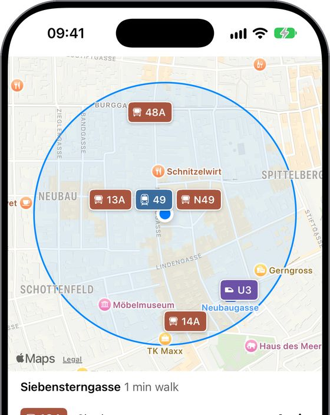
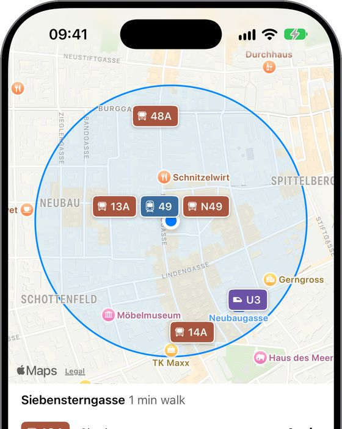
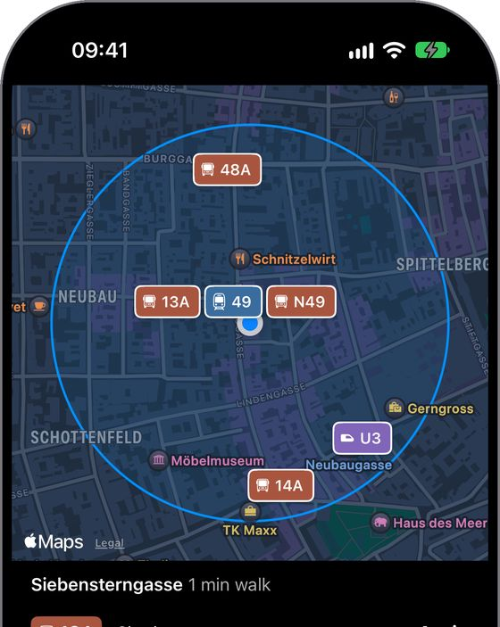
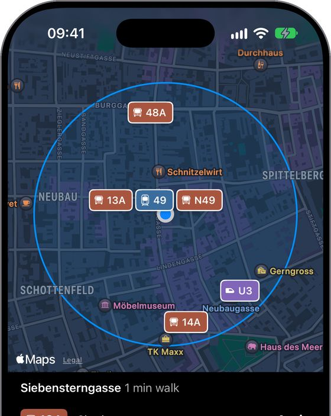
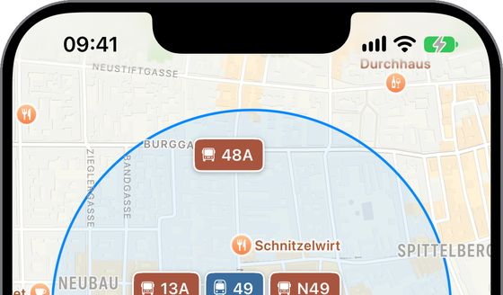
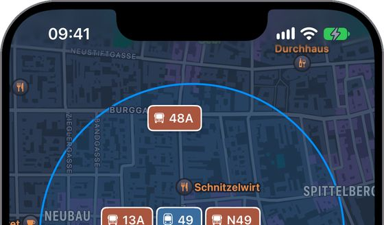
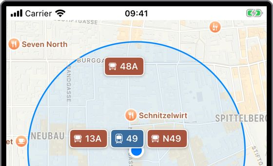

# Departs 1.2 (10) TestFlight

On 18 November 2026, with 1.2 (9) built, the owner asked whether the home map could reach up under the status bar while the square stayed exactly as it was. He was shown four treatments captured from the app, in light and dark, and chose the first: "I prefer 1, the blur". Later that evening he said: "when the suites finish feel free to open the PR, merge it, build and send to TestFlight. I'm the only tester so far anyway."

Only the build number changes, from 9 to 10. The marketing version stays 1.2. The backend is unchanged.

The decision is O18 in the plan's [third amendment](../plans/ios-two-screens.md#third-amendment-the-map-under-the-status-bar). A27 there has not been reviewed by the owner.

## What changes for testers

- **The map reaches the top of the screen.** On a phone with a Dynamic Island or a notch, the home map continues above its square, under the clock and the status icons. iOS blurs it there by itself. The app adds no fade and no layer.
- **The square is where it was.** You are still at its centre, it still spans 960 m, and the list starts at the same place.
- **Nothing under the status bar can be tapped.**
- **Unchanged:** an iPhone SE, whose status bar is 20 pt tall, and every phone at an accessibility text size keep the layout of 1.2 (9).

| | Before (1.2 (9)) | After |
| --- | --- | --- |
| Light |  |  |
| Dark |  |  |

| A notch, light | A notch, dark | iPhone SE, unchanged |
| --- | --- | --- |
|  |  |  |

Live production data at the Vienna test coordinate, captured on 18 November. iPhone 17 Pro and iPhone 16e with iOS 27.0, iPhone SE (3rd generation) with iOS 26.2. Seven JPEGs, 340 KB together.

## Verification of 1.2 (10)

Xcode 27.3 beta (27C5035i). Fixture results are from the UI suite's local server; live results are production, through a Debug build without the API override.

- **Suites, with the build number already 10:** 69 unit and 32 UI tests pass on iPhone 17 Pro with iOS 27.0, iPhone 17 Pro with iOS 26.2 and iPhone SE (3rd generation) with iOS 26.2: 101 of 101 on each, run one after another. Build 9 had 67 unit and 32 UI tests. The two new unit tests cover where the map reaches the top and that it takes no touch under the status bar. The home UI test now also measures where a stop lands in the square.
- **One failure came first on iOS 27.0.** In the first full run there, `testNoDeparturesHasAnHourMessageAndNoIdleRows` failed: 100 of 101. The same test then passed 12 times alone and 6 times after the test that precedes it, and the second full run is the 101 of 101 above. See [the first item below](#seen-while-testing-not-changed-in-this-build).
- **Acceptance criteria**, measured on fixtures:
  - On iPhone 17 Pro the map is 402 × 464 at y = 0 and the list starts at y = 464, where it started in build 9. On the SE the map is 375 × 375 at y = 20, as in build 9.
  - The square shows what it showed. With the rider at the centre of the square and 960 m across it, a stop label's centre is within 0.3 pt of the point computed from its coordinate, on both phones.
  - A 100 m move shifts a stop label 41.7 pt on iPhone 17 Pro (target 41.9) and 39.0 pt on the SE (target 39.06) within 1.1 s, with no stops request.
  - Drag, pinch and double tap leave the home map unchanged; labels still open a line or scroll the list.
  - At the largest accessibility text size the map is the square alone and starts under the status bar.
- **The square, pixel by pixel**, live data on iPhone 17 Pro with iOS 27.0, build 9's layout against this build: no shift at a quarter of a pixel in 15 patches across the square, in light and in dark. 1.5% of the square's pixels differ by more than 8 of 255 levels in light and 0.4% in dark: building outlines, label edges and the pulsing location dot. The list below does not differ in a single pixel.
- **A notch**, iPhone 16e with iOS 27.0, live data, light and dark: the clock and the status icons stay clear. A map label can sit directly below them.

## Archive and upload

The archive is made from `main` once the pull request is merged, after the production API is checked again. Its results are added here afterwards.

## Seen while testing, not changed in this build

1. **One UI test failed once, and the cause is not known.** In the first full run on iPhone 17 Pro with iOS 27.0, home with no departures did not show "Nothing leaves here in the next hour" within ten seconds. The run recorded nothing about what the screen showed instead. The test passed in 18 repeats and in a second full run on the same simulator, and in the full runs on the two other simulators. It covers the list's states, which this build does not change, and a reading of the loading code found no race. The test now reports the screen and the requests made when it fails.
2. **A stop label can drift under the status bar.** The list's area changes only after a 150 m move (A15), while the map follows every step (A18), so a stop near the northern edge of the ring can end up above the square for a while. It is shown under the system's blur and cannot be tapped (A26). Reasoned from the rules; not seen.
3. **Before a location arrives, the map shows its default region.** On a first launch, behind the location question, it showed central Europe, now from the top of the screen down. Build 9 showed the same in the square.
4. The open findings in the [1.2 (8) record](1.2-8.md#open-findings-not-changed-in-this-build) and the [1.2 (9) record](1.2-9.md#seen-while-testing-not-changed-in-this-build) still stand.

## Not verified

How the clock and the status icons read over a real, moving map outdoors, in light and in dark; a notch on a phone; a stop label under the status bar; VoiceOver over the part of the map under the status bar. These need the TestFlight build on a device.
