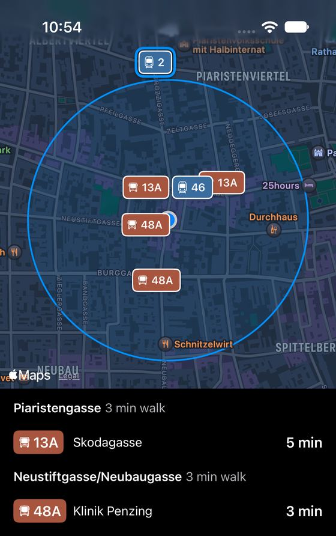
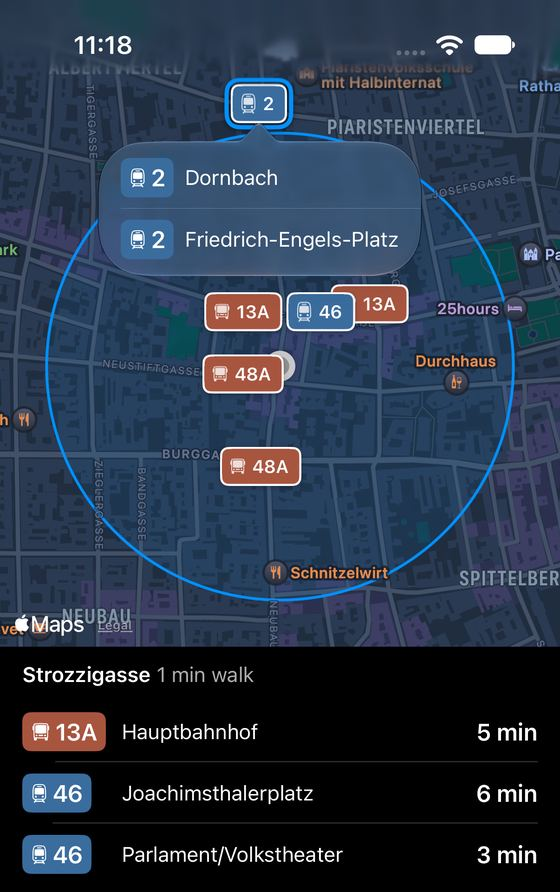
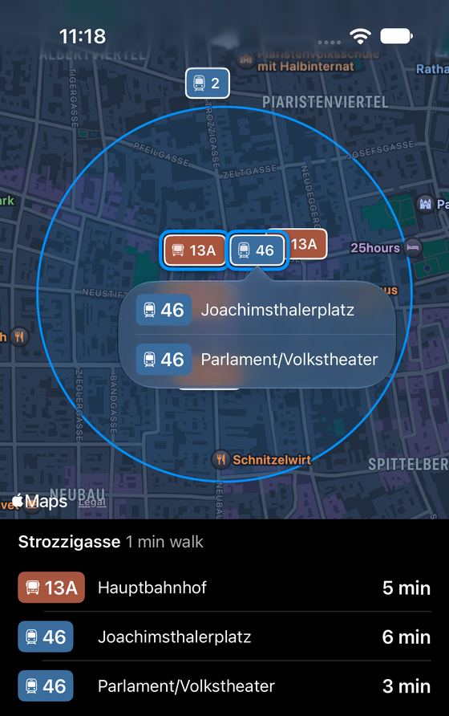
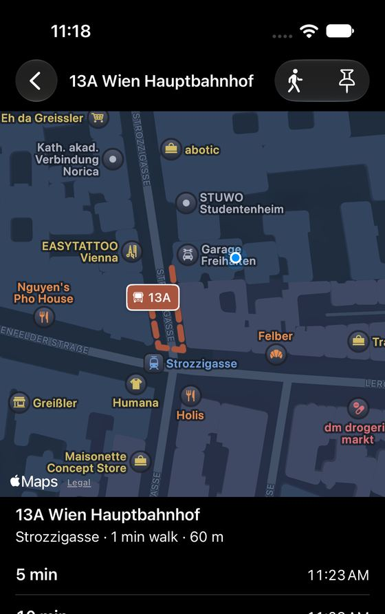

# Departs 1.2 (11) TestFlight

With Departs 1.2 (10) on his phone on 19 November 2026, the owner reported that taps on some map labels did nothing: "tapping these overlapping labels on the map fails. Tapping this one out of the circle fails also." He was shown two fixes captured from a prototype and chose the first, without times in the choice. When the change was built and shown to him, he said: "Ship".

Only the build number changes, from 10 to 11. The marketing version stays 1.2. The backend is unchanged.

The decision is O19 in the plan's [fourth amendment](../plans/ios-two-screens.md#fourth-amendment-a-tap-on-a-map-label). A28 to A33 there have not been reviewed by the owner.

## What changes for testers

- **Each badge on the map is its line.** Tap a badge to open that line. If the line runs both ways from that stop, you choose the direction first. The choice shows no times: the list below has them.
- **A label answers every tap.** In 1.2 (10) a label that was already selected ignored the next tap, so a line opened from the map could not be opened again from the same label.
- **The list no longer jumps.** A tap on a stop with several rows used to move the list to that stop, which often showed nothing.

| | Before (1.2 (10)) | After |
| --- | --- | --- |
| Tap 2 |  |  |

| Tap 46: it runs both ways | Tap 13A: one way, so it opens |
| --- | --- |
|  |  |

Live production data at the place of the owner's screenshots, iPhone 17 Pro with iOS 27.0, dark appearance. Four JPEGs, 267 KB together.

## Verification of 1.2 (11)

Xcode 27.3 beta (27C5035i). Fixture results are from the UI suite's local server; live results are production, through a Debug build without the API override.

- **Suites, with the build number already 11:** 73 unit and 33 UI tests pass on iPhone 17 Pro with iOS 27.0, iPhone 17 Pro with iOS 26.2 and iPhone SE (3rd generation) with iOS 26.2: 106 of 106 on each, run one after another. Build 10 had 69 unit and 32 UI tests. The new tests cover which rows a badge, "+N" and the whole label stand for, which badge a touch belongs to, the size of the choice, VoiceOver's activation of a label, and the two badges of one label.
- **The report, reproduced** before the change, on live data at the same place: a tap on the label of the first stop selected it and left the list where it was; a second tap on that label did nothing; a line opened from a label did not open from it a second time.
- **Acceptance criteria**, on fixtures unless marked live (details in [PR #38](https://github.com/p3ob7o/Departs/pull/38)):
  - A badge with one direction opens its line: 48A on fixtures, 13A at Strozzigasse live.
  - A badge with two directions offers them, and the one picked opens: U3 and each badge of the label "13A · 49" on fixtures; 46 and 2 live.
  - The choice shows no times. Text recognition on its own frame finds the line and its two directions, and no "min", "Now" or clock time.
  - A selected label answers the next tap: the 48A label opens its line twice in a row. Live, 13A opened on the first and on the second tap.
  - Closing a choice opens nothing and removes the ring.
  - Drag, swipe, pinch and a double tap beside the labels open no choice and leave the map unchanged.
  - Two short directions measure under 280 pt wide. A 60-character direction stops at 320 pt and wraps.
- **The live runs** came from a scratch UI test that is not in the repository. They were made before the last two changes: the choice's anchor now stays put while it closes, and a VoiceOver test was added. The suites ran after them.

## Archive and upload

[PR #38](https://github.com/p3ob7o/Departs/pull/38) was merged into `main` at 13:22 CET on 19 November 2026. The archive was made from `main` at `23ed45d0354f746371cc570070a8b3c9ecb8fd26`, whose tree equals the tested branch head `441f83e`.

- Before the merge, at 13:22 CET, production answered at the Vienna test coordinate: 17 stops, 17 of 17 boards in one batch, four departures from the per-line call, and a walking route.
- Xcode 27.3 beta archive and App Store Connect export passed. The package is signed with Apple Distribution and has `get-task-allow = false`, App Intents metadata, family `[1]`, portrait only, minimum OS 26.0 and version 1.2 (11). Its binary contains no `DEPARTS_` hook and none of the strings removed in earlier builds, and its Info.plist has no local-networking or transport-security exception.
- IPA: 805,170 bytes. SHA-256 `e30de4f9e27c02e68e811dc35e549814e5cad14a6c034beac99385543217b6d7`.
- Production was rechecked at 13:23 CET, after the merge deployed: 17 stops, 17 of 17 boards, the per-line call and walking directions all answered.
- Apple package validation returned **VERIFY SUCCEEDED with no errors** at 13:24 CET.
- Apple reported **UPLOAD SUCCEEDED with no errors** at 13:25 CET, delivery `c62b4432-d876-4d23-986f-e6c4c446ea21`.
- App Store Connect reported **VALID** at 13:28 CET: version 1.2, build 11, minimum OS 26.0, internal state **IN_BETA_TESTING**. The external state is READY_FOR_BETA_SUBMISSION. No external review and no App Store submission was made.
- The English testing notes are published and read back. They ask testers to tap badges that sit side by side, badges that overlap and one near the top of the screen, and to check that the right line opens.
- **Xcode Cloud.** The "Default" workflow archives every change to `main`, and for this merge it started nothing: six minutes later there was no run and no status on the commit. A run started by hand at 13:29 CET archived the merge commit and succeeded.

## Seen while testing, not changed in this build

1. **The ring goes around the whole label**, also when only one of its badges was tapped (A30).
2. **A label near the top takes taps only below the status bar** (A26). The label of line 2 lay partly under it in the owner's screenshot and in the live run; its lower part opened the choice.
3. The open findings in the [1.2 (8)](1.2-8.md#open-findings-not-changed-in-this-build), [1.2 (9)](1.2-9.md#seen-while-testing-not-changed-in-this-build) and [1.2 (10)](1.2-10.md#seen-while-testing-not-changed-in-this-build) records still stand.

## Not verified

Taps with a real finger on a phone, in particular on small badges side by side; VoiceOver's speech and focus on the choice; a stop with more than three lines on real data, where "+N" appears; the choice at accessibility text sizes, where the map is a row of the list.
