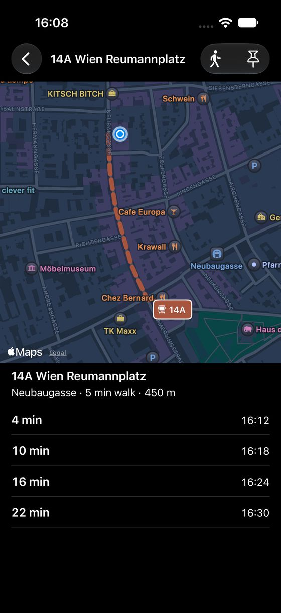
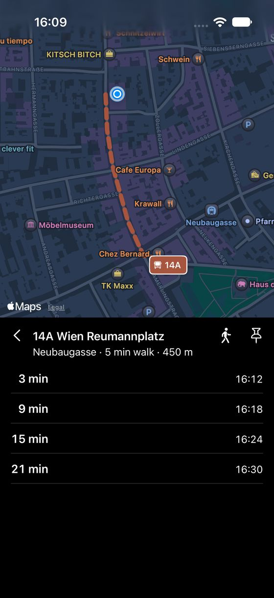
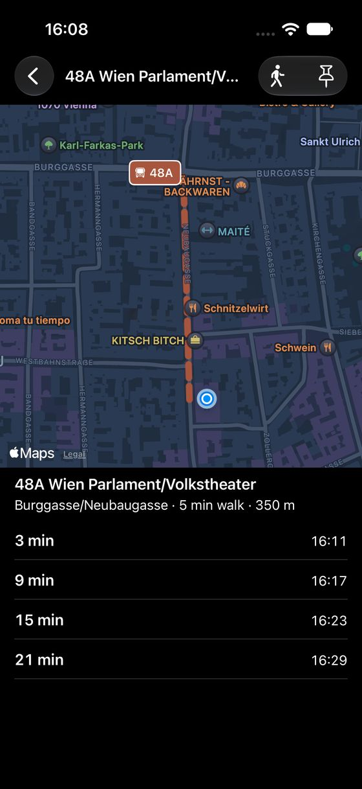
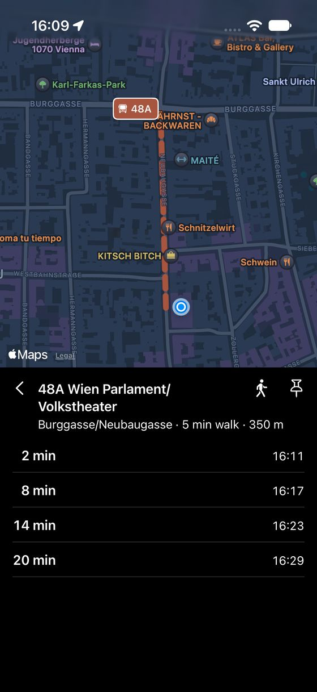
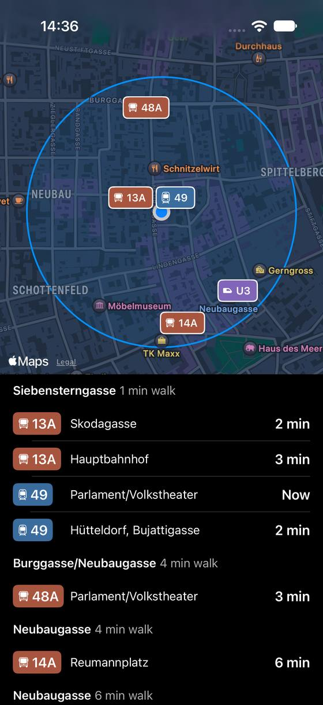
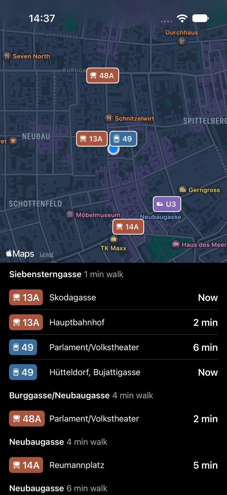
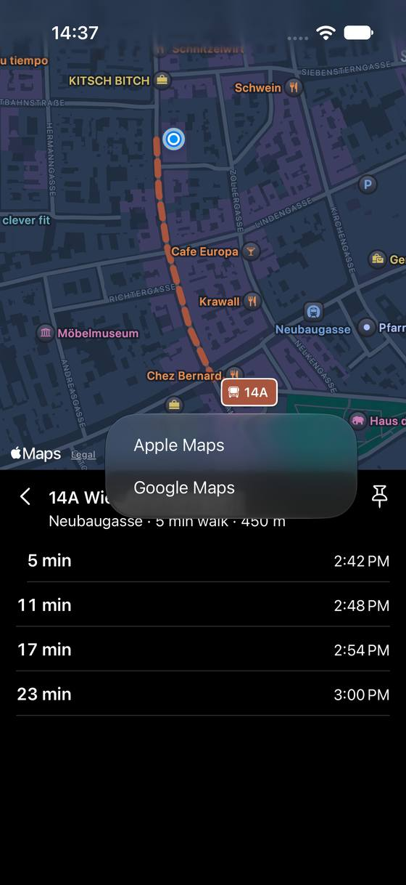

# Departs 1.2 (12) TestFlight

With Departs 1.2 (11) on his phone on 19 November 2026, the owner sent a screenshot of the line screen of 14A toward Reumannplatz with four requests: countdowns aligned on the right, a choice between Google Maps and Apple Maps that is remembered, the line screen's back, line, walk and pin under a map framed as on home, and no blue circle on home. When the change was built and shown to him, he said: "ship".

Only the build number changes, from 11 to 12. The marketing version stays 1.2. The backend is unchanged.

The decisions are O20 to O23 in the plan's [fifth amendment](../plans/ios-two-screens.md#fifth-amendment-the-line-screens-controls-under-its-map). A34 to A42 there have not been reviewed by the owner.

## What changes for testers

- **The line screen's countdowns line up on the right.** They share one column, so the 4 of "4 min" stands above the 0 of "10 min". The clock times stay on the right.
- **Google Maps or Apple Maps.** With Google Maps installed, the first tap on the walk button offers both. The one you pick opens and is remembered; after that a tap opens it at once, and a long press offers the choice again. Without Google Maps the button opens Apple Maps, as before.
- **The line screen's controls sit under its map.** The map has home's frame, from the status bar down. Under it: back, the line and its direction, walk and pin, and below them the stop with the walk to it, on one line where it fits. The swipe from the left edge still goes back, also over the map. At the largest text sizes the screen keeps its bar, as before.
- **No circle on home.** The map no longer draws the ring around you. The location dot stays.

| | Before (1.2 (11)) | After |
| --- | --- | --- |
| 14A toward Reumannplatz |  |  |
| 48A, a long title and stop line |  |  |
| Home |  |  |

| The choice of map apps |
| --- |
|  |

Live production data at the Vienna test coordinate, iPhone 17 Pro with iOS 27.0, dark appearance, 24-hour clock. Seven JPEGs, 489 KB together.

## Verification of 1.2 (12)

Xcode 27.3 beta (27C5035i). Fixture results are from the UI suite's local server; live results are production, through a Debug build without the API override.

- **Suite, with the build number already 12:** 81 unit and 39 UI tests pass on iPhone 17 Pro with iOS 27.0, 120 of 120, finished at 18:23 CET on 19 November. The pull request was merged on this result, because the owner asked for the build sooner. The same suite on iPhone 17 Pro with iOS 26.2 and on iPhone SE (3rd generation) with iOS 26.2 was still running at that moment. Its results, the German stress test on this tree and the check of the archive are added under [Archive and upload](#archive-and-upload).
- **Before the build number changed**, on the same app code (`cc973cb`): the two gesture tests passed three times each on all three simulators, and the full suite passed on iOS 27.0. One commit earlier (`ac483d2`), before the swipe back moved to public API, 81 unit and 38 UI tests passed on all three simulators, and the German stress test passed on the SE.
- **Test counts:** Build 11 had 73 unit and 33 UI tests. The new tests cover the countdown column (2 unit, 1 UI), the list's dividers (1 UI), the choice of map apps (3 unit, 1 UI), the stop line (1 unit, 1 UI), the line map's strip under the status bar (1 unit), the missing ring (1 unit), going back (1 UI), and the touches that must still work while the swipe from the edge waits (1 UI).
- **Release build:** checked on the archive itself, after the merge. On `ac483d2` a Release build for the simulator was iPhone only, portrait only, minimum OS 26.0, with `LSApplicationQueriesSchemes` = `comgooglemaps`, no local-networking or transport-security exception and no `DEPARTS_` hook in the binary.
- **Repository checks:** type check, lint, production build and the 95 backend tests pass.
- **Acceptance criteria**, on fixtures unless marked live (details in [PR #40](https://github.com/p3ob7o/Departs/pull/40)):
  - The four countdowns end within 0.11 pt of each other. Every divider starts at x = 16.0 pt, with mixed one- and two-digit countdowns, with "Now" and with saved clock times, on the three simulators.
  - With Google Maps installed (a Debug-only stand-in), the first tap offers both apps and opens nothing; the app picked opens and is remembered across a relaunch; a long press offers the choice again. Without Google Maps, Apple Maps opens in walking mode to the stop.
  - The line map is 402 × 464 pt at y = 0 on iPhone 17 Pro, the same as home, and 375 × 375 pt at y = 20 on the SE. Back, walk and pin start at y = 468, under the map, with the title between them. Both ends of the walk lie inside the square.
  - For 48A the title wraps beside the buttons and "Burggasse/Neubaugasse · 5 min walk · 350 m" is one line, 312 pt wide, under walk and pin. Live, 49's "Siebensterngasse · 2 min walk · 120 m" is one line too. On the SE the 48A stop line wraps after a "·", and no line starts with one.
  - The back button goes back. The swipe from the left edge goes back from the map's middle and bottom, the controls and the list, 3 times of 3 at each height on each simulator. Pans on the map from 40 % of its width and from 30 pt off the edge still pan. On home the swipe changes nothing.
  - While the swipe waits: a tap on the back button's outer part goes back as fast as one on its centre; a home row opens from a tap 4 pt into it after going back; a long press on walk opens the choice while the finger is down, and sliding to Apple Maps picks it; a pull to refresh from the edge refreshes; and a scroll from the edge scrolls.
  - Home draws no ring and stays centred on the rider.
- **The live captures** came from a scratch UI test that is not in the repository, on an earlier commit of this change. Since then only the code behind the swipe back and the build number changed, neither of which shows on screen.

## Archive and upload

[PR #40](https://github.com/p3ob7o/Departs/pull/40) was merged into `main` at 18:32 CET on 19 November 2026. The archive was made from `main` at `8ebb702105c8afa9566d47029e3b8bab83044164`, whose tree equals the branch head `556de9c`. That head differs from `a69e666`, the tree the suites ran on, only in this record.

- **The suites on the release tree.** iPhone 17 Pro with iOS 27.0 finished at 18:23 CET, before the merge: 81 unit and 39 UI tests, 120 of 120. iPhone 17 Pro with iOS 26.2 finished at 18:34 CET, after the merge and before the upload: 120 of 120. iPhone SE (3rd generation) with iOS 26.2 finished at 18:45 CET, after the upload: 120 of 120. The German stress test on the SE passed at 18:46 CET. So this tree passed on all three simulators, and the merge waited for the first of them only.
- Production answered at the Vienna test coordinate at 18:32 CET, as the merge's deployment completed, and again at 18:42 CET: 17 stops, 17 of 17 boards in one batch, four departures from the per-line call, and a walking route. The backend did not change in this build.
- Xcode 27.3 beta archive and App Store Connect export passed. The package is signed with Apple Distribution and has `get-task-allow = false`, App Intents metadata, family `[1]`, portrait only, minimum OS 26.0 and version 1.2 (12). Its Info.plist differs from build 11's in two entries only: the build number, and `LSApplicationQueriesSchemes` = `comgooglemaps`. It has no local-networking or transport-security exception.
- The binary contains no `DEPARTS_` hook and none of the strings removed in earlier builds. It contains no private gesture-delegate selector: the only `gestureRecognizer…` names in it are the public ones of `UIGestureRecognizerDelegate`.
- IPA: 864,670 bytes. SHA-256 `4ee9e25a93c52851d2532e55f7d6defeb580b0459b74bfb78e1398d642527f2c`.
- Apple package validation returned **VERIFY SUCCEEDED with no errors** at 18:34 CET.
- Apple reported **UPLOAD SUCCEEDED with no errors** at 18:35 CET, delivery `eb8935cd-083b-41c6-9cbe-68e2a945aa11`.
- App Store Connect reported **VALID** at 18:39 CET: version 1.2, build 12, minimum OS 26.0. The internal state became **IN_BETA_TESTING** at 18:41 CET. The external state is READY_FOR_BETA_SUBMISSION. No external review and no App Store submission was made.
- The English testing notes are published and read back. They ask testers to check the swipe back from the left edge, over the map and over the list, the press and hold on the walk button, and that Google Maps opens walking directions to the stop.
- **Xcode Cloud.** The "Default" workflow started by itself for the merge commit at 18:32 CET and succeeded at 18:33 CET.

## Seen while testing, not changed in this build

1. **A scroll that starts at the left edge moves the list a little less** than one that starts in the middle: 119 pt against 136 pt for the same 150 pt drag at the largest text size, as in 1.2 (11). iOS first waits to see whether the touch is a swipe back.
2. In UI tests, a fast horizontal drag that starts on a home row opened that row's line, as in 1.2 (11). A finger was not tried.
3. The open findings in the [1.2 (8)](1.2-8.md#open-findings-not-changed-in-this-build), [1.2 (9)](1.2-9.md#seen-while-testing-not-changed-in-this-build), [1.2 (10)](1.2-10.md#seen-while-testing-not-changed-in-this-build) and [1.2 (11)](1.2-11.md#seen-while-testing-not-changed-in-this-build) records still stand.

## Not verified

Google Maps itself: the simulator has none, so a Debug-only hook stands in, and the URL that opens its walking directions is unit-tested only. VoiceOver's two-finger scrub to go back, with the bar hidden. A long press and the swipe back with a real finger. VoiceOver on the walk button's menu. How the plain symbols read against a busy map edge.
