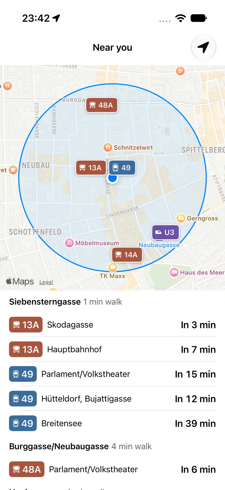
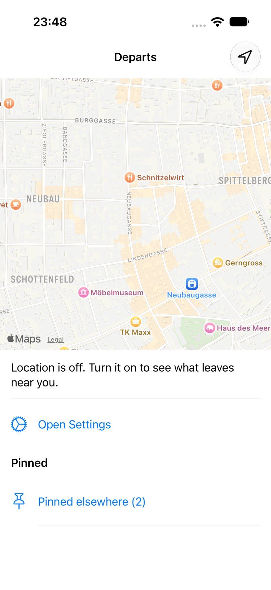
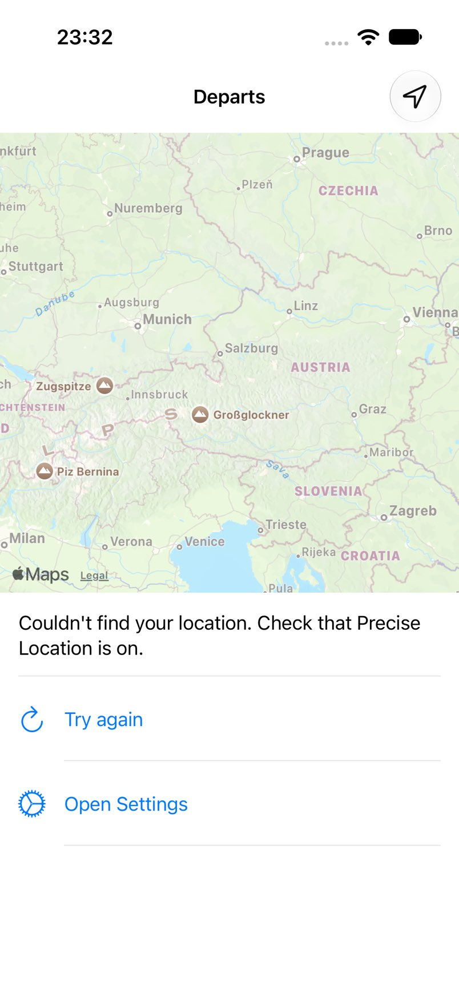
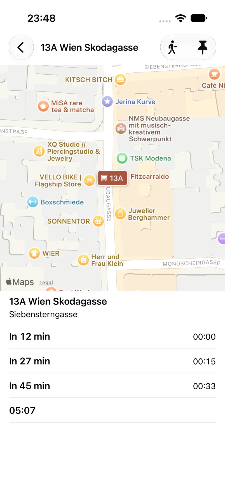
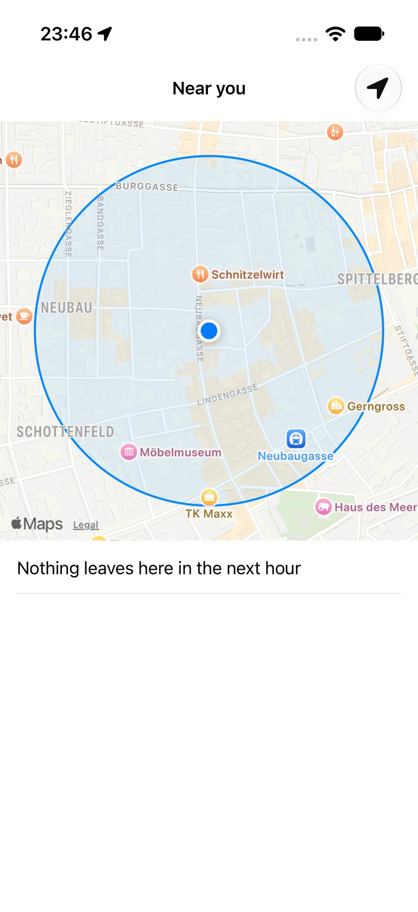
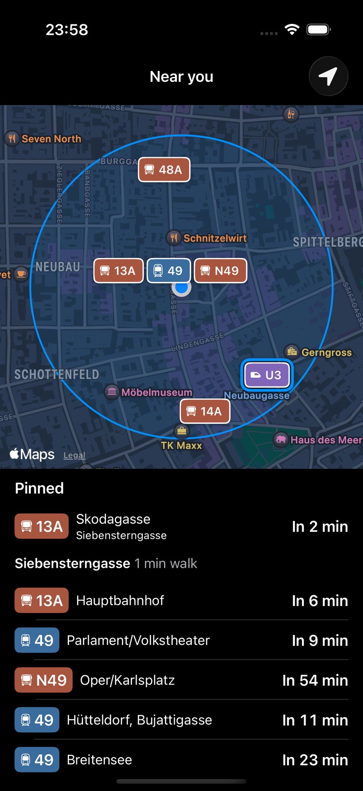

# Departs 1.2 (8) TestFlight

The owner tested Departs 1.2 (7) on 16 November 2026 and asked for two things that evening: a thorough round of tests, and an app that looks within 400 metres of where you are and nowhere else. Asked which top-bar control should go, the owner chose to remove place search entirely, then said: "Once you are done, push, merge, build, and send to Testflight."

Only the build number changes, from 7 to 8. The marketing version stays 1.2. The backend is unchanged.

## What changes for testers

- The search radius is 400 m, always. "Search farther" is gone.
- Place search is gone: the search button, the title menu, recent places and every "Choose an area" action. The top bar holds one control, the location button.
- With Location off, home shows the notice, "Open Settings" and pinned routes only.
- When no usable fix arrives, home says so and offers "Try again" and "Open Settings". Before, it waited on "Finding departures…" for a request that was never made.
- The list no longer starts over about every five minutes. See the first finding below.
- The location button brings a panned map back to the searched circle.

| Home | Location off | No usable fix |
| --- | --- | --- |
|  |  |  |

| A pinned route with Location off | Nothing in the next hour | Dark, with a pin |
| --- | --- | --- |
|  |  |  |

Seven JPEGs, 1.0 MB together. They are live production data at the Vienna test coordinate, taken through a Debug build and a logging proxy.

## The test of 1.2 (7)

Source `1f5ec2c`, which is what build 7 was made from.

- **Suites.** 62 unit and 24 UI tests pass on iPhone 17 Pro with iOS 27.0, iPhone 17 Pro with iOS 26.2 and iPhone SE (3rd generation) with iOS 26.2. One UI test, the Apple Maps hand-off, failed on the two simulators where Maps had no location permission of its own. It passed on the third, where the permission had been granted. The hand-off itself was correct each time.
- **Backend.** 95 tests, type check, lint and a production build pass. Production answered every request of the session; Vercel recorded no runtime error in the previous 24 hours.

Two defects were found and are fixed in build 8.

1. **The list started over about every five minutes on a phone.** Once the stops were five minutes old, the next location fix was loaded as a new area. Two fixes at one spot never have identical coordinates, so the list emptied, showed "Finding departures…", returned to the top and recentred the map. A saved list was wiped the same way on reopening after more than five minutes. A unit probe against the build 7 source reproduces it: a fix five metres away after 301 seconds raises the area revision and leaves zero rows during the reload. No simulator shows it, because a simulated location is exactly constant.
2. **A coarse fix left home waiting forever.** A fix less accurate than 100 m was reported as located and then ignored, so nothing was requested and "Finding departures…" stayed. That is what Precise Location off produces. In build 7 search was the way out; build 8 has none, so it needed a state of its own.

## Verification of 1.2 (8)

- **Suites.** 61 unit and 28 UI tests pass on iPhone 17 Pro with iOS 27.0, iPhone 17 Pro with iOS 26.2 and iPhone SE (3rd generation) with iOS 26.2: 89 of 89 on each, with the build number already set to 8. Each new simulator was given Apple Maps' location permission first, as the behaviour document now describes.
- **German stress test.** The expanded German catalog test passes on the SE at the default and the largest accessibility text size. No German ships.
- **Live sessions through a logging proxy, Vienna test coordinate, 23:40 to 00:20 CET.** Opening costs six requests: one stops, one batch, four walking routes. A refresh costs one batch, every 30 seconds. The nine rows on screen were exactly what the plan's rules give for the captured stops and batch. A failed batch kept every row with clock times and one banner, and recovered in one request. A response without the nearest platforms, an empty batch, a failed stops request and a failed line request each showed their own state and recovered.
- **Six and a half minutes on home** with two five-metre location changes: the scroll position never moved and one batch went out every 30 seconds. The stops refresh at five minutes was answered from the 24-hour cache without touching the list. Nothing was requested in the background, and one batch followed the return to the foreground.
- **Moving about 950 m** reset the list to the top around the new position.
- **Location off** with two pins: no departures, no map labels and no circle. "Pinned elsewhere (2)" opened a pinned line with four departures, the stop alone on the map and no further batch.
- **Upgrade.** Build 7 was used to search a place, widen the radius to 800 m and pin a route. Build 8 installed over it opened on "Near you" at 400 m with the pin kept.
- **Text size, dark mode and small screen.** The largest accessibility size was checked on home, the line screen, Location off and no usable fix: nothing is clipped. Dark mode was checked on iOS 26.2. On the 667-point display four rows fit under the map.
- **Release configuration.** A Release build for the simulator is 1.2 (8), iPhone only, portrait, iOS 26 minimum, with no local-networking exception. Its binary contains no `DEPARTS_` hook, test fixture or search string. Launched with an unreachable `DEPARTS_API_BASE_URL`, a preferences override and the new accuracy override, it ignored all three and loaded production.

## Archive and upload

The archive is made from `main` after this change is merged. Apple's validation, the upload and the processing result are recorded here once known.

## Open findings, not changed in this build

These were seen during the test. None is new in build 8. Each needs the owner's decision.

1. **A stop with no departures is shown as a failure.** At Berlin Alexanderplatz the provider returns no board for three of 27 stops. The single-stop endpoint answers `[]` with 200 for each: nothing leaves there. The batch endpoint lists them as `missing`, and the app shows "Some times couldn't update · Retry" and "Couldn't load this stop · Retry" for as long as you stand there. Vienna returned 17 of 17 throughout. Reporting such a stop as an empty board in the backend would correct builds 7 and 8 without an app change.
2. **A hub is long and crowded.** The same place listed 27 rows at midnight. A line can have three destinations at its nearest stop, and rule 5 keeps them all. Map labels overlap there.
3. **Tinted actions measure 4.02:1 in light mode.** "Refresh", "Retry", "Try again", "Open Settings" and "Pinned elsewhere" use the accent colour `#007AFF` on white. The plan asks for 4.5:1. Dark mode measures 5.76:1.
4. **The line screen names the line twice**, in the title and again as a heading right under the map.
5. **Rows inside a stop follow the provider's order, not time.** A departure in 15 minutes can sit above one in 12, and at night a night line sits between the day line's rows.
6. **Freshness has no margin.** A board is fresh for 60 seconds, a refresh comes every 30, and the CDN may serve a batch up to 30 seconds old. A slow response after an old one can show the saved banner for a moment. This was reasoned from the code and the cache headers, not observed.
7. **Accuracy.** The app asks Core Location for hundred-metre accuracy and rejects anything coarser than 100 m. Away from Wi-Fi that may reject often; a simulator cannot show how often. Build 8 then says it could not find the location, where build 7 waited silently.

## Not verified

VoiceOver speech, haptics, real GPS, Precise Location off on a phone, the "Open Settings" destination (the simulator opened the Settings root), Siri and Shortcuts discovery, Home Screen icon appearances and start-up on mobile data need the TestFlight build on a device. Live markers and delays were fixture tests: every sampled production departure was scheduled.
