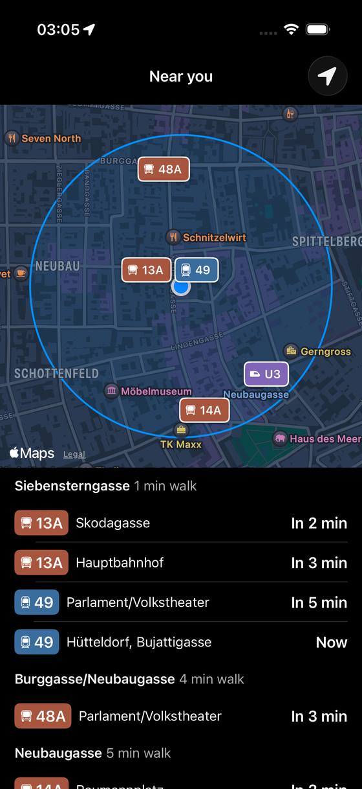
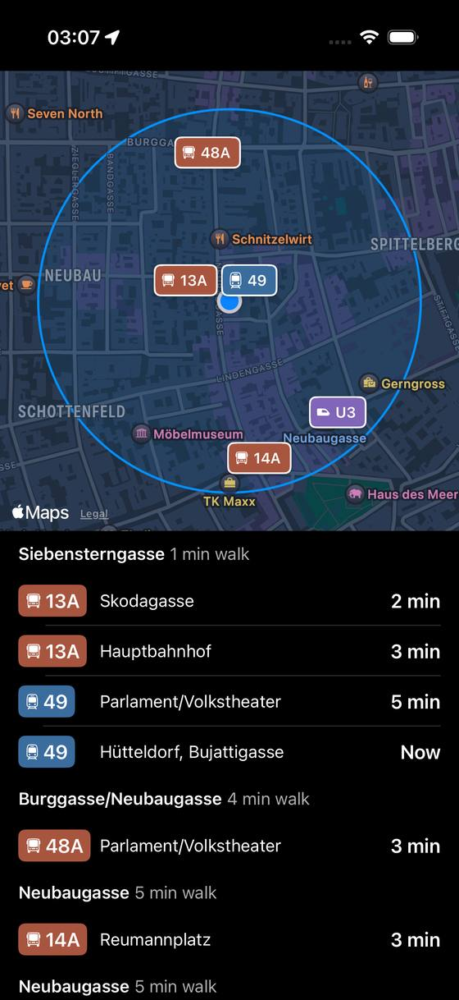
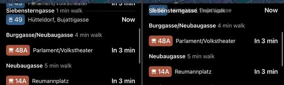
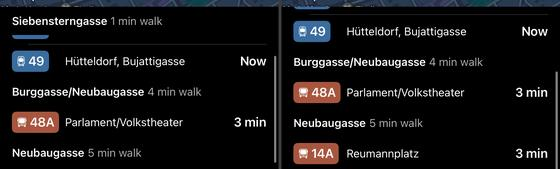
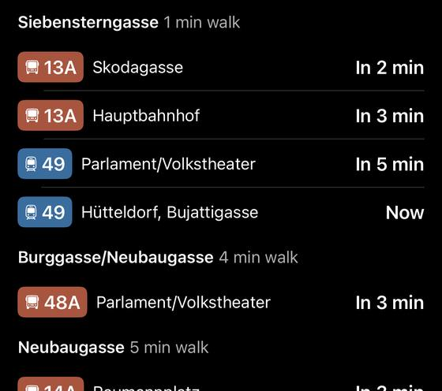
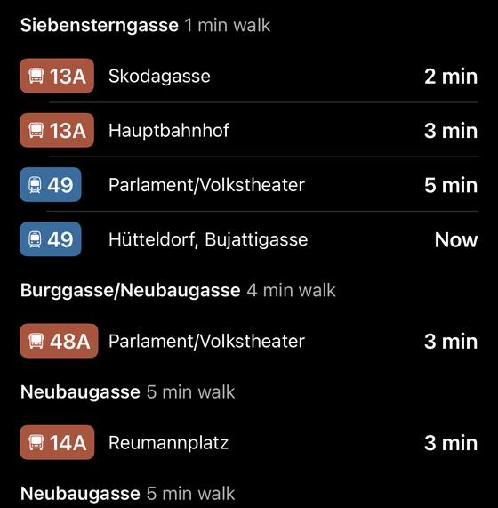
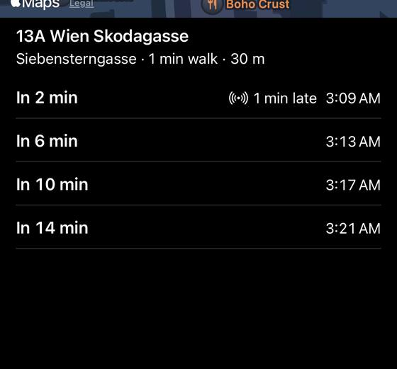
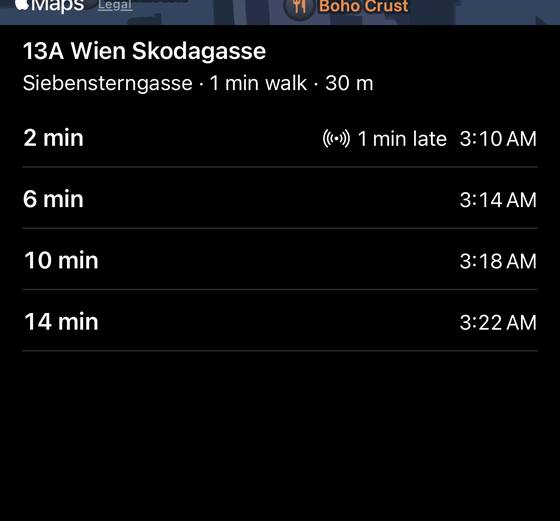

# Departs 1.2 (9) TestFlight

The owner used Departs 1.2 (8) on his phone and asked for four corrections on 17 November 2026, each with an annotated screenshot. On 18 November he corrected how the first had been read, reviewed the choices, and added a fifth decision after seeing the first implementation. He then said: "Once 4 is settled, yes, merge 34 and send to TestFlight."

Only the build number changes, from 8 to 9. The marketing version stays 1.2. The backend is unchanged.

The decisions are O13 to O17 in the plan's [second amendment](../plans/ios-two-screens.md#second-amendment-the-map-at-the-top). A20, A23 and A24 there have not been reviewed by the owner.

## What changes for testers

- **The map is at the top.** Home has no bar: no "Near you" and no location button. The square map starts under the status bar, stays centred on you, follows you as you walk, and cannot be panned or zoomed. Pull to refresh also asks for a new location.
- **A stop's name leaves with its last line.** It stays at the top while the stop's lines pass under it, and never covers the last one. A stop with one line does not stick. A pinned name keeps its colour and hides what passes under it.
- **Destinations start at one x.** The badges share one column at standard text sizes.
- **Badges show only the line's identifier.** A provider name such as "FlixBus N70" reads "N70".
- **No "In".** Home reads "7 min"; the line screen reads "12 min" and "00:00". VoiceOver still says "In 7 min".
- **No usable location, but a saved area:** the list and the map stay on it, and one row offers "Couldn't find your location · Try again".

| | Before (1.2 (8)) | After |
| --- | --- | --- |
| Map at the top |  |  |
| Stop name |  |  |
| Destinations |  |  |
| Line screen |  |  |

Fixture data in dark appearance, iPhone 17 Pro and iPhone SE (3rd generation) with iOS 26.2. Eight JPEGs, 296 KB together.

## Verification of 1.2 (9)

Xcode 27.3 beta (27C5035i). Fixture results are from the UI suite's local server; live results are production, through a Debug build without the API override.

- **Suites, with the build number already 9:** 67 unit and 32 UI tests pass on iPhone 17 Pro with iOS 27.0, iPhone 17 Pro with iOS 26.2 and iPhone SE (3rd generation) with iOS 26.2: 99 of 99 on each, run one after another. Build 8 had 61 unit and 28 UI tests; the new ones cover the five decisions and A19.
- **German stress test** on the SE, default and largest accessibility text size: pass.
- **Release build for the simulator:** 1.2 (9), iPhone only, portrait, iOS 26 minimum, with no local-networking exception. Its binary contains no `DEPARTS_` hook and none of the removed strings ("Near you", "Last area", "Use my location").
- **Acceptance criteria**, measured on fixtures (details in [PR #34](https://github.com/p3ob7o/Departs/pull/34)):
  - Home has no navigation bar. The map is 402 × 402 at y = 62 on iPhone 17 Pro and 375 × 375 at y = 20 on the SE; the list starts at its bottom edge.
  - 6 rows fully visible on iPhone 17 Pro (5 in build 8) and 4 on the SE. Rows are 44 pt.
  - The ring is centred on the square, radius width ÷ 2.4 (167.5 pt and 156.3 pt), and the location dot is within 1.4 pt of the centre.
  - A 100 m move shifts a stop label 41.7 pt on iPhone 17 Pro (target 41.9) and 39.0 pt on the SE (target 39.06) within 1.1 s, with no stops request.
  - Drag, pinch and double tap leave the home map unchanged; labels still open a line or scroll the list.
  - Scrolling in 30-pt steps, no stop name ever covered its last line. The same test fails on the build 8 source.
  - Destinations start within 1 px of each other on fixture data; 41 px apart in build 8.
  - On-screen text recognition finds "2 min" and "Now" and no "In" on either screen; spoken labels keep "In 2 min".
  - A pinned and an unpinned stop name have the same colour in light and in dark.
  - At the largest accessibility text size nothing is clipped, the map starts under the status bar, and the status bar stays readable.
- **Live, Berlin Alexanderplatz**, 18 November: at 02:46 CET the list was scrolled end to end with no stop name covering its last line, and destinations started within 1 px of each other. At 18:02 CET a row from the provider's "FlixBus 057" read "057". The stops response there names 18 FlixBus lines.

## Archive and upload

The archive is made from `main` once [PR #34](https://github.com/p3ob7o/Departs/pull/34) is merged, after the production API is checked again. Its results are added here afterwards.

Before the merge, on 18 November at 18:07 CET, production answered at the Vienna test coordinate: 17 stops, 17 of 17 boards in one batch, four departures from the per-line call, and a walking route.

## Seen while testing, not changed in this build

1. **iOS fades a stop name while it is pushed out.** Its header measured alpha 0.53 seven points into the push, so for about 15 pt of scrolling the line that already passed shows through. The last line is never under it. This is the system's transition.
2. **Precise Location off freezes the map.** MapKit's coarse location never moves it (A20), and the app gets no usable fix, so the map stays on the saved area. This needs a check on a phone.
3. The seven open findings in the [1.2 (8) record](1.2-8.md#open-findings-not-changed-in-this-build) still stand. The first matters most: a stop with no departures is shown as a failed load at Berlin Alexanderplatz.

## Not verified

The map following a real walk, Precise Location off on a phone, VoiceOver speech, haptics, real GPS, Siri and Shortcuts discovery, and how the fading name feels in a real scroll need the TestFlight build on a device.
